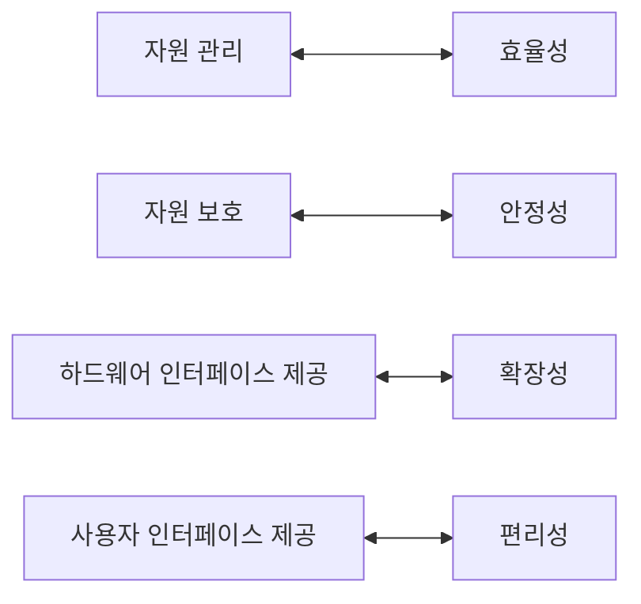

# 1. 운영체제 소개

## 1.1 일상생활 속의 운영체제

운영체제 (OS, Operating System)는 컴퓨터를 켜면 가장 먼저 만나는 소프트웨어다.

| 분류 | 예 |
| --- | --- |
| 개인용 컴퓨터 | 윈도우, macOS |
| 대형 컴퓨터·서버 | 유닉스, 리눅스 |
| 모바일 | iOS (애플 제품에만 사용), 안드로이드 (여러 제조사가 사용) |
| 임베디드 | 스마트 시계, 스마트 TV, 내비게이션, MP3 플레이어 |

**임베디드 운영체제 (embedded operating system)**

- CPU 성능이 낮고 메모리가 작은 기계에 내장하도록 만든 운영체제다.
- 일반 운영체제보다 기능이 일부 빠져 있다.
- 운영체제가 없는 기계는 처음 만든 기능만 쓸 수 있다. 운영체제가 있으면 기능을 계속 추가할 수 있다.
  - 예: 운영체제가 없는 MP3 플레이어는 MP3만 재생한다. 운영체제가 있으면 FLAC 같은 새 형식 지원, 음질 개선, 무선 다운로드를 추가할 수 있다.
  - 예: 유선전화기는 통화만 하지만, 스마트폰은 앱을 설치해 게임이나 내비게이션으로도 쓴다.

## 1.2 운영체제의 필요성

초기 컴퓨터는 정해진 계산만 했기 때문에 사용 규칙이 필요 없었다. 성능이 좋아지고 여러 작업을 동시에 하게 되면서, 규칙 없이 쓰면 기계를 망가뜨릴 수 있게 되었다. 그래서 등장한 것이 운영체제다.

| 질문 | 답 |
| --- | --- |
| 컴퓨터는 운영체제가 없어도 작동하는가? | 작동한다. 하지만 기능에 제약이 있다 |
| 운영체제가 있는 기계와 없는 기계의 차이는? | 운영체제가 있으면 응용 프로그램을 설치하고 새 기능을 쉽게 추가할 수 있다 |
| 운영체제는 성능 향상에만 필요한가? | 아니다. 자원을 관리하고 편리한 인터페이스를 제공한다 |
| 운영체제는 자원을 어떻게 관리하는가? | 사용자가 자원에 직접 접근하지 못하게 막아서 보호한다 |
| 사용자는 숨어 있는 자원을 어떻게 쓰는가? | 운영체제가 제공하는 사용자 인터페이스와 하드웨어 인터페이스로 쓴다 |

**운영체제 없이도 돌아간 컴퓨터, 에니악 (ENIAC)**

- 미사일 탄도 계산용으로 만든 4층 건물 크기의 진공관 기계다. 운영체제도, 키보드도, 모니터도 없었다.
- 전선 연결을 바꿔서 프로그래밍했다. 기능을 바꿀 수 있으니 컴퓨터는 맞지만, 새 기능마다 회로를 다시 짜야 했다.
- 반면 운영체제가 있는 기계는 프로그램만 바꾸면 기능을 바꿀 수 있다. 이런 기계를 프로그램이 가능한 (programmable) 기계라고 한다.

**자원을 나눠 줄 중재자가 필요하다**

- 워드프로세서, 웹 브라우저, 채팅, 음악 재생 같은 응용 프로그램 (application program)은 여러 개인데, CPU·메모리·키보드·모니터는 대부분 하나다.
- 응용 프로그램끼리 장치를 독차지하거나 서로를 망가뜨릴 수 있다.
- 그래서 누구에게 먼저 장치를 줄지 정하고, 악의적인 프로그램으로부터 자원을 지키는 중재자가 필요하다.
- 컴퓨터에 연결된 모든 장치를 컴퓨터 자원 (computer resource)이라고 한다.

**자원을 숨기고, 대신 써 준다**

- 사용자는 하드디스크의 특정 위치에 직접 저장할 수 없다. 운영체제에 부탁하면 운영체제가 알맞은 위치에 저장한다.
- 운영체제는 저장 위치 대신 번호표를 돌려준다. 사용자는 번호표로 데이터를 꺼내거나, 고치거나, 지운다.
- 이렇게 사용자가 컴퓨터를 쓸 수 있게 해 주고 결과를 알려 주는 것을 인터페이스 (interface)라고 한다.

> [!NOTE]
> 책에서는 운영체제를 소프트웨어와 하드웨어의 결합 형태인 펌웨어 (firmware)라고 부르기도 한다고 설명한다. 하지만 보통 펌웨어는 BIOS·UEFI처럼 하드웨어의 롬이나 플래시에 들어 있는 소프트웨어를 말한다. 운영체제를 펌웨어라고 부르는 경우는 드물다.

## 1.3 운영체제의 정의

> [!IMPORTANT]
> **운영체제**: 사용자에게 편리한 인터페이스 환경을 제공하고, 컴퓨터 시스템의 자원을 효율적으로 관리하는 소프트웨어

**레스토랑 비유**

- 손님이 주문하면 웨이터가 주방에 전하고, 손님은 음식만 받는다.
- 손님이 주방에 들어가 직접 요리하거나 조리 도구를 만지려 하면 관리자가 막는다. 주방이 엉망이 되기 때문이다.
- 운영체제도 마찬가지다. 사용자가 하드디스크에 직접 저장하면 기존 데이터와 섞이므로, 운영체제가 대신 저장하고 꺼내 준다.

**공동 주방의 관리자**

- 집에서 혼자 요리할 때는 내 도구와 재료를 마음대로 써도 된다.
- 여러 사람이 함께 쓰는 공동 주방에서는 도구와 재료를 나눠 주는 관리자가 필요하다.
- 운영체제는 요리하려는 여러 사람(응용 프로그램)에게 공동 도구(컴퓨터 자원)를 나눠 주는 관리자다.

> [!TIP]
> 인터페이스는 자동차의 핸들과 계기판에 비유할 수 있다. 자동차는 엔진과 바퀴로 움직이지만 운전자는 핸들로 조종하고 계기판으로 상황을 본다. 컴퓨터도 CPU와 메모리로 일하지만, 사용자는 키보드·마우스로 입력하고 모니터로 결과를 본다.

## 1.4 운영체제의 역할

| 역할 | 내용 |
| --- | --- |
| 자원 관리 | 키보드, 네트워크카드, 사운드카드 같은 자원을 응용 프로그램에 적당한 순서로 나눠 주고 알맞은 시점에 회수한다 |
| 자원 보호 | 악의적이거나 미숙한 사용자·프로그램이 남의 영역을 침범하지 못하게 막는다 |
| 하드웨어 인터페이스 제공 | 제조사와 종류가 다른 하드웨어를 일관된 방법으로 쓸 수 있게 한다 (드라이버) |
| 사용자 인터페이스 제공 | 사용자가 운영체제를 편하게 쓰게 한다 (명령어 → GUI → 터치스크린) |

- 하드웨어 인터페이스는 드라이버 (driver)를 설치해야 지원된다. 장치 드라이버, 디바이스 드라이버라고도 한다.
- 사용자 인터페이스는 키보드만 쓰던 유닉스·MS-DOS 시절에서 그래픽 사용자 인터페이스 (GUI, Graphical User Interface)로, 다시 스마트폰의 터치스크린으로 발전했다.

> [!NOTE]
> 바이러스와 스파이웨어도 운영체제가 막아야 하지만, 운영체제가 복잡해지고 공격이 지능화되어 한계가 있다. 그래서 바이러스 검사, 디스크 조각 모음, 압축 프로그램처럼 운영체제를 보조하는 유틸리티 (utility)가 등장했다.

## 1.5 운영체제의 목표

운영체제의 네 가지 역할은 각각 네 가지 목표와 짝을 이룬다.

| 목표 | 내용 |
| --- | --- |
| 효율성 | 같은 자원으로 더 많은 일을 하거나, 같은 일을 더 적은 자원으로 한다. 운영체제의 크기를 줄이고 코드를 최적화한다 |
| 안정성 | 운영체제가 불안하면 모든 작업이 불안하다. 보안 문제를 처리하고, 문제가 생기면 이전 상태로 복구하는 결함 포용 (fault tolerant) 기능이 필요하다 |
| 확장성 | 자원을 쉽게 추가·제거할 수 있어야 한다. 꽂으면 바로 쓰는 플러그 앤 플레이 (Plug & Play)가 대표적이다 |
| 편리성 | 사용자가 편하게 작업할 수 있어야 한다 |

> [!TIP]
> 효율성과 편리성은 서로 부딪힌다. GUI를 빼고 텍스트만 쓰게 하거나, 프로그램마다 메모리를 100MB로 제한하면 효율은 오르지만 사용자는 불편하고 다양한 프로그램을 만들기 어렵다. 운영체제는 편리성을 지키면서 낭비를 막아야 한다.

---

[목차](./README.md) | [운영체제의 역사 →](./02-운영체제의-역사.md)
