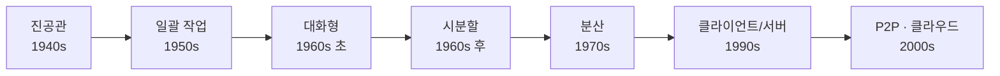
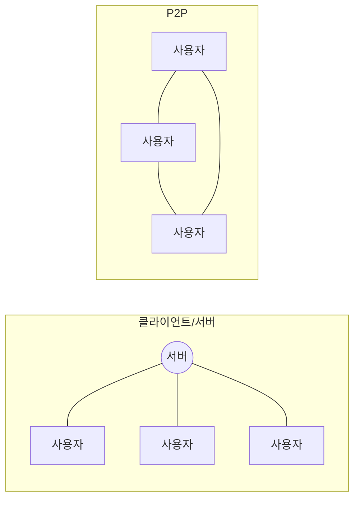

# 2. 운영체제의 역사

운영체제의 역사는 주변장치의 발전과 함께 보면 이해하기 쉽다. 새로운 장치가 나올 때마다 운영체제가 할 수 있는 일이 늘어났다.

## 2.1 한눈에 보기

| 구분 | 시기 | 주요 기술 | 특징 |
| --- | --- | --- | --- |
| 0기 | 1940년대 | - | 진공관(0과 1) 사용, 운영체제 없음 |
| 1기 | 1950년대 | 카드 리더, 라인 프린터 | 일괄 작업 시스템, 운영체제의 등장 |
| 2기 | 1960년대 초반 | 키보드, 모니터 | 대화형 시스템 |
| 3기 | 1960년대 후반 | C 언어 | 다중 프로그래밍, 시분할 시스템 |
| 4기 | 1970년대 | PC | 개인용 컴퓨터의 등장, 분산 시스템 |
| 5기 | 1990년대 | 웹 | 클라이언트/서버 시스템 |
| 6기 | 2000년대 | 스마트폰 | P2P, 그리드 컴퓨팅, 클라우드 컴퓨팅, 사물 인터넷 |



## 2.2 초창기 컴퓨터 (1940년대)

- 최초의 컴퓨터로 알려진 에니악 (ENIAC)은 펜실베이니아대학교의 존 모클리와 존 에커트가 만들었다.
  - 무게 30톤, 진공관 18,000개로 이루어진 미사일 탄도 계산용 기계다.
  - 사람이 주판으로 7시간 걸리던 계산을 3초 만에 끝냈다.
- 진공관이 켜지면 1, 꺼지면 0으로 판단했다. 컴퓨터가 2진법을 쓰게 된 계기다.
- 키보드, 마우스, 모니터가 없었고, 운영체제도 없었다.
- 전선을 연결해 논리회로를 구성하는 하드와이어링 (hard wiring) 방식이었다. 다른 계산을 하려면 전선을 다시 연결해야 했다.

## 2.3 일괄 작업 시스템 (1950년대)

- 입력장치로 천공카드 리더 (punch card reader), 출력장치로 라인 프린터 (line printer)를 썼다.
  - 천공카드: 카드에 구멍을 뚫어 문자나 숫자를 표현했다. OMR 카드의 원조 격이다.
  - 라인 프린터: 문자만 한 번에 한 줄씩 출력했다.
- 전선을 다시 연결할 필요 없이 프로그램만 바꾸면 다른 작업을 할 수 있게 되었다.
- 한 번에 한 작업만 했다. 프로그램과 데이터를 한꺼번에 넣고 실행한 뒤, 결과를 받고 나서야 다음 작업을 읽었다.
- 실행 중간에 데이터를 넣거나 고칠 수 없었다. 이런 시스템을 **일괄 작업 시스템 (batch job system)** 또는 일괄 처리 시스템이라고 한다.
- 작지만 운영체제가 있었다. 그래서 메모리가 운영체제 영역과 사용자 영역으로 나뉘었다.

> [!WARNING]
> 책에서는 이 시기 컴퓨터가 IC 칩으로 만들어졌다고 설명한다. 실제로 1950년대 컴퓨터는 주로 트랜지스터로 만들어졌고, IC(집적회로)는 1960년대에 쓰이기 시작했다.

> [!TIP]
> 일괄 작업의 흔적은 지금도 남아 있다. MS-DOS·초기 윈도우가 부팅 때 읽던 `autoexec.bat`의 확장자 `bat`가 batch job을 뜻한다. 시작할 때 한꺼번에 처리할 작업을 모아 둔 파일이다.

## 2.4 대화형 시스템 (1960년대 초반)

- 키보드(타자기의 쿼티 자판에 키를 추가)와 모니터(초록색·주황색 단색)가 등장했다.
- 일괄 작업 시스템에서는 결과가 틀려도 최종 출력물을 받아야 알 수 있었다. 프린터에 `ERROR`가 찍히면 천공카드를 다시 뚫어야 했다.
- 키보드와 모니터 덕분에 작업 중간에 입력을 받고, 중간 결과를 보여 줄 수 있게 되었다. 입력값에 따라 작업 흐름도 바꿀 수 있다.
- 컴퓨터와 사용자가 대화하듯 작업한다고 해서 **대화형 시스템 (interactive system)** 이라고 한다.
- 문서 편집기나 게임 같은 다양한 응용 프로그램을 만들 수 있게 되었다.
- 다만 사용자가 언제 반응할지 몰라서 작업 시간을 예측하기 어려워졌다.

| 구분 | CPU 집중 작업 (CPU bound job) | 입출력 집중 작업 (I/O bound job) |
| --- | --- | --- |
| 특징 | 대부분의 시간을 계산에 쓴다 | 대부분의 시간을 입출력에 쓴다 |
| 등장 | 일괄 작업 시스템 | 대화형 시스템 |
| 예 | 수학 계산 | 동영상 플레이어, 데이터베이스 |

## 2.5 시분할 시스템 (1960년대 후반)

**다중 프로그래밍**

- 컴퓨터는 작아지고 빨라졌지만 여전히 비쌌다. 비싼 기계로 한 번에 한 작업만 하는 건 낭비였다.
- 그래서 CPU 하나로 여러 작업을 동시에 실행하는 다중 프로그래밍 (multiprogramming) 기술이 개발되었다.

**시분할 시스템 (time sharing system)**

- CPU 사용 시간을 아주 잘게 쪼개 여러 작업에 돌아가며 나눠 준다.
- 영화 필름이 정지 사진을 빠르게 넘겨 움직이는 것처럼 보이듯, 여러 작업이 동시에 실행되는 것처럼 보인다.
  - 예: A, B, C에 0.1초씩 돌아가며 주면, A는 0.3초 뒤에 다시 CPU를 받는다.
- 다중 작업 (multitasking) 시스템이라고도 한다. 오늘날 대부분의 컴퓨터가 쓰는 방식이다.
- 잘게 나눈 시간 한 조각을 타임 슬라이스 (time slice) 또는 타임 퀀텀 (time quantum)이라고 한다.

```
시간  0.0  0.1  0.2  0.3  0.4  0.5  0.6
CPU   | A  | B  | C  | A  | B  | C  | ...
```

> [!NOTE]
> 엄밀히는 다중 프로그래밍은 "여러 작업을 메모리에 올려 두고 CPU를 놀리지 않는 것", 시분할은 "그 CPU 시간을 잘게 쪼개 돌아가며 주는 것"으로 구분한다. 책에서는 둘을 함께 설명한다.

**시분할의 단점과 실시간 시스템**

- 여러 작업을 번갈아 처리하기 위한 추가 작업이 필요하다.
- 작업이 많으면 중요한 작업이 정해진 시간 안에 끝난다는 보장이 없다.
- 그래서 원자력·미사일 제어처럼 시간이 중요한 곳에서는 **실시간 시스템 (real-time system)** 을 쓴다.

| 구분 | 경성 실시간 시스템 (hard real-time) | 연성 실시간 시스템 (soft real-time) |
| --- | --- | --- |
| 응답 시간 | 정확히 지켜야 한다 | 최대한 지키지만 어느 정도 융통성이 있다 |
| 예 | 원자로 온도 제어, 미사일 요격 | 동영상 재생기 (늦으면 끊기지만 치명적이진 않다) |

**다중 사용자 시스템**

- 동시에 실행되는 작업의 개수를 멀티프로그래밍 수준 (level of multiprogramming)이라고 한다. 일괄 작업 시스템은 1이다.
- 시분할 덕분에 한 사람이 여러 프로그램을 돌릴 수도 있고, 여러 사람이 한 컴퓨터를 동시에 쓸 수도 있게 되었다. 이를 다중 사용자 시스템 (multi-user system)이라고 한다.
- 이 시기에 AT&T 벨연구소에서 유닉스를 만들었다. 다중 프로그래밍과 다중 사용자를 지원하는, 단순함을 지향한 운영체제다.

## 2.6 분산 시스템 (1970년대 후반)

- 1977년 스티브 잡스가 개인용 컴퓨터 애플 II를 발표했다. 개인도 컴퓨터를 가질 수 있게 되었다.
  - PC 운영체제로는 애플의 매킨토시와 마이크로소프트의 MS-DOS가 많이 쓰였다.
- 같은 시기에 인터넷이 등장했다.
  - 미국 ARPA가 서로 호환되지 않는 LAN을 하나로 묶으려고 아르파넷 (ARPAnet)을 만들었다.
  - 컴퓨터 간 통신 규약으로 TCP/IP를 정의했고, 오늘날 인터넷도 TCP/IP를 쓴다.
- 비싼 메인프레임 대신, 작고 싼 컴퓨터 여러 대를 네트워크로 묶어 큰 일을 처리하게 되었다. 이를 **분산 시스템 (distributed system)** 이라고 한다.

## 2.7 클라이언트/서버 시스템 (1990년대 ~ 현재)

- 분산 시스템은 모든 컴퓨터의 지위가 같아서, 컴퓨터가 고장 나거나 추가되면 작업을 나누고 결과를 모으기 어렵다.
- 클라이언트/서버 시스템 (client/server system)은 작업을 요청하는 클라이언트와 처리하는 서버로 역할을 나눈다.
- 일반인에게 알려진 건 웹 시스템이 보급되면서부터다. 웹은 전형적인 클라이언트/서버 구조다.
- 단점은 서버 과부하다. 모든 요청이 서버로 몰리기 때문에, 사람이 한꺼번에 몰리면 서버가 다운되기도 한다.

> [!NOTE]
> 서버처럼 멈추지 않고 계속 실행되며 요청을 처리하는 프로그램을 데몬 (daemon)이라고 한다. 웹 데몬이 설치된 컴퓨터를 웹 서버, FTP 데몬이 설치된 컴퓨터를 FTP 서버라고 부른다.

## 2.8 P2P 시스템 (2000년대 초반 ~ 현재)

- 1990년대 말 MP3 파일을 공유하려 했는데, 파일이 수 MB라 클라이언트/서버 구조로는 서버가 버티지 못했다.
- **P2P 시스템 (peer-to-peer system)**: 서버는 검색만 맡고, 파일은 사용자(peer)끼리 직접 주고받는다. 서버 부하가 적다.



| 활용 | 내용 |
| --- | --- |
| MP3 공유 | 1999년 냅스터 (Napster), 국내 소리바다. 저작권 문제로 금지되었다 |
| 메신저 | 로그인할 때만 서버에서 인증과 출석(친구 상태) 정보를 받고, 채팅과 파일은 사용자끼리 직접 주고받는다 |
| 대용량 파일 공유 | 같은 파일을 가진 여러 사람에게서 조금씩 나눠 받는다. 10명에게 받으면 10배 빠르고, 몇 명이 끊어도 나머지에게 받는다 |

> [!TIP]
> **서버가 없는 P2P: 비트코인과 블록체인**
>
> - 메신저처럼 인증용 서버가 있는 P2P도 있고, 서버가 아예 없는 완전 P2P도 있다.
> - 비트코인은 거래 장부를 은행 같은 중앙 서버 대신 P2P 네트워크 전체에 나눠 저장한다. 이것이 블록체인 (block chain)이다.
> - 장부 하나가 조작되거나 사라져도 거래에 영향이 없다. 장부를 바꾸려면 전체의 50% 이상이 동의해야 해서 악의적인 공격을 막는다.

## 2.9 기타 컴퓨팅 환경 (2000년대 초반 ~ 현재)

**그리드 컴퓨팅 (grid computing)**

- 필요한 기간만 컴퓨팅 자원을 빌려 쓰고 비용을 내는 환경이다.
  - 예: 3D 애니메이션을 만들 때 고성능 컴퓨터를 몇 년 쓰고 나면 금방 구형이 된다. 필요한 만큼만 빌리면 좋다.
- 서로 다른 기종의 컴퓨터를 묶어 컴퓨터 풀 (computer pool)을 만들고, 대용량 연산을 나눠 처리한다. 분산 시스템의 한 분야다.

**SaaS (Software as a Service)**

- 소프트웨어를 설치하지 않고, 서버에서 실행되는 기능을 인터넷으로 필요한 만큼 쓰고 비용을 낸다.
- 설치나 업데이트 없이 접속만 하면 쓸 수 있다.

**클라우드 컴퓨팅 (cloud computing)**

- 그리드 컴퓨팅과 SaaS를 합친 형태다. 언제 어디서나 프로그램과 데이터를 자유롭게 쓸 수 있다.
- 하드웨어가 구름에 가려진 것처럼 보이지 않는다고 해서 클라우드라고 부른다.
- 예: 회사 홈페이지를 직접 서버를 두지 않고 클라우드에 올려 쓴 만큼 낸다. 서버·네트워크 관리는 클라우드 제공자가 한다.
- 예: 스마트폰을 바꿔도 클라우드 백업으로 이전 상태를 그대로 복원한다.
- 인공지능, 빅데이터 분석처럼 계산량이 큰 기술을 가능하게 했다.

**사물 인터넷 (IoT, Internet of Things)**

- 사물에 센서와 통신 기능을 넣어 인터넷에 연결하는 기술이다.
- 예: 버스 도착 시간 알림, 스마트폰으로 가전 제어, 스마트 시티

---

[← 운영체제 소개](./01-운영체제-소개.md) | [목차](./README.md) | [운영체제의 구조 →](./03-운영체제의-구조.md)
