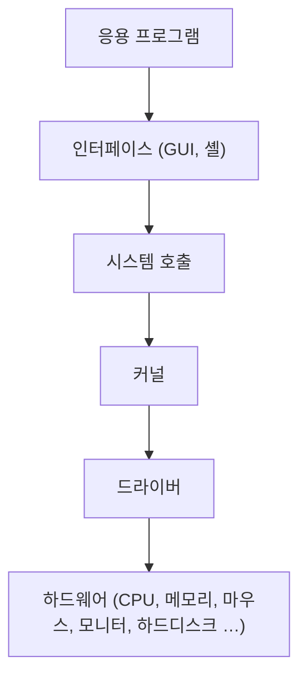
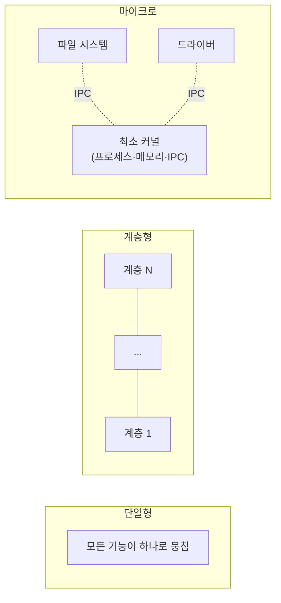
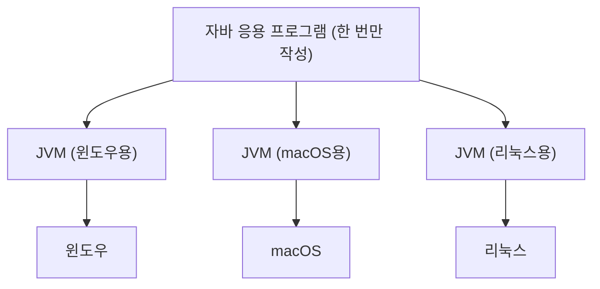

# 3. 운영체제의 구조

## 3.1 커널과 인터페이스

| 구분 | 역할 | 자동차 비유 |
| --- | --- | --- |
| 커널 (kernel) | 프로세스·메모리·저장장치 관리 등 운영체제의 핵심 기능 모음 | 엔진 |
| 인터페이스 (interface) | 사용자의 명령을 커널에 전달하고, 실행 결과를 사용자에게 알려줌 | 핸들, 브레이크, 계기판 |

- 세단이든 SUV든 자동차의 성능은 엔진이 좌우하듯, 운영체제의 성능은 커널이 좌우한다.
- 스마트폰 운영체제에도 커널이 있다.
  - 안드로이드는 리눅스 커널을 기반으로 하고, 여러 제조사가 쓸 수 있게 커널을 공개한다.
  - iOS도 유닉스 계열 커널을 기반으로 하지만, 공개하지 않고 자사 제품에만 쓴다.

**커널과 인터페이스의 분리**

- 운영체제는 커널과 인터페이스를 분리해서 만든다.
- 같은 커널이라도 인터페이스가 다르면 사용자에게는 다른 운영체제처럼 보인다.
- 예: 유닉스의 사용자 인터페이스를 셸 (shell)이라고 하며, C셸 (csh), T셸 (tcsh), 배시셸 (bash) 등 여러 종류가 있다.
  - 셸은 명령어 기반이라 일반인은 유닉스를 어렵게 느낀다.
  - 그런데 화려한 GUI의 macOS도 유닉스 계열 커널로 만들었다.
  - 유닉스가 어려운 게 아니라, 명령어 기반 인터페이스가 어려운 것이다.
- 사용자에게는 커널보다 인터페이스가 먼저 보이기 때문에, 좋은 커널보다 좋은 인터페이스의 컴퓨터를 고르는 경향이 있다.

## 3.2 시스템 호출과 디바이스 드라이버

응용 프로그램과 커널 사이의 인터페이스는 시스템 호출, 커널과 하드웨어 사이의 인터페이스는 드라이버다.

### 시스템 호출 (system call)

커널이 자신을 보호하기 위해 만든 인터페이스다.

- 커널은 사용자·응용 프로그램이 자원에 직접 접근하는 것을 차단한다.
- 자원을 쓰려면 반드시 시스템 호출을 거쳐야 한다.

**직접 접근 vs 시스템 호출 (커피 비유)**

| 구분 | 직접 접근 | 시스템 호출을 통한 접근 |
| --- | --- | --- |
| 커피 비유 | 커피와 설탕 위치, 커피머신 사용법을 다 알고 직접 만든다 | 다른 사람에게 부탁하고 커피만 받는다 |
| 장점 | 내 입맛대로 만들 수 있다 | 사용법을 몰라도 되고, 커피머신이 망가질 일이 없다 |
| 단점 | 부주의로 커피머신을 망가뜨릴 수 있다 | - |
| 컴퓨터에서 | 두 프로그램이 각자 마음에 드는 위치에 저장하다가 서로의 데이터를 덮어쓸 수 있다 | 커널이 제공하는 `write()`로 저장을 부탁하고, `read()`로 꺼낸다. 어디에 저장됐는지는 몰라도 된다 |

**정리**

- 시스템 호출은 커널이 제공하는 시스템 자원 사용과 관련된 함수다.
- 응용 프로그램이 하드웨어 자원에 접근하거나 운영체제 서비스를 쓰려면 시스템 호출을 사용해야 한다.
- 운영체제는 커널 서비스를 시스템 호출로만 제한해서 컴퓨터 자원을 보호한다.
- 시스템 호출은 사용자가 자발적으로 커널 영역에 진입할 수 있는 유일한 수단이다.

> [!WARNING]
> 책에서는 C 언어의 `printf()`도 시스템 호출이라고 설명한다. 엄밀히는 `printf()`는 C 표준 라이브러리 함수이고, 내부에서 `write()` 시스템 호출을 불러 화면에 출력한다. 파이썬의 `print()`도 마찬가지다.

> [!TIP]
> **API와 SDK**
>
> - **API** (Application Programming Interface): 응용 프로그램이 다른 프로그램과 연동할 수 있도록 제공하는 인터페이스
>   - 예: 포토샵은 모든 필터를 직접 만들지 않고, 필터 개발자용 API를 제공한다.
>   - 시스템 호출보다 넓은 개념이다. 운영체제가 제공하는 API = 시스템 호출로 볼 수 있다.
> - **SDK** (Software Development Kit): API + 사용 매뉴얼 + 코드 편집기·에뮬레이터 등 개발 도구를 한데 묶은 패키지
>   - 예: Android SDK (Android Studio)

### 디바이스 드라이버 (device driver)

하드웨어 제작자가 만든, 하드웨어 특성을 반영한 소프트웨어다.

**왜 제작자가 만드는가?**

- 하드웨어 종류가 너무 많아 커널이 모두 대응하기 어렵다.
- 하드웨어 특성은 제작자가 가장 잘 안다.

**동작 방식**

- 커널은 입출력의 기본 부분만 만든다.
- 제작자에게 받은 드라이버는 커널이 실행될 때 함께 실행된다.

| 종류 | 예시 | 설치 |
| --- | --- | --- |
| 내장 드라이버 | 키보드, 마우스 (단순한 장치) | 커널에 포함 → 꽂으면 바로 동작 |
| 별도 설치 드라이버 | 그래픽카드, 프린터 (크고 복잡한 장치) | 사용자가 직접 설치 |

> [!IMPORTANT]
> 커널에 들어가는 길은 시스템 호출 하나뿐이지만, 드라이버는 내장형과 설치형이 모두 있다. 그래서 하드웨어는 커널과 직접 연결되기도 하고, 제작자가 만든 드라이버를 통해 연결되기도 한다.

## 3.3 커널의 구성

### 커널이 하는 일

| 핵심 기능 | 설명 |
| --- | --- |
| 프로세스 관리 | 프로세스에 CPU를 배분하고 작업에 필요한 환경을 제공 |
| 메모리 관리 | 프로세스에 작업 공간을 배치하고, 실제 메모리보다 큰 가상 공간을 제공 |
| 파일 시스템 관리 | 데이터를 저장하고 접근할 수 있는 인터페이스 제공 |
| 입출력 관리 | 필요한 입력과 출력 서비스 제공 |
| 프로세스 간 통신(IPC) 관리 | 공동 작업을 위한 프로세스 간 통신 환경 지원 |

이 기능들은 서로 복잡하게 얽혀 있고, 어떻게 구현하느냐에 따라 커널 구조가 나뉜다.

### 단일형 구조 커널 (monolithic architecture)

초창기 운영체제 구조. 핵심 기능 모듈들이 구분 없이 하나로 구성되어 있다.

- 대표 예: MS-DOS, VMS, 초기 유닉스
- 초기에는 기능을 구현하기에 바빠서 모듈을 나눌 여력이 없었다.
- 비유: 함수 없이 `main()` 하나에 모든 기능을 구현한 프로그램

함수 호출 오버헤드가 없으면 프로그램이 빨라지듯, 모듈 간 통신 비용이 적어 효율적이다. 하지만 단점이 많다.

- 모든 모듈이 묶여 있어 버그·오류 처리가 어렵다.
- 상호 의존성이 높아 작은 결함이 시스템 전체로 퍼진다.
- 수정이 어려워 이식성이 낮다.
- 현대 OS는 너무 커서 완전한 단일형으로 구현하기 어렵다.

### 계층형 구조 커널 (layered architecture)

단일형이 발전한 형태. 비슷한 기능의 모듈을 계층으로 묶고, 계층 간 통신으로 운영체제를 구현한다.

- 모듈화되어 있어 버그·오류 처리가 단일형보다 쉽다.
- 오류가 나면 해당 계층만 수정하면 되므로 디버깅이 쉽다.
- 윈도우를 비롯한 오늘날 대부분의 운영체제가 이 구조다.

### 마이크로 구조 커널 (micro architecture)

**등장 배경**: 계층형 커널은 요구사항에 맞춰 계층·기능을 계속 추가했다.
→ 커널이 비대해지고, 필요한 하드웨어 용량이 커지고, 오류를 잡기 어려워졌다.
→ 이와 반대 방향으로 설계한 것이 마이크로 구조 커널이다.

- 커널은 프로세스 관리, 메모리 관리, IPC 관리 등 가장 기본적인 기능만 제공한다.
- 나머지 기능은 대부분 사용자 영역에 구현된다.
- 모듈은 세분화되어 독립적으로 존재하고, 모듈 간 정보 교환은 IPC로 한다.

장점

- 모듈이 독립적이라 하나가 실패해도 전체 OS가 멈추지 않는다.
- 이식이 쉽다.
- 커널이 가벼워 CPU 성능이 낮은 시스템에도 적용할 수 있다.

- 대표 예: 마하(Mach) — 애플 macOS(OS X)·iOS 커널의 기반으로 유명해졌다.
  - 참고: 실제 macOS/iOS 커널(XNU)은 Mach에 BSD 등을 합친 하이브리드 구조다.

### 커널 구조 비교

| 구분 | 구성 방식 | 핵심 키워드 | 예 |
| --- | --- | --- | --- |
| 단일형 | 모든 모듈이 하나로 | 효율적, 이식성 낮음 | MS-DOS, 초기 유닉스 |
| 계층형 | 비슷한 모듈을 계층으로 묶음 | 디버깅 쉬움, 현대 OS 대부분 | 윈도우 |
| 마이크로 | 최소 기능만 커널에, 나머지는 사용자 영역 | 독립성, 가벼움, IPC | 마하 |

## 3.4 가상머신 (virtual machine)

**문제: 언어의 호환성**

- C 언어는 저급 언어 기능이 있어 시스템 프로그래밍에 적합하다. (대표 OS: 유닉스)
- 하지만 다른 커널을 가진 OS 간 호환성이 떨어진다.
  - 유닉스에서 만든 C 코드는 윈도우에서 그대로 동작하지 않는다.
  - 유닉스끼리도 버전에 따라 호환되지 않는 경우가 있다.
- → 같은 프로그램을 OS별로 따로 만들어야 한다.

**해결: 자바(Java)와 가상머신**

- 운영체제와 응용 프로그램 사이에 가상머신을 두고, 그 위에서 응용 프로그램을 실행한다.
- 응용 프로그램은 모든 OS에서 같은 환경에서 도는 것처럼 보인다. 코드를 하나만 만들면 된다.
- 자바가 OS별로 만들어 배포하는 가상머신을 자바 가상머신 (JVM, Java Virtual Machine)이라고 한다.

> [!TIP]
> 파이썬 코드가 OS에 상관없이 동작하는 것도 OS별 파이썬 인터프리터가 중간에 있기 때문이다.

**다른 쓰임: 운영체제 위의 운영체제**

- 윈도우에서 가끔 유닉스를 써야 한다면, 두 운영체제를 따로 설치하고 부팅할 때 고르는 대신 윈도우 위에 유닉스 가상머신을 설치하면 된다.
- 단점: 응용 프로그램이 가상머신을 거쳐야 해서 느려진다.

---

[← 운영체제의 역사](./02-운영체제의-역사.md) | [목차](./README.md) | [[심화] 운영체제의 종류와 역사 →](./04-운영체제의-종류와-역사.md)
