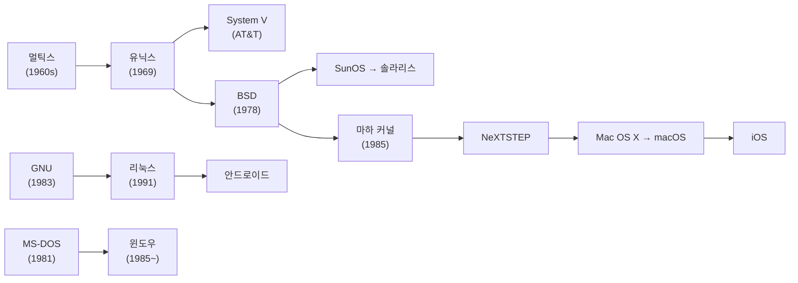

# 4. [심화] 운영체제의 종류와 역사

## 4.1 한눈에 보는 계보

## 4.2 유닉스와 리눅스

### 유닉스의 탄생

- 1960년대 컴퓨터는 비쌌다. 한 사람이 한 작업만 하기엔 아까워서, 여러 사람이 다양하게 쓸 수 있는 운영체제를 만들려 했다.
- AT&T, 제너럴일렉트릭, 허니웰, MIT가 미국 국방성 지원을 받아 **멀틱스 (Multics)** 프로젝트를 시작했다.
  - 다중 사용자, 다중 프로세서, 다중 프로세스를 모두 지원하려다 보니 진행이 순조롭지 않았다.
- 1969년 AT&T 벨연구소의 켄 톰프슨이 쓰지 않던 PDP-7 컴퓨터에 멀틱스와 비슷한 운영체제를 만들기 시작했다. 데니스 리치 등이 합류했다.
- 복잡한 멀틱스 (multi-) 대신 단순하다는 뜻으로 **유닉스 (Unix, uni-)** 라는 이름을 붙였다.
  - 프로그램 실행에만 집중한 덕분에 멀틱스보다 훨씬 먼저 완성되었다.
  - "일관성과 단순함"이라는 유닉스의 철학이 여기서 나왔다.

### C 언어와 함께 퍼지다

- 데니스 리치가 B 언어를 바탕으로 C 언어를 만들었다. 단순하고 어셈블리어로 번역하기 쉬워 다른 기계로 옮기기 좋았다.
- 1973년 어셈블리어로 만든 유닉스를 C 언어로 다시 작성했다. 덕분에 다른 기종으로 이식하기 쉬워져 인기를 얻었다.
- 소스코드가 공개되어 여러 기업과 대학이 기능을 더했다. 그래서 컴퓨터 전공자들은 대부분 유닉스와 C 언어를 배우게 되었다.

### BSD와 System V

- 1978년 UC 버클리의 빌 조이와 척 헤일리가 유닉스를 고쳐 **BSD (Berkeley Software Distribution)** 를 배포했다.
  - 다중 작업 지원과 네트워킹 소프트웨어가 강점이었다. 근거리 통신망 구축이 쉬워져 연구소와 대학에 널리 퍼졌다.
- AT&T는 BSD의 영향력을 경계해 자사 유닉스를 AT&T System V로 정했다. 이후 유닉스는 **System V 계열과 BSD 계열**로 나뉘었다.

### 다양한 유닉스

| 회사 | 운영체제 |
| --- | --- |
| 디지털이퀴프먼트 | 울트릭스 (Ultrix, BSD 기반) |
| 산타크루스오퍼레이션 + 마이크로소프트 | 제닉스 (Xenix) |
| 선마이크로시스템스 | SunOS (BSD 기반) → 솔라리스. 이 경험으로 자바도 만들었다 |
| 카네기멜론대학교 | 마하 (Mach, 1985). 아주 작은 마이크로 커널 유닉스로, 이후 애플 운영체제의 기반이 되었다 |

### GNU와 자유 소프트웨어

- 1983년 리처드 스톨먼이 **GNU (GNU is Not Unix)** 프로젝트를 발표했다.
- 소프트웨어를 누구나 자유롭게 실행, 복사, 수정, 배포할 수 있어야 한다고 주장했다.
  - 이 정신을 담은 라이선스가 **GPL (General Public License)** 이다.
  - 저작권 (copyright)의 반대 개념으로 카피레프트 (copyleft)를 내세웠다.
- 1985년 이를 지원하기 위해 자유소프트웨어재단 (FSF, Free Software Foundation)을 세웠다.

### 리눅스의 탄생

- GNU는 운영체제 커널 개발에서 난관에 부딪혔다.
- 1991년 리누스 토르발스가 PC에서 돌아가는 유닉스 호환 커널을 만들어 GPL로 공개했다. 그의 이름을 딴 **리눅스 (Linux)** 다.
- 여러 회사가 리눅스 커널에 응용 프로그램을 묶어 레드햇, 데비안, 슬랙웨어 같은 배포판으로 내놓았다.
- 오늘날 유닉스 계열은 PC, 서버, 대형 컴퓨터, 스마트폰까지 다양한 환경에서 쓰인다.

## 4.3 매킨토시와 스티브 잡스

### 애플 II

- 1976년 스티브 잡스, 스티브 워즈니악, 로널드 웨인이 애플을 창업했다. 1977년 애플 II로 개인용 컴퓨터를 대중화했다.
  - 키보드, 메인보드, 전원장치가 하나로 합쳐진 일체형이고, 확장 슬롯이 8개 있었다.
  - 8bit CPU를 쓰고, 운영체제는 롬에 고정되어 있었다.
  - 저장장치는 카세트테이프에서 플로피디스크로 바뀌었다.
- 게임 덕분에 빠르게 퍼졌다. 카세트테이프나 플로피디스크만 복사하면 수백 가지 게임을 할 수 있었다.
- 이어서 스프레드시트, 워드프로세서 같은 사무용 소프트웨어도 쏟아졌다.

> [!WARNING]
> 책에서는 애플 II가 "모토롤라 MOS 6500번대 CPU"를 썼다고 한다. 실제로는 MOS 테크놀로지의 6502 CPU다. 모토롤라 68000 계열은 이후 매킨토시에 쓰였다.

### 기술보다 사용자 경험

- 잡스의 업적은 기술 자체보다 사용자 인터페이스에 있다. 다른 기술보다 빠른 것보다, 사용자가 편한 것에 집중했다.
- 사용자 인터페이스보다 더 사용자 친화적이고 경험에 중심을 둔 개념을 UX (User eXperience)라고 한다.

| 연도 | 사건 |
| --- | --- |
| 1984 | 매킨토시 출시. 마우스로 쓰는 GUI를 대중화했다 |
| 1985 | 경영 분쟁으로 애플에서 쫓겨나 NeXT를 창업 |
| 1997 | 애플 복귀. 이듬해 투명 케이스의 아이맥으로 애플을 되살렸다 |
| 2001 | 아이팟 출시. 원반을 돌리는 조작과 아이튠즈로 MP3 시장을 장악했다 |
| 2007 | 아이폰 출시. 멀티터치로 노키아·모토롤라 중심의 휴대전화 시장을 뒤집었다 |

> [!WARNING]
> - 책에서는 Mac OS가 GUI를 "처음" 도입했다고 하지만, 제록스 알토 (1973)와 애플 리사 (1983)가 먼저였다. 매킨토시는 GUI를 대중화했다.
> - 책에서는 Mac OS가 마하 커널 기반이라고 하는데, 1984년의 초기 Mac OS는 아니다. 마하 커널을 쓴 건 NeXT의 NeXTSTEP을 바탕으로 한 Mac OS X (2001)부터다.

> [!TIP]
> MP3 플레이어의 종주국은 한국이다. 최초의 MP3 플레이어인 엠피맨 (MPMan, 1998)이 한국 제품이고, 아이리버·코원 같은 한국 기업이 시장을 장악했었다. 그런데 아이팟이 좋은 사용자 경험과 아이튠즈라는 유통 구조로 시장을 가져갔다. 하드웨어 성능이 비슷해질수록 경험이 승부를 가른다는 사례다.

## 4.4 윈도우 운영체제

### MS-DOS와 IBM 호환 PC

- 애플은 스펙을 공개하지 않아 불법 복제품이 넘쳐났다.
- IBM은 1981년 IBM PC, 1983년 IBM XT를 내놓았다. 인텔 8086 계열 16bit CPU를 쓰고, 운영체제는 플로피디스크에 담긴 **MS-DOS**(마이크로소프트의 디스크 기반 OS)였다.
- 처음에는 비싸서 잘 팔리지 않자, IBM은 설계를 공개하고 누구나 호환 기종을 만들 수 있게 했다.
  - 삼성, 삼보 같은 회사가 뛰어들어 가격이 내려갔고, 애플의 점유율은 계속 떨어졌다.
- 아이러니하게도 IBM은 큰 이득을 보지 못했다. 어떤 회사가 PC를 만들든 꼭 필요한 CPU와 운영체제를 판 인텔과 마이크로소프트가 크게 성장했다.

> [!TIP]
> 인텔 CPU 이름이 8086 → 80286 → 80386 → 80486으로 이어져 286·386·486 컴퓨터라고 불렀다. 그다음은 586 대신 펜티엄 (Pentium)이다. 지금 프로그램에 붙는 x86(32bit)과 x64(64bit) 표시가 여기서 나왔다.

### 윈도우의 출시

- 마이크로소프트는 매킨토시의 GUI에 자극받아 1985년 윈도우를 내놓았고, 계속 업그레이드했다.
- 애플의 폐쇄적인 정책으로 매킨토시 보급률은 낮았던 반면, IBM 호환 PC와 윈도우는 전 세계 PC 시장의 90% 이상을 차지했다.
- 유닉스는 공개 소스라 많은 사람이 다듬어 작고 안정적이었다. 반면 윈도우는 역사가 짧고 참여자가 한정되어 안정화에 시간이 걸렸다.
- 윈도우는 무겁다는 것이 가장 큰 단점이었다. 업그레이드할 때마다 더 빠른 CPU와 큰 메모리가 필요해 PC도 함께 바꾸는 일이 흔했다.

## 4.5 모바일 운영체제

### 스마트폰의 등장

- 윈도우는 유료이고 업그레이드할 때도 돈을 내야 했지만, 익숙함과 많은 응용 프로그램 덕분에 마이크로소프트는 큰 수익을 올렸다.
- 그런데 스마트폰이 보급되면서 마이크로소프트의 번영은 한풀 꺾였다.
- 아이폰이 시장을 장악하자 다른 제조사도 스마트폰을 만들려 했지만 마땅한 운영체제가 없었다. 구글은 이를 예견하고 **안드로이드**를 만들었다.

### 안드로이드의 특징

- 리눅스 커널을 기반으로 한 모바일 플랫폼이다. 운영체제, 미들웨어, 핵심 애플리케이션을 함께 담고 있다.
- 리눅스 커널과 자바를 써서 호환성이 좋다. ARM 프로세서뿐 아니라 태블릿, TV, PC로도 옮길 수 있다.
- 무료이고 소스코드가 공개되어, 제조사들이 자사 제품에 맞게 고쳐 쓴다.

> [!WARNING]
> 책에서는 안드로이드가 GPL을 따른다고 설명한다. 실제로 GPL이 적용되는 건 리눅스 커널 부분이고, 안드로이드의 나머지 대부분은 Apache 2.0 라이선스로 공개되어 있다.

### 특허 전쟁

- 구글은 안드로이드를 무료로 배포하지만, 마이크로소프트는 안드로이드의 일부 기능이 자사 특허를 침해한다며 제조사들에게서 사용료를 받았다.
- **특허 괴물 (patent troll)**: 제품을 만들지 않고 특허만 모아 로열티로 수익을 내는 회사다. 예: 인텔렉추얼벤처스, 인터디지털

### 무료 배포의 철학

- GNU의 답: 무료로 써 보고 좋으면 돈을 내라. 기업이 고쳐 쓰고 싶으면 제작자에게 정당한 대가를 내라.
- 구글도 안드로이드를 팔지 않지만 돈을 번다. 구글 플레이 유료 앱 수익의 일부가 구글로 가고, 초기 설정 때 구글 계정 인증을 거치게 해 지메일·유튜브로 사람을 모은다.
- 애플도 아이폰 판매뿐 아니라 아이튠즈의 음악·게임·영화 유통으로 이익을 낸다.
- 안드로이드와 아이폰은 사람들을 각 회사의 콘텐츠 세상으로 끌어들이는 단말기 역할을 한다.

---

[← 운영체제의 구조](./03-운영체제의-구조.md) | [목차](./README.md) | [다음 장: 컴퓨터의 구조와 성능 향상 →](../02-컴퓨터의-구조와-성능-향상/)
