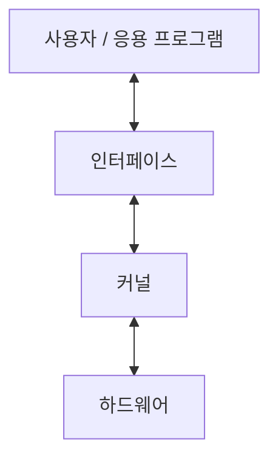
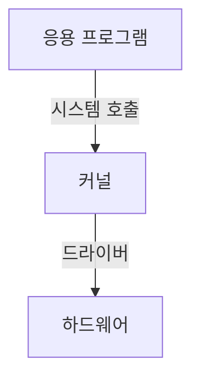
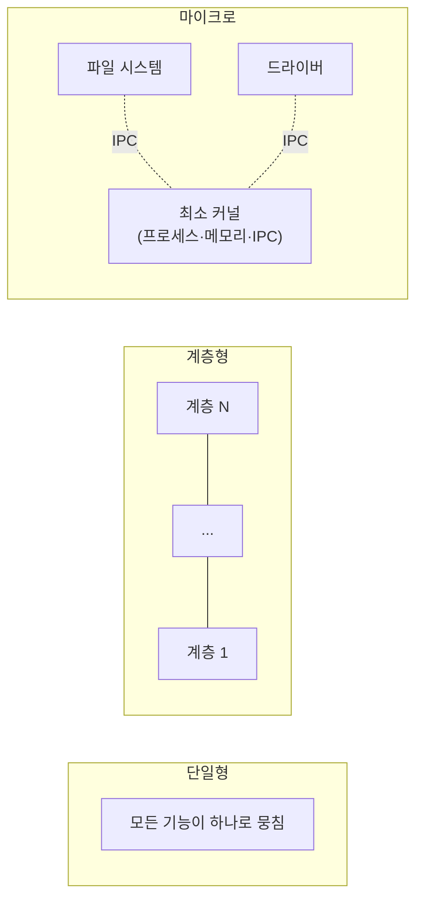
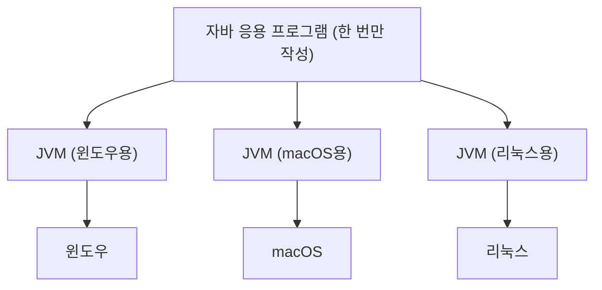

# 01. 운영체제의 구조

## 목차

1. [커널과 인터페이스](#1-커널과-인터페이스)
2. [시스템 호출과 디바이스 드라이버](#2-시스템-호출과-디바이스-드라이버)
3. [커널의 구성](#3-커널의-구성)
4. [가상머신](#4-가상머신)
5. [요약](#요약)
6. [느낀 점](#느낀-점)

---

## 1. 커널과 인터페이스

| 구분 | 역할 | 자동차 비유 |
| --- | --- | --- |
| 커널 (kernel) | 프로세스·메모리·저장장치 관리 등 운영체제의 핵심 기능 모음 | 엔진 |
| 인터페이스 (interface) | 사용자의 명령을 커널에 전달하고, 실행 결과를 사용자에게 알려줌 | 핸들, 브레이크, 계기판 |

- 운영체제는 커널과 인터페이스를 분리해서 만든다.
- 같은 커널이라도 인터페이스가 다르면 사용자에게는 다른 운영체제처럼 보인다.

---

## 2. 시스템 호출과 디바이스 드라이버

응용 프로그램과 커널 사이의 인터페이스는 시스템 호출, 커널과 하드웨어 사이의 인터페이스는 드라이버다.

### 2.1 시스템 호출 (system call)

커널이 자신을 보호하기 위해 만든 인터페이스다.

- 커널은 사용자·응용 프로그램이 자원에 직접 접근하는 것을 차단한다.
- 자원을 쓰려면 반드시 시스템 호출을 거쳐야 한다.
- 시스템 호출 = 커널이 제공하는 시스템 자원 사용과 관련된 함수
- 하드웨어 자원 접근, 운영체제 서비스 이용 시 시스템 호출을 사용한다.
- 사용자가 자발적으로 커널 영역에 진입할 수 있는 유일한 수단이다.

> [!TIP]
> **API와 SDK**
>
> - **API** (Application Programming Interface): 응용 프로그램이 다른 프로그램과 연동할 수 있도록 제공하는 인터페이스
>   - 예: 포토샵은 모든 필터를 직접 만들지 않고, 필터 개발자용 API를 제공한다.
>   - 시스템 호출보다 넓은 개념이다. 운영체제가 제공하는 API = 시스템 호출로 볼 수 있다.
> - **SDK** (Software Development Kit): API + 사용 매뉴얼 + 코드 편집기·에뮬레이터 등 개발 도구를 한데 묶은 패키지
>   - 예: Android SDK (Android Studio)

### 2.2 디바이스 드라이버 (device driver)

하드웨어 제작자가 만든, 하드웨어 특성을 반영한 소프트웨어다.

**왜 제작자가 만드는가?**

- 하드웨어 종류가 너무 많아 커널이 모두 대응하기 어렵다.
- 하드웨어 특성은 제작자가 가장 잘 안다.

**동작 방식**

- 커널은 입출력의 기본 부분만 만든다.
- 제작자에게 받은 드라이버는 커널이 실행될 때 함께 실행된다.

| 종류 | 예시 | 설치 |
| --- | --- | --- |
| 내장 드라이버 | 키보드, 마우스 (단순한 장치) | 커널에 포함 → 꽂으면 바로 동작 |
| 별도 설치 드라이버 | 그래픽카드, 프린터 (크고 복잡한 장치) | 사용자가 직접 설치 |

> [!IMPORTANT]
> 커널에 들어가는 길은 시스템 호출 하나뿐이지만, 드라이버는 내장형과 설치형이 모두 있다.

---

## 3. 커널의 구성

### 커널이 하는 일

| 핵심 기능 | 설명 |
| --- | --- |
| 프로세스 관리 | 프로세스에 CPU를 배분하고 작업에 필요한 환경을 제공 |
| 메모리 관리 | 프로세스에 작업 공간을 배치하고, 실제 메모리보다 큰 가상 공간을 제공 |
| 파일 시스템 관리 | 데이터를 저장하고 접근할 수 있는 인터페이스 제공 |
| 입출력 관리 | 필요한 입력과 출력 서비스 제공 |
| 프로세스 간 통신(IPC) 관리 | 공동 작업을 위한 프로세스 간 통신 환경 지원 |

이 기능들은 서로 복잡하게 얽혀 있고, 어떻게 구현하느냐에 따라 커널 구조가 나뉜다.

### 3.1 단일형 구조 커널 (monolithic architecture)

초창기 운영체제 구조. 핵심 기능 모듈들이 구분 없이 하나로 구성되어 있다.
(비유: 함수 없이 `main()` 하나에 모든 기능을 구현한 프로그램)

모듈 간 통신 비용이 적어 효율적이지만, 단점이 많다.

- 모든 모듈이 묶여 있어 버그·오류 처리가 어렵다.
- 상호 의존성이 높아 작은 결함이 시스템 전체로 퍼진다.
- 수정이 어려워 이식성이 낮다.
- 현대 OS는 너무 커서 완전한 단일형으로 구현하기 어렵다.

### 3.2 계층형 구조 커널 (layered architecture)

단일형이 발전한 형태. 비슷한 기능의 모듈을 계층으로 묶고, 계층 간 통신으로 운영체제를 구현한다.

- 모듈화되어 있어 버그·오류 처리가 단일형보다 쉽다.
- 오류가 나면 해당 계층만 수정하면 되므로 디버깅이 쉽다.
- 윈도우를 비롯한 오늘날 대부분의 운영체제가 이 구조다.

### 3.3 마이크로 구조 커널 (micro architecture)

**등장 배경**: 계층형 커널은 요구사항에 맞춰 계층·기능을 계속 추가했다.
→ 커널이 비대해지고, 필요한 하드웨어 용량이 커지고, 오류를 잡기 어려워졌다.
→ 이와 반대 방향으로 설계한 것이 마이크로 구조 커널이다.

- 커널은 프로세스 관리, 메모리 관리, IPC 관리 등 가장 기본적인 기능만 제공한다.
- 나머지 기능은 대부분 사용자 영역에 구현된다.
- 모듈은 세분화되어 독립적으로 존재하고, 모듈 간 정보 교환은 IPC로 한다.

장점

- 모듈이 독립적이라 하나가 실패해도 전체 OS가 멈추지 않는다.
- 이식이 쉽다.
- 커널이 가벼워 CPU 성능이 낮은 시스템에도 적용할 수 있다.

- 대표 예: 마하(Mach) — 애플 macOS(OS X)·iOS 커널의 기반으로 유명해졌다.
  - 참고: 실제 macOS/iOS 커널(XNU)은 Mach에 BSD 등을 합친 하이브리드 구조다.

### 커널 구조 비교

| 구분 | 구성 방식 | 핵심 키워드 |
| --- | --- | --- |
| 단일형 | 모든 모듈이 하나로 | 효율적, 이식성 낮음 |
| 계층형 | 비슷한 모듈을 계층으로 묶음 | 디버깅 쉬움, 현대 OS 대부분 |
| 마이크로 | 최소 기능만 커널에, 나머지는 사용자 영역 | 독립성, 가벼움, IPC |

---

## 4. 가상머신 (virtual machine)

**문제: 언어의 호환성**

- C 언어는 저급 언어 기능이 있어 시스템 프로그래밍에 적합하다. (대표 OS: 유닉스)
- 하지만 다른 커널을 가진 OS 간 호환성이 떨어진다.
  - 유닉스에서 만든 C 코드는 윈도우에서 그대로 동작하지 않는다.
  - 유닉스끼리도 버전에 따라 호환되지 않는 경우가 있다.
- → 같은 프로그램을 OS별로 따로 만들어야 한다.

**해결: 자바(Java)와 가상머신**

- 운영체제 위에 가상머신을 만들고, 그 위에서 응용 프로그램을 실행한다.
- 코드를 수정하지 않아도 대부분의 OS에서 동작한다.

> [!TIP]
> JVM은 OS별로 따로 만들어져 있다. 개발자는 코드를 한 번만 작성하면, 각 OS의 JVM이 알맞게 연결해 준다.
> 파이썬 코드가 OS에 상관없이 동작하는 것도 OS별 파이썬 인터프리터가 중간에 있기 때문이다.

---

## 요약

- **운영체제의 정의**: 사용자에게 편리한 인터페이스 환경을 제공하고, 컴퓨터 시스템의 자원을 효율적으로 관리하는 소프트웨어
- **운영체제의 구성**
  - **인터페이스**: 사용자·응용 프로그램과 커널 사이에서 명령을 전달하고 결과를 돌려줌
  - **커널**: 운영체제의 핵심 기능 모음
- **커널의 종류**
  - **단일형**: 핵심 기능 모듈들이 구분 없이 하나로 구성
  - **계층형**: 비슷한 기능의 모듈을 계층으로 묶고, 계층 간 통신으로 구현
  - **마이크로**: 프로세스 관리, 메모리 관리, IPC 관리 등 가장 기본적인 기능만 제공

---

## 느낀 점

- 실제 책에서는 운영체제의 역사도 함께 다루는데, 굉장히 재밌었다.
- 커널이 단일형·계층형·마이크로 구조로 나뉜다는 걸 처음 알았다.
- 드라이버가 커널이 실행될 때 함께 실행된다는 점 등 새로 알게 된 것이 많았다.

---

[다음 장: 컴퓨터의 구조와 성능 향상 →](../02-컴퓨터의-구조와-성능-향상/)
