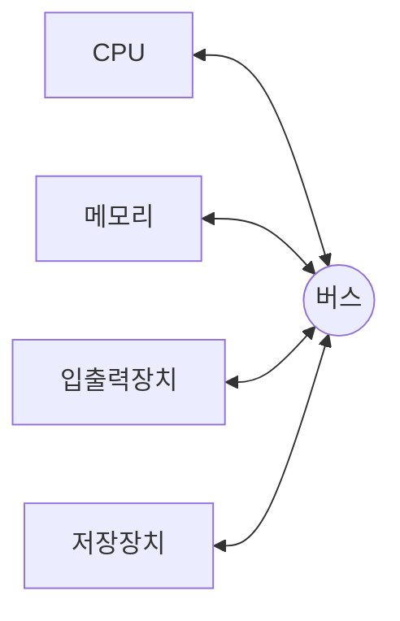
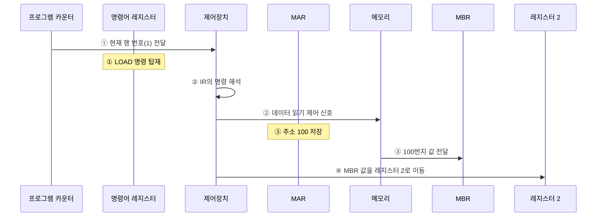
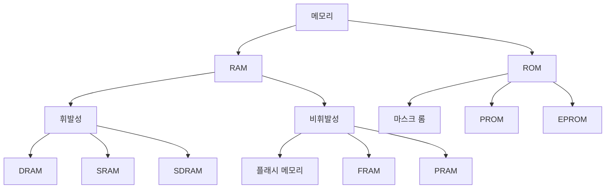
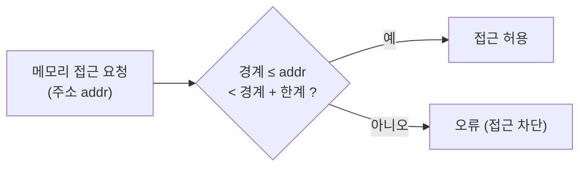
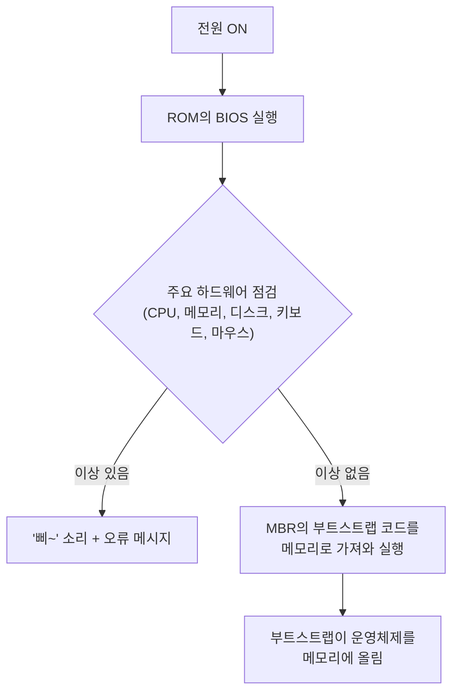
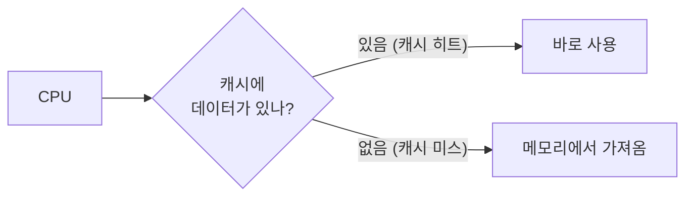
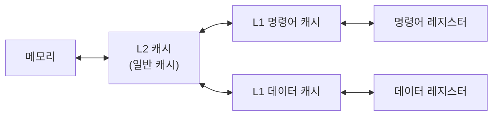
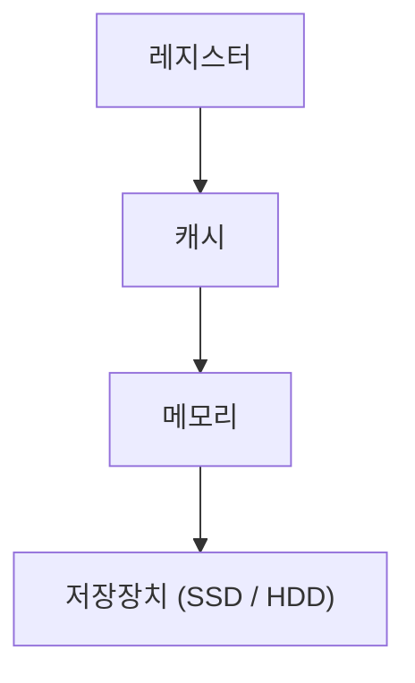
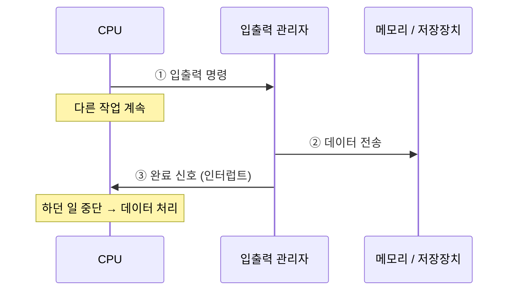
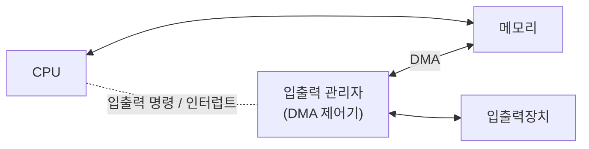

# 02. 컴퓨터의 구조와 성능 향상

운영체제를 이해하려면 컴퓨터 시스템의 구조와 하드웨어의 특성을 알아야 한다.

## 목차

1. [컴퓨터의 기본 구성](#1-컴퓨터의-기본-구성)
   - [폰노이만 구조](#11-폰노이만-구조)
   - [하드웨어 사양 관련 용어](#12-하드웨어-사양-관련-용어)
2. [CPU와 메모리](#2-cpu와-메모리)
   - [CPU의 구성](#21-cpu의-구성)
   - [레지스터의 종류](#22-레지스터의-종류)
   - [버스의 종류와 대역폭](#23-버스의-종류와-대역폭)
   - [메모리의 종류](#24-메모리의-종류)
   - [메모리 보호](#25-메모리-보호)
   - [부팅](#26-부팅)
3. [컴퓨터 성능 향상 기술](#3-컴퓨터-성능-향상-기술)
   - [버퍼](#31-버퍼-buffer)
   - [캐시](#32-캐시-cache)
   - [저장장치의 계층 구조](#33-저장장치의-계층-구조-storage-hierarchy)
   - [인터럽트](#34-인터럽트-interrupt)
   - [직접 메모리 접근 (DMA)](#35-직접-메모리-접근-dma-direct-memory-access)
   - [메모리 매핑 입출력 (MMIO)](#36-메모리-매핑-입출력-mmio-memory-mapped-io)
   - [사이클 훔치기](#37-사이클-훔치기-cycle-stealing)
4. [요약](#요약)
5. [느낀 점](#느낀-점)

---

## 1. 컴퓨터의 기본 구성

### 1.1 폰노이만 구조

> 📦 **CPU, 메모리, 입출력장치, 저장장치가 버스로 연결된 구조**
> 오늘날의 컴퓨터는 대부분 이 구조를 따른다.



**등장 배경**

- 이전 컴퓨터는 전선으로 회로를 구성하는 **하드와이어링** 방식이었다.
- 용도를 바꾸려면 전선 연결 자체를 바꿔야 했다.
- 존 폰노이만(John von Neumann)이 **하드웨어는 그대로 두고 프로그램만 교체해 메모리에 올리는 방식**을 제안했다.
- 덕분에 프로그래밍만으로 다양한 작업을 할 수 있게 되었다.

**가장 중요한 특징**

> 📦 **모든 프로그램은 메모리에 올라와야 실행할 수 있다.**

- 예: 워드프로세서와 보고서 파일은 하드디스크에 저장되지만, 실행하려면 메모리에 올라와야 한다.
- **운영체제도 프로그램**이므로 메모리에 올라와야 실행된다.
- 운영체제 전반을 이해하는 밑거름이 되는 개념이다.

### 1.2 하드웨어 사양 관련 용어

#### 클록 (clock)

- CPU 속도와 관련된 단위. CPU 작업의 **박자**를 만든다. (비유: 오케스트라의 박자)
- 클록이 일정 간격으로 **틱(tick)** 을 만들면, CPU 안의 모든 부품이 이에 맞춰 작업한다.
  - 틱 = 펄스(pulse) = 클록틱(clock tick)
- 버스에 연결된 부품들도 메인보드 클록의 틱마다 데이터를 주고받는다.

#### 헤르츠 (Hz)

- 1초에 클록틱이 몇 번 발생하는지 나타내는 단위
  - 1초에 1번 = 1Hz, 1,000번 = 1kHz
- 예: **3.4GHz** = 1초에 클록틱 3.4 × 10⁹번 → CPU가 1초에 약 34억 번 연산

#### 시스템 버스와 CPU 내부 버스

| 구분 | 별칭 | 연결 대상 | 속도 |
| --- | --- | --- | --- |
| 시스템 버스 (system bus) | FSB (Front-Side Bus, 전면 버스) | 메모리, 주변장치 | 메인보드 클록 |
| CPU 내부 버스 | BSB (Back-Side Bus, 후면 버스) | CPU 내부 장치 | CPU 클록 (훨씬 빠름) |

- 시스템 버스가 1,333MHz인 메인보드에 800MHz 메모리를 쓰면, 메인보드가 800MHz로 동작해 **성능이 저하**된다.
- CPU는 내부 버스 속도로, 메모리는 시스템 버스 속도로 동작한다.
  → **두 버스의 속도 차이로 작업이 지연**된다.

---

## 2. CPU와 메모리

### 2.1 CPU의 구성

CPU는 아래 세 장치의 협업으로 작업을 처리한다.

| 구성 요소 | 역할 |
| --- | --- |
| 산술논리 연산장치 (ALU) | 데이터 연산 |
| 제어장치 (CU) | 작업 지시 |
| 레지스터 (register) | CPU 내 데이터 임시 보관 |

### 2.2 레지스터의 종류

#### 일반 레지스터

| 레지스터 | 역할 |
| --- | --- |
| 데이터 레지스터 (DR) | 메모리에서 가져온 데이터를 임시 보관. CPU 레지스터의 대부분이라 **일반(범용) 레지스터**라고도 함 |
| 주소 레지스터 (AR) | 데이터나 명령어가 저장된 메모리 주소를 저장 |

#### 특수 레지스터

| 레지스터 | 역할 |
| --- | --- |
| 프로그램 카운터 (PC) | **다음에 실행할 명령어의 주소**를 기억했다가 제어장치에 알려줌. 명령어 포인터(instruction pointer)라고도 함 |
| 명령어 레지스터 (IR) | **현재 실행 중인 명령어** 저장. 제어장치가 이를 해석해 제어 신호를 보냄 |
| 메모리 주소 레지스터 (MAR) | 메모리에서 데이터를 읽거나 쓸 때 **주소를 지정** |
| 메모리 버퍼 레지스터 (MBR) | 메모리에서 가져온 / 메모리로 보낼 **데이터를 임시 저장**. 항상 MAR과 함께 동작 |
| 프로그램 상태 레지스터 (PSR) | ALU 연산 결과의 상태(양수/음수, 0 여부, 자리 올림 등) 저장. 플래그·상태·컨디션 레지스터라고도 함 |

#### 예시 1: `LOAD mem(100), register 2;` 실행 과정



1. **PC**에 현재 행 번호(1)가 저장되고 제어장치로 전송된다. **IR**에는 `LOAD` 명령이 탑재된다.
2. **제어장치**가 IR의 명령을 해석해, 메모리에서 데이터를 가져오라는 제어 신호를 보낸다.
3. **MAR**에 100이 저장되고, 메모리 관리자가 100번지 값을 **MBR**로 가져온다.
4. 제어장치가 MBR의 값을 **레지스터 2**로 옮긴다.

> 명령어 자체를 메모리에서 가져오는 과정은 단순화를 위해 생략했다.

#### 예시 2: 분기 조건과 PSR

```c
01 if (D2 - D3 > 0)
02     goto 100;
03 else
04     goto 200;
```

- `D2 - D3`의 결과가 다음 실행 위치를 결정한다. (양수 → 100행, 음수 → 200행)
- **PSR**이 연산 결과를 임시 저장하고, 양수/음수 여부를 제어장치에 알려준다.

### 2.3 버스의 종류와 대역폭

| 버스 | 연결 | 방향 | 용도 |
| --- | --- | --- | --- |
| 제어 버스 | 제어장치 | **양방향** | CPU → 메모리·주변장치로 제어 신호 전송. 완료·오류 시 반대로도 신호가 옴 |
| 주소 버스 | MAR | **단방향** | 메모리·주변장치에 읽기/쓰기 위치 정보 전송 |
| 데이터 버스 | MBR | **양방향** | 데이터 이동 |

#### 대역폭 (bandwidth)

- 한 번에 전달할 수 있는 데이터의 최대 크기 (비유: 4차선 도로 = 차 4대 동시 통행)
- 버스 대역폭 = CPU가 한 번에 처리할 수 있는 데이터 크기
  - 예: 32bit CPU → 한 번에 최대 32bit 처리, 레지스터 32bit, 버스 대역폭 32bit

#### 워드 (word)

- **CPU가 한 번에 처리할 수 있는 데이터의 최대 크기**
- 다음은 항상 같다: `버스 대역폭 = 레지스터 크기 = 메모리에 한 번에 저장되는 단위 = 1워드`
- 예: 32bit CPU에서 1워드 = 32bit

### 2.4 메모리의 종류

**메모리 기본 단위**

- 소자 하나 = 1bit (0 또는 1)
- 주소는 **바이트 단위**로 지정
- 읽기/쓰기는 **워드 단위**로 이동 (대역폭이 32bit인데 1bit씩 옮길 이유가 없음)

**RAM vs ROM**

| 구분 | 이름 | 특징 |
| --- | --- | --- |
| RAM | Random Access Memory | 읽기·쓰기 가능. 저장 위치와 상관없이 같은 속도로 접근 |
| ROM | Read Only Memory | 읽기만 가능. 전력이 끊겨도 데이터 유지 |



#### 휘발성 메모리 (volatile memory)

| 종류 | 특징 | 용도 |
| --- | --- | --- |
| DRAM (Dynamic RAM) | 시간이 지나면 데이터가 사라져 **주기적으로 재생(refresh)** 필요 | 메인메모리 |
| SRAM (Static RAM) | 전력이 있는 동안 데이터 유지, 재생 불필요. **빠르지만 비쌈** | 캐시 등 고속 메모리 |
| SDRAM (Synchronous DRAM) | DRAM의 발전형. 클록틱마다 데이터를 저장하는 **동기 DRAM** (SRAM과는 다른 종류) | 메인메모리 |

> **메인메모리는 왜 아직 휘발성인가?**
> 비휘발성 메모리는 전력 없이 데이터를 유지해야 하므로 내부가 복잡하고, **느리고, 비싸다.**

#### 비휘발성 메모리 (non-volatile memory)

- 종류: 플래시 메모리, FRAM (Ferroelectric RAM), PRAM (Phase change RAM) 등
- **플래시 메모리**
  - 디지털카메라, MP3 플레이어, USB 드라이브 등에 사용
  - 소자당 **쓰기 횟수 제한** (수천~1만 번) → 오래 쓰면 성능 저하·데이터 손실 위험
- **SSD**
  - 하드디스크를 대체하는 저장장치
  - 비싸지만 빠른 접근 속도, 저전력, 내구성 → PC·노트북·스마트폰 등에 널리 사용

#### ROM

- 전력이 끊겨도 데이터 유지, 단 한 번 저장하면 바꾸기 어렵다.
- 이 특성 때문에 **바이오스(BIOS, Basic Input/Output System)** 를 롬에 저장한다.

| 종류 | 특징 |
| --- | --- |
| 마스크 롬 (mask ROM) | 데이터를 지우거나 쓸 수 없음 |
| PROM (Programmable ROM) | 전용 기계로 **한 번만** 저장 가능 |
| EPROM (Erasable PROM) | **여러 번** 쓰고 지울 수 있음. 플래시처럼 쓸 수 있지만 비싸서 잘 안 씀 |

### 2.5 메모리 보호

**왜 필요한가?**

- **일괄 작업 시스템**: 메모리가 운영체제 영역 / 사용자 영역으로 나뉜다.
  → 사용자 작업이 운영체제 영역을 침범하지 못하게 막아야 한다.
- **현대 OS (시분할)**: 여러 프로그램이 동시에 실행되어 사용자 영역이 여러 작업 공간으로 나뉜다.
  → 보호하지 않으면 다른 작업의 프로그램·데이터를 파괴하거나, 최악의 경우 OS 영역을 침범해 시스템이 멈출 수 있다.
  - 이렇게 OS나 다른 프로그램 영역을 침범하려는 악성 소프트웨어를 **바이러스**라고 한다.

**왜 하드웨어의 도움이 필요한가?**

- 운영체제도 CPU를 사용하는 소프트웨어다.
- 사용자 프로세스가 CPU를 차지하는 동안 **운영체제의 작업은 잠시 중단**된다.
- 그래서 OS가 멈춘 상태에서도 메모리를 지키려면 **하드웨어의 도움**이 필요하다.

**방법: 경계 레지스터 + 한계 레지스터**

| 레지스터 | 저장 값 |
| --- | --- |
| 경계 레지스터 (bound register) | 현재 작업의 **메모리 시작 주소** |
| 한계 레지스터 (limit register) | 현재 작업이 차지하는 **메모리 크기** (마지막 주소까지의 차이) |

- 작업이 진행되는 동안, 접근 주소가 `경계 ~ 경계 + 한계` 범위를 벗어나는지 **하드웨어가 점검**한다.



### 2.6 부팅 (booting)

> 응용 프로그램은 운영체제가 메모리에 올린다. 그럼 **운영체제는 누가 메모리에 올릴까?**

**부팅** = 컴퓨터를 켰을 때 운영체제를 메모리에 올리는 과정



- **마스터 부트 레코드 (MBR, Master Boot Record)**: 하드디스크의 **첫 번째 섹터**. 부트스트랩 코드가 저장되어 있다.
- **부트스트랩 (bootstrap)**: 운영체제를 메모리로 가져와 실행하는 작은 프로그램
  - 유닉스용 부트스트랩 → 유닉스 실행, 윈도우용 부트스트랩 → 윈도우 실행
- **부팅 USB/DVD 만들기** = USB·DVD에 MBR 영역을 만들고 부트스트랩 코드를 설치하는 것

> 참고: 최신 PC는 BIOS 대신 **UEFI**, MBR 대신 **GPT** 파티션 방식을 주로 쓴다. 기본 흐름(펌웨어 → 부트로더 → OS)은 같다.

## 3. 컴퓨터 성능 향상 기술

**문제**: CPU는 CPU 내부 버스 속도로, 메모리는 시스템 버스 속도로 동작한다.
→ 메모리를 비롯한 주변장치가 **CPU 속도를 따라가지 못한다.**

이 장치 간 속도 차이를 줄이기 위한 기술 중 운영체제와 관련된 것들을 살펴본다.

### 3.1 버퍼 (buffer)

**속도가 다른 두 장치 사이에서 그 차이를 완화**하는 장치. 데이터를 일정량 모아 한꺼번에 옮긴다.

- 비유: 귤 5개를 하나씩 다섯 번 옮기는 대신, **바구니(버퍼)** 에 담아 한 번에 옮긴다.
- 느린 입출력장치에서 데이터를 하나씩 보내면 들인 노력에 비해 전송량이 적다. 모아서 보내면 적은 노력으로 많이 옮길 수 있다.

**소프트웨어 버퍼의 예**

- **동영상 스트리밍**: 네트워크 수신 속도와 재생 속도가 다를 수 있다. 영상 일부를 미리 버퍼에 담아 두고 재생해 끊김을 막는다.
- **화면 출력**: 출력 버퍼에 한 줄이 다 차지 않으면 화면에 나오지 않을 수 있다.
  - C의 `printf("Hello\n");`에서 `\n`은 줄 바꿈이면서, 터미널 출력에서는 **버퍼 내용을 내보내는 계기**도 된다.
  - 그래서 `printf` 끝에 `\n`을 붙이는 습관이 좋다.

#### 스풀 (spool)

**입출력장치가 독립적으로 동작하도록 고안된 소프트웨어 버퍼**

- 예: 프린터 스풀러 — 문서 작업과 프린터 출력이 **서로 독립적으로** 진행된다.
  - 출력할 내용을 스풀러에 모두 넘기면, 프린터가 출력하는 동안에도 다른 작업을 계속할 수 있다.

> 💡 **하드웨어 안전 제거**
>
> - 버퍼를 쓰면 버퍼가 찰 때까지 실제 전송이 미뤄진다. 저장된 것처럼 보여도 **아직 저장되지 않은 데이터**가 있을 수 있다.
>   - 그래서 USB에 복사한 직후 바로 뽑거나, 종료 없이 전원 코드를 뽑으면 데이터가 사라지거나 부품이 망가질 수 있다.
> - **하드웨어 안전 제거**는 버퍼에 남은 데이터를 저장장치로 마저 보내고, 전원을 차단해 안전하게 뺄 수 있게 해준다.
> - 버퍼 내용을 강제로 내보내는 방법: C 라이브러리의 `fflush()`, 유닉스 명령어 `sync`

### 3.2 캐시 (cache)

**메모리와 CPU 간 속도 차이를 완화**하기 위해, 메모리의 데이터를 미리 가져와 두는 임시 장소

- 버퍼의 일종. CPU가 **앞으로 쓸 것으로 예상되는 데이터**를 미리 가져다 둔다. → **미리 가져오기 (prefetch)**
- 비유: 간장 10cc가 필요할 때 50cc를 가져다 두면, 다음번엔 장독대까지 가지 않아도 된다.
- 캐시는 **CPU 안**에 있고 **CPU 내부 버스 속도**로 동작한다.

#### 캐시 히트와 캐시 미스



| 용어 | 의미 |
| --- | --- |
| 캐시 히트 (cache hit) | 원하는 데이터를 캐시에서 찾음 → 바로 사용 |
| 캐시 미스 (cache miss) | 캐시에 없음 → 메모리에서 가져옴 |
| 캐시 적중률 (cache hit ratio) | 캐시 히트 비율. 일반적인 컴퓨터는 약 90% |

#### 캐시 적중률을 높이는 방법

1. **캐시 크기를 늘린다.**
   - 더 많이 미리 가져올 수 있어 적중률이 오른다.
   - 같은 클록의 CPU라도 저가형과 고가형은 캐시 크기가 다르다. (예: 4MB vs 8MB 이상)
   - 캐시는 비싸서 수 MB 수준으로만 쓴다.
2. **앞으로 많이 쓸 데이터를 가져온다.** → **지역성 (locality)**
   - 현재 위치에 가까운 데이터가 멀리 있는 데이터보다 쓰일 확률이 높다.
   - 예: 10행을 실행 중이면, 101행보다 11행이 다음에 실행될 확률이 높다. → 11~20행을 미리 가져온다.

> 💡 지역성 관점에서 `goto` 문은 피하는 게 좋다. 멀리 점프하면 미리 가져온 데이터가 쓸모없어진다.

#### 즉시 쓰기 vs 지연 쓰기

캐시의 데이터가 바뀌면 메모리의 원래 데이터에도 반영해야 한다.

| 방식 | 동작 | 장점 | 단점 |
| --- | --- | --- | --- |
| 즉시 쓰기 (write through) | 변경 즉시 메모리에 반영 | 메모리가 항상 최신 → 정전에도 데이터 유지 | 전송이 잦아 느림 |
| 지연 쓰기 (write back, copy back) | 변경 내용을 모아 주기적으로 반영 | 전송 횟수가 줄어 빠름 | 메모리와 캐시 간 **불일치** 가능 |

#### L1 캐시와 L2 캐시

명령어는 **명령어 부분**(무슨 작업을 할지)과 **데이터 부분**(작업 대상)으로 나뉜다. 캐시도 이를 기준으로 나뉜다.

| 레벨 | 종류 | 연결 |
| --- | --- | --- |
| L1 (Level 1) | 특수 캐시: **명령어 캐시** / **데이터 캐시**로 구분 | 명령어 레지스터 / 데이터 레지스터에 직접 연결 |
| L2 (Level 2) | 일반 캐시: 명령어·데이터 구분 없이 가져옴 | 메모리와 연결 |



> 참고: 최신 CPU는 여러 코어가 함께 쓰는 **L3 캐시**까지 두는 경우가 많다.

> 💡 **웹 브라우저 캐시**
>
> - 소프트웨어 캐시의 대표 예. "다시 방문할 것을 예상해 지우지 않고 남겨 둔 데이터"
> - 자주 바뀌지 않는 로고·버튼 이미지 등을 저장해 두었다가, 재방문 시 사용해 속도를 높인다.
> - 너무 많이 쌓이면 오히려 느려질 수 있어 가끔 비워주는 게 좋다.

### 3.3 저장장치의 계층 구조 (storage hierarchy)

**최고 성능을 내려면?**

- 하드디스크 대신 SSD 사용
- 메모리를 하드디스크 크기만큼 확장
- 캐시를 크게 늘려 적중률 향상

→ 하지만 **비용이 너무 크다.** (예: 1MB에 만 원인 캐시로 4GB를 채우면 약 4,000만 원)

**해결: 가격과 성능의 타협점**

빠르고 비싼 저장장치는 CPU 가까이, 싸고 용량이 큰 저장장치는 멀리 배치한다.
→ 적당한 가격으로 **빠른 속도와 큰 용량**을 함께 얻는다.



| 방향 | 속도 | 가격 | 용량 |
| --- | --- | --- | --- |
| ↑ CPU 쪽 | 빠름 | 비쌈 | 작음 |
| ↓ 반대쪽 | 느림 | 쌈 | 큼 |

**문제: 데이터 일관성**

같은 데이터가 여러 계층에 중복 저장되므로 일관성 유지가 어렵다.

- **지연 쓰기**를 쓰면 캐시와 메모리 내용이 한동안 다르다.
  - 협업 중인 다른 작업이 그 데이터를 읽으면 일관성이 깨진다.
  - 갑자기 전원이 꺼지면 데이터를 잃는다.
- **버퍼**를 비우지 않고 하드웨어를 제거해도 일관성이 깨진다.
- 분산 데이터베이스, 병렬 컴퓨터의 분산 메모리에서도 같은 문제가 생긴다.

### 3.4 인터럽트 (interrupt)

#### 폴링 vs 인터럽트

| 방식 | 동작 | 요리사 비유 | 효율 |
| --- | --- | --- | --- |
| **폴링 (polling)** | CPU가 입출력장치 상태를 **주기적으로 직접 검사**하고 데이터를 처리 | 요리사가 직접 창고에서 재료를 가져옴 | CPU가 모든 입출력에 관여 → 낮음 |
| **인터럽트** | CPU는 지시만 하고, 입출력 관리자가 처리 후 **완료 신호**를 보냄 | 주방 보조에게 시키고 요리사는 계속 요리 | 입출력 중에도 CPU가 다른 작업 가능 → 높음 |

- 초기 컴퓨터는 주변장치가 적어 폴링으로 충분했지만, 오늘날은 주변장치가 많아 인터럽트 방식을 쓴다.
- 여기서 **입출력 관리자(장치 관리자)** 가 주방 보조 역할이다.

#### 인터럽트 동작 과정



1. CPU가 입출력 관리자에게 입출력 명령을 보낸다.
2. 입출력 관리자가 데이터를 메모리로 가져오거나, 메모리의 데이터를 저장장치로 옮긴다.
3. 전송이 끝나면 입출력 관리자가 CPU에 **완료 신호**를 보낸다. → 이 신호가 **인터럽트**

> "하던 작업을 **중단하고** 처리해야 하는 신호"라서 인터럽트라고 부른다.

#### 인터럽트 번호와 인터럽트 벡터

- **인터럽트 번호 (interrupt number)**: 어떤 장치의 작업이 끝났는지 알리기 위한 장치 고유 번호. OS마다 다르다.
  - 윈도우에서는 **IRQ (Interrupt ReQuest)** 라고 부른다.
  - 예: 키보드 IRQ 1, 마우스 IRQ 12, 첫 번째 하드디스크 IRQ 14
- **인터럽트 벡터 (interrupt vector)**: 여러 인터럽트를 **하나의 배열**로 묶은 것
  - 여러 입출력이 동시에 끝날 때마다 인터럽트를 따로 보내면 비효율적이다.
  - 예: 0번과 3번이 동시에 끝나면, CPU는 벡터를 받아 두 작업을 함께 처리한다.

#### 다양한 인터럽트

입출력 완료 외에도 인터럽트가 발생하는 경우가 있다.

- 사용자가 전원 버튼으로 **강제 종료** → CPU는 처리 중인 데이터를 안전하게 보관한 뒤 종료
- 작업이 **자기 메모리 영역을 벗어나** 접근하려 할 때
- **0으로 나눌** 때

### 3.5 직접 메모리 접근 (DMA, Direct Memory Access)

- 폴링 시절에는 CPU가 메모리·주변장치에 대한 모든 권한을 가졌다.
- 인터럽트 방식에서는 **입출력 관리자가 데이터 입출력을 맡는다.**
- 그런데 메모리는 원래 **CPU만 접근할 수 있는** 공간이다.
  → 입출력 관리자가 **CPU 허락 없이 메모리에 접근할 수 있는 권한**이 필요하다. 이것이 **DMA**다.
- DMA가 있어야 입출력 관리자가 CPU 관여 없이 작업을 끝낼 수 있다. → 인터럽트 방식의 **필수 요소**



### 3.6 메모리 매핑 입출력 (MMIO, Memory Mapped I/O)

- DMA를 쓰면 메모리에 **CPU용 데이터와 입출력장치용 데이터가 섞인다.**
- 섞이면 관리가 어려우므로, 메모리의 **일정 공간을 입출력 전용으로 할당**한다.
- 이처럼 CPU용 공간과 DMA 입출력용 공간을 분리하는 기법이 **메모리 매핑 입출력**이다.

### 3.7 사이클 훔치기 (cycle stealing)

- CPU와 DMA가 **동시에** 메모리에 접근하면, 보통 **CPU가 양보**한다.
- CPU 입장에서는 DMA가 사이클(순서)을 훔쳐 간 것이라 **사이클 훔치기**라고 부른다.

**왜 CPU가 양보할까?**

| 이유 | 설명 |
| --- | --- |
| 느린 쪽은 기다리면 손해가 크다 | 입출력장치는 작은 버퍼에 데이터를 담아 메모리로 옮긴다. 제때 못 옮기면 버퍼가 넘치거나 장치가 멈춘다. 반면 CPU는 캐시·레지스터로 잠깐은 버틸 수 있다. |
| 입출력장치는 가끔, 짧게만 쓴다 | CPU가 메모리에 수억 번 접근하는 사이 입출력장치는 드문드문 끼어드는 정도다. CPU가 그때마다 양보해도 전체 손해는 작다. 반대로 CPU가 항상 우선이면 입출력장치는 거의 일을 못 한다. |

> 비유: 바쁜 엘리베이터에서 계속 오가는 직원(CPU)이 가끔 오는 택배 기사(입출력장치)에게 한 번 양보하는 것이 전체적으로 이득이다.

---

## 요약

- **폰노이만 구조**: CPU, 메모리, 입출력장치, 저장장치가 버스로 연결된 구조. **모든 프로그램은 메모리에 올라와야 실행된다.**
- **클록 / 헤르츠**: CPU 작업의 박자 / 1초당 클록틱 발생 횟수
- **시스템 버스(FSB) vs CPU 내부 버스(BSB)**: 속도 차이로 작업 지연이 발생
- **CPU 구성**: 산술논리 연산장치 + 제어장치 + 레지스터
- **특수 레지스터**: PC(다음 명령 주소), IR(현재 명령), MAR(메모리 주소), MBR(메모리 데이터), PSR(연산 결과 상태)
- **버스**: 제어 버스(양방향), 주소 버스(단방향), 데이터 버스(양방향)
- **워드**: CPU가 한 번에 처리하는 데이터 최대 크기 = 버스 대역폭 = 레지스터 크기
- **메모리**: RAM(휘발성: DRAM·SRAM·SDRAM / 비휘발성: 플래시·FRAM·PRAM), ROM(마스크 롬·PROM·EPROM)
- **메모리 보호**: 경계 레지스터 + 한계 레지스터로 하드웨어가 접근 범위를 점검
- **부팅**: BIOS → 하드웨어 점검 → MBR의 부트스트랩 → 운영체제 로드
- **버퍼**: 속도가 다른 두 장치 사이에서 데이터를 모아 옮겨 속도 차이를 완화. **스풀**은 입출력장치를 독립적으로 동작시키는 소프트웨어 버퍼
- **캐시**: 메모리 데이터를 CPU 가까이 미리 가져다 둠. 적중률은 크기와 **지역성**으로 높임. 쓰기 방식은 즉시 쓰기 / 지연 쓰기
- **저장장치 계층 구조**: 빠르고 비싼 장치는 CPU 가까이, 싸고 큰 장치는 멀리. 대신 데이터 일관성 문제가 생김
- **인터럽트**: CPU는 입출력을 지시만 하고, 입출력 관리자가 끝나면 완료 신호를 보냄 (↔ 폴링)
- **DMA**: 입출력 관리자가 CPU 허락 없이 메모리에 접근하는 권한
- **MMIO**: 메모리 일부를 입출력 전용 공간으로 분리
- **사이클 훔치기**: CPU와 DMA가 동시에 메모리에 접근하면 CPU가 양보

---

## 느낀 점

- 직접 윈도우 PC에 메모리와 SSD를 조립하면서 BIOS 등 여러 설정을 만져본 적이 있다. 이번에 부트스트랩 같은 부팅 과정을 개념적으로 살펴보니 그때 했던 작업이 더 잘 이해됐다.
- 메모리를 보호하기 위해 경계 레지스터와 한계 레지스터를 두고, 하드웨어가 접근 범위를 점검한다는 걸 새로 알았다.

### 더 찾아본 것: 캐시 지역성과 데이터 지향 설계

캐시의 지역성을 활용하면 더 효율적인 프로그램을 만들 수 있지 않을까 싶어 찾아봤다.

- CPU는 메모리에서 값 하나를 읽을 때 그 값만이 아니라 주변 데이터까지 **캐시 라인(보통 64바이트)** 단위로 함께 가져온다.
- 그런데 객체 지향 방식으로 데이터를 묶어 두면 이 장점을 살리기 어렵다.

```c
struct Monster {
    float x;
    float y;
    int hp;
    char name[64];
    // ...
};
struct Monster monsters[100000];
```

- 모든 몬스터의 위치만 업데이트해도 `x`, `y`뿐 아니라 당장 안 쓰는 `hp`, `name`까지 캐시에 올라온다.
- 가져온 데이터 중 실제로 쓰는 비율이 낮으니 캐시 미스가 늘고 성능이 떨어진다.

그래서 성능이 중요한 게임에서는 데이터를 종류별로 모아 두는 **데이터 지향 설계**를 쓰기도 한다.

```c
struct Position { float x, y; };
struct Position positions[100000];
int hps[100000];
```

- 위치를 업데이트할 때 가져온 캐시 라인이 전부 위치 데이터라 낭비가 없다.
- Unity에는 이 방식을 쉽게 쓸 수 있게 해주는 **DOTS (Data-Oriented Technology Stack)** 가 있다. 메모리 배치뿐 아니라 멀티스레드 활용까지 포함해 성능을 최적화한다.
