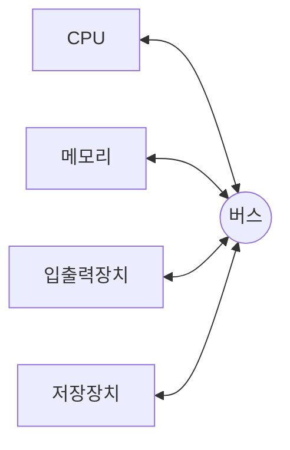

# 1. 컴퓨터의 기본 구성

## 1.1 폰노이만 구조

> [!IMPORTANT]
> **CPU, 메모리, 입출력장치, 저장장치가 버스로 연결된 구조**
> 오늘날의 컴퓨터는 대부분 이 구조를 따른다.

**등장 배경**

- 이전 컴퓨터는 전선으로 회로를 구성하는 하드와이어링 방식이었다.
- 용도를 바꾸려면 전선 연결 자체를 바꿔야 했다.
- 존 폰노이만(John von Neumann)이 하드웨어는 그대로 두고 프로그램만 교체해 메모리에 올리는 방식을 제안했다.
- 덕분에 프로그래밍만으로 다양한 작업을 할 수 있게 되었다.

**가장 중요한 특징**

> [!IMPORTANT]
> **모든 프로그램은 메모리에 올라와야 실행할 수 있다.**

- 예: 워드프로세서와 보고서 파일은 하드디스크에 저장되지만, 실행하려면 메모리에 올라와야 한다.
- 운영체제도 프로그램이므로 메모리에 올라와야 실행된다.
- 운영체제 전반을 이해하는 밑거름이 되는 개념이다.

## 1.2 하드웨어 사양 관련 용어

### 클록 (clock)

- CPU 속도와 관련된 단위. CPU 작업의 박자를 만든다. (비유: 오케스트라의 박자)
- 클록이 일정 간격으로 틱(tick) 을 만들면, CPU 안의 모든 부품이 이에 맞춰 작업한다.
  - 틱 = 펄스(pulse) = 클록틱(clock tick)
- 버스에 연결된 부품들도 메인보드 클록의 틱마다 데이터를 주고받는다.

### 헤르츠 (Hz)

- 1초에 클록틱이 몇 번 발생하는지 나타내는 단위
  - 1초에 1번 = 1Hz, 1,000번 = 1kHz
- 예: 3.4GHz = 1초에 클록틱 3.4 × 10⁹번 → CPU가 1초에 약 34억 번 연산

### 시스템 버스와 CPU 내부 버스

| 구분 | 별칭 | 연결 대상 | 속도 |
| --- | --- | --- | --- |
| 시스템 버스 (system bus) | FSB (Front-Side Bus, 전면 버스) | 메모리, 주변장치 | 메인보드 클록 |
| CPU 내부 버스 | BSB (Back-Side Bus, 후면 버스) | CPU 내부 장치 | CPU 클록 (훨씬 빠름) |

- 시스템 버스가 1,333MHz인 메인보드에 800MHz 메모리를 쓰면, 메인보드가 800MHz로 동작해 성능이 저하된다.
- CPU는 내부 버스 속도로, 메모리는 시스템 버스 속도로 동작한다.
  → 두 버스의 속도 차이로 작업이 지연된다.

---

[목차](./README.md) | [CPU와 메모리 →](./02-CPU와-메모리.md)
