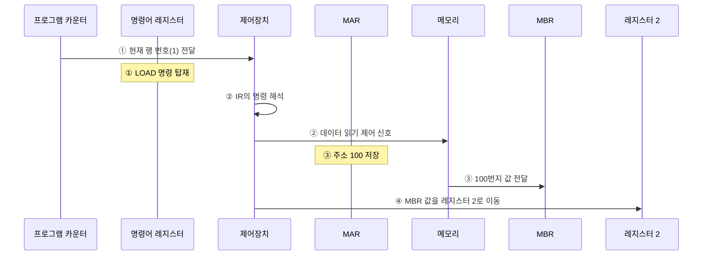
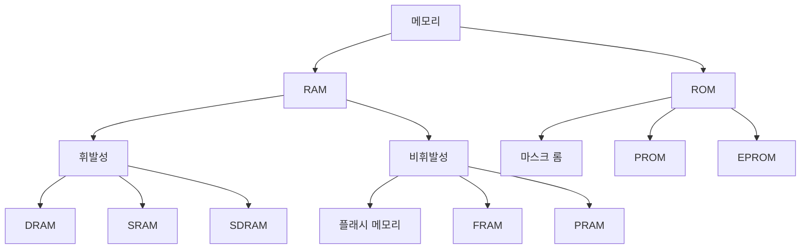
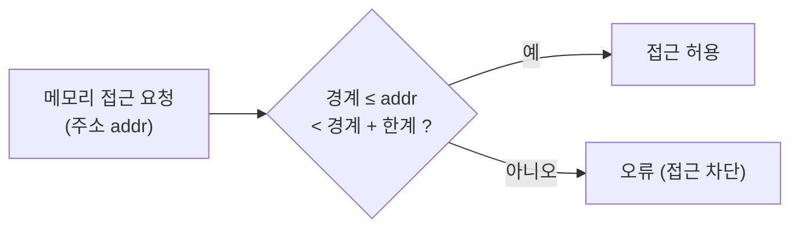
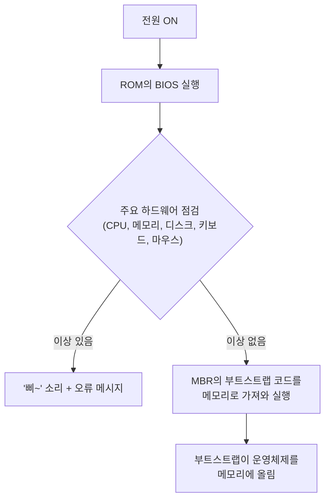

# 2. CPU와 메모리

## 2.1 CPU의 구성

CPU는 아래 세 장치의 협업으로 작업을 처리한다.

| 구성 요소 | 역할 |
| --- | --- |
| 산술논리 연산장치 (ALU) | 데이터 연산 |
| 제어장치 (CU) | 작업 지시 |
| 레지스터 (register) | CPU 내 데이터 임시 보관 |

## 2.2 레지스터의 종류

### 일반 레지스터

| 레지스터 | 역할 |
| --- | --- |
| 데이터 레지스터 (DR) | 메모리에서 가져온 데이터를 임시 보관. CPU 레지스터의 대부분이라 일반(범용) 레지스터라고도 함 |
| 주소 레지스터 (AR) | 데이터나 명령어가 저장된 메모리 주소를 저장 |

### 특수 레지스터

| 레지스터 | 역할 |
| --- | --- |
| 프로그램 카운터 (PC) | 다음에 실행할 명령어의 주소를 기억했다가 제어장치에 알려줌. 명령어 포인터(instruction pointer)라고도 함 |
| 명령어 레지스터 (IR) | 현재 실행 중인 명령어 저장. 제어장치가 이를 해석해 제어 신호를 보냄 |
| 메모리 주소 레지스터 (MAR) | 메모리에서 데이터를 읽거나 쓸 때 주소를 지정 |
| 메모리 버퍼 레지스터 (MBR) | 메모리에서 가져온 / 메모리로 보낼 데이터를 임시 저장. 항상 MAR과 함께 동작 |
| 프로그램 상태 레지스터 (PSR) | ALU 연산 결과의 상태(양수/음수, 0 여부, 자리 올림 등) 저장. 플래그·상태·컨디션 레지스터라고도 함 |

### 예시 1: `LOAD mem(100), register 2;` 실행 과정



1. PC에 현재 행 번호(1)가 저장되고 제어장치로 전송된다. IR에는 `LOAD` 명령이 탑재된다.
2. 제어장치가 IR의 명령을 해석해, 메모리에서 데이터를 가져오라는 제어 신호를 보낸다.
3. MAR에 100이 저장되고, 메모리 관리자가 100번지 값을 MBR로 가져온다.
4. 제어장치가 MBR의 값을 레지스터 2로 옮긴다.

> 명령어 자체를 메모리에서 가져오는 과정은 단순화를 위해 생략했다.

### 예시 2: 분기 조건과 PSR

```c
01 if (D2 - D3 > 0)
02     goto 100;
03 else
04     goto 200;
```

- `D2 - D3`의 결과가 다음 실행 위치를 결정한다. (양수 → 100행, 음수 → 200행)
- PSR이 연산 결과를 임시 저장하고, 양수/음수 여부를 제어장치에 알려준다.

## 2.3 버스의 종류와 대역폭

| 버스 | 연결 | 방향 | 용도 |
| --- | --- | --- | --- |
| 제어 버스 | 제어장치 | 양방향 | CPU → 메모리·주변장치로 제어 신호 전송. 완료·오류 시 반대로도 신호가 옴 |
| 주소 버스 | MAR | 단방향 | 메모리·주변장치에 읽기/쓰기 위치 정보 전송 |
| 데이터 버스 | MBR | 양방향 | 데이터 이동 |

### 대역폭 (bandwidth)

- 한 번에 전달할 수 있는 데이터의 최대 크기 (비유: 4차선 도로 = 차 4대 동시 통행)
- 버스 대역폭 = CPU가 한 번에 처리할 수 있는 데이터 크기
  - 예: 32bit CPU → 한 번에 최대 32bit 처리, 레지스터 32bit, 버스 대역폭 32bit

### 워드 (word)

- CPU가 한 번에 처리할 수 있는 데이터의 최대 크기
- 다음은 항상 같다: `버스 대역폭 = 레지스터 크기 = 메모리에 한 번에 저장되는 단위 = 1워드`
- 예: 32bit CPU에서 1워드 = 32bit

## 2.4 메모리의 종류

**메모리 기본 단위**

- 소자 하나 = 1bit (0 또는 1)
- 주소는 바이트 단위로 지정
- 읽기/쓰기는 워드 단위로 이동 (대역폭이 32bit인데 1bit씩 옮길 이유가 없음)

**RAM vs ROM**

| 구분 | 이름 | 특징 |
| --- | --- | --- |
| RAM | Random Access Memory | 읽기·쓰기 가능. 저장 위치와 상관없이 같은 속도로 접근 |
| ROM | Read Only Memory | 읽기만 가능. 전력이 끊겨도 데이터 유지 |



### 휘발성 메모리 (volatile memory)

| 종류 | 특징 | 용도 |
| --- | --- | --- |
| DRAM (Dynamic RAM) | 시간이 지나면 데이터가 사라져 주기적으로 재생(refresh) 필요 | 메인메모리 |
| SRAM (Static RAM) | 전력이 있는 동안 데이터 유지, 재생 불필요. 빠르지만 비쌈 | 캐시 등 고속 메모리 |
| SDRAM (Synchronous DRAM) | DRAM의 발전형. 클록틱마다 데이터를 저장하는 동기 DRAM (SRAM과는 다른 종류) | 메인메모리 |

> **메인메모리는 왜 아직 휘발성인가?**
> 비휘발성 메모리는 전력 없이 데이터를 유지해야 하므로 내부가 복잡하고, 느리고, 비싸다.

### 비휘발성 메모리 (non-volatile memory)

- 종류: 플래시 메모리, FRAM (Ferroelectric RAM), PRAM (Phase change RAM) 등
- **플래시 메모리**
  - 디지털카메라, MP3 플레이어, USB 드라이브 등에 사용
  - 소자당 쓰기 횟수 제한 (수천~1만 번) → 오래 쓰면 성능 저하·데이터 손실 위험
- **SSD**
  - 하드디스크를 대체하는 저장장치
  - 비싸지만 빠른 접근 속도, 저전력, 내구성 → PC·노트북·스마트폰 등에 널리 사용

### ROM

- 전력이 끊겨도 데이터 유지, 단 한 번 저장하면 바꾸기 어렵다.
- 이 특성 때문에 바이오스(BIOS, Basic Input/Output System) 를 롬에 저장한다.

| 종류 | 특징 |
| --- | --- |
| 마스크 롬 (mask ROM) | 데이터를 지우거나 쓸 수 없음 |
| PROM (Programmable ROM) | 전용 기계로 한 번만 저장 가능 |
| EPROM (Erasable PROM) | 여러 번 쓰고 지울 수 있음. 플래시처럼 쓸 수 있지만 비싸서 잘 안 씀 |

## 2.5 메모리 보호

**왜 필요한가?**

- **일괄 작업 시스템**: 메모리가 운영체제 영역 / 사용자 영역으로 나뉜다.
  → 사용자 작업이 운영체제 영역을 침범하지 못하게 막아야 한다.
- **현대 OS (시분할)**: 여러 프로그램이 동시에 실행되어 사용자 영역이 여러 작업 공간으로 나뉜다.
  → 보호하지 않으면 다른 작업의 프로그램·데이터를 파괴하거나, 최악의 경우 OS 영역을 침범해 시스템이 멈출 수 있다.
  - 이렇게 OS나 다른 프로그램 영역을 침범하려는 악성 소프트웨어를 바이러스라고 한다.

**왜 하드웨어의 도움이 필요한가?**

- 운영체제도 CPU를 사용하는 소프트웨어다.
- 사용자 프로세스가 CPU를 차지하는 동안 운영체제의 작업은 잠시 중단된다.
- 그래서 OS가 멈춘 상태에서도 메모리를 지키려면 하드웨어의 도움이 필요하다.

**방법: 경계 레지스터 + 한계 레지스터**

| 레지스터 | 저장 값 |
| --- | --- |
| 경계 레지스터 (bound register) | 현재 작업의 메모리 시작 주소 |
| 한계 레지스터 (limit register) | 현재 작업이 차지하는 메모리 크기 (마지막 주소까지의 차이) |

- 작업이 진행되는 동안, 접근 주소가 `경계 ~ 경계 + 한계` 범위를 벗어나는지 하드웨어가 점검한다.



## 2.6 부팅 (booting)

> 응용 프로그램은 운영체제가 메모리에 올린다. 그럼 운영체제는 누가 메모리에 올릴까?

**부팅** = 컴퓨터를 켰을 때 운영체제를 메모리에 올리는 과정



- **마스터 부트 레코드 (MBR, Master Boot Record)**: 하드디스크의 첫 번째 섹터. 부트스트랩 코드가 저장되어 있다.
- **부트스트랩 (bootstrap)**: 운영체제를 메모리로 가져와 실행하는 작은 프로그램
  - 유닉스용 부트스트랩 → 유닉스 실행, 윈도우용 부트스트랩 → 윈도우 실행
- **부팅 USB/DVD 만들기** = USB·DVD에 MBR 영역을 만들고 부트스트랩 코드를 설치하는 것

> 참고: 최신 PC는 BIOS 대신 UEFI, MBR 대신 GPT 파티션 방식을 주로 쓴다. 기본 흐름(펌웨어 → 부트로더 → OS)은 같다.

---

[← 컴퓨터의 기본 구성](./01-컴퓨터의-기본-구성.md) | [목차](./README.md) | [컴퓨터 성능 향상 기술 →](./03-컴퓨터-성능-향상-기술.md)
