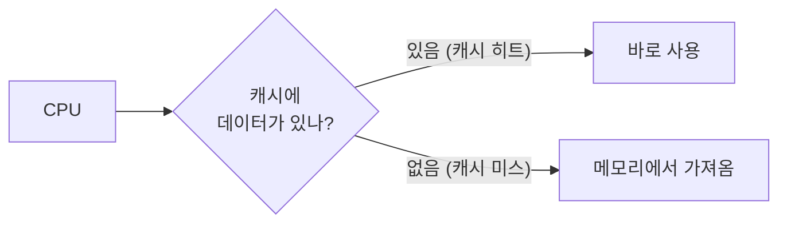
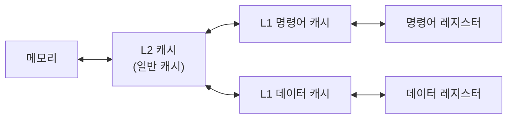
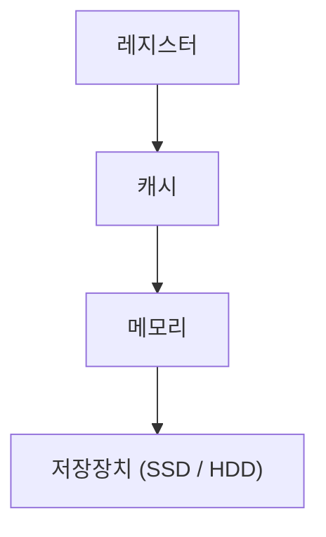
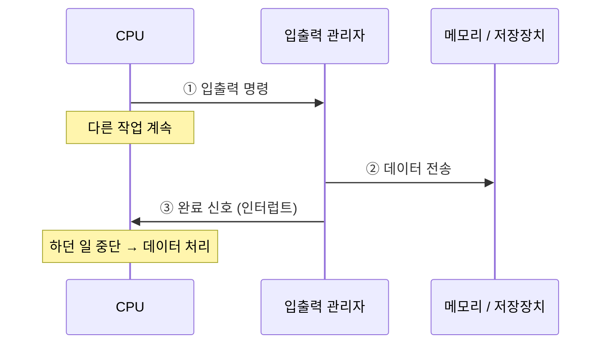
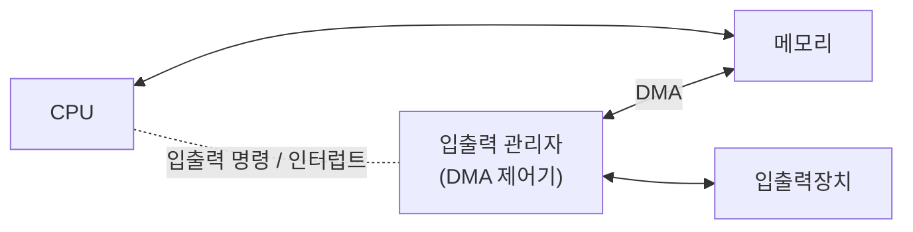

# 3. 컴퓨터 성능 향상 기술

**문제**: CPU는 CPU 내부 버스 속도로, 메모리는 시스템 버스 속도로 동작한다.
→ 메모리를 비롯한 주변장치가 CPU 속도를 따라가지 못한다.

이 장치 간 속도 차이를 줄이기 위한 기술 중 운영체제와 관련된 것들을 살펴본다.

## 3.1 버퍼 (buffer)

속도가 다른 두 장치 사이에서 그 차이를 완화하는 장치. 데이터를 일정량 모아 한꺼번에 옮긴다.

- 비유: 귤 5개를 하나씩 다섯 번 옮기는 대신, 바구니(버퍼) 에 담아 한 번에 옮긴다.
- 느린 입출력장치에서 데이터를 하나씩 보내면 들인 노력에 비해 전송량이 적다. 모아서 보내면 적은 노력으로 많이 옮길 수 있다.

**소프트웨어 버퍼의 예**

- **동영상 스트리밍**: 네트워크 수신 속도와 재생 속도가 다를 수 있다. 영상 일부를 미리 버퍼에 담아 두고 재생해 끊김을 막는다.
- **화면 출력**: 출력 버퍼에 한 줄이 다 차지 않으면 화면에 나오지 않을 수 있다.
  - C의 `printf("Hello\n");`에서 `\n`은 줄 바꿈이면서, 터미널 출력에서는 버퍼 내용을 내보내는 계기도 된다.
  - 그래서 `printf` 끝에 `\n`을 붙이는 습관이 좋다.

### 스풀 (spool)

입출력장치가 독립적으로 동작하도록 고안된 소프트웨어 버퍼

- 예: 프린터 스풀러 — 문서 작업과 프린터 출력이 서로 독립적으로 진행된다.
  - 출력할 내용을 스풀러에 모두 넘기면, 프린터가 출력하는 동안에도 다른 작업을 계속할 수 있다.

> 💡 **하드웨어 안전 제거**
>
> - 버퍼를 쓰면 버퍼가 찰 때까지 실제 전송이 미뤄진다. 저장된 것처럼 보여도 아직 저장되지 않은 데이터가 있을 수 있다.
>   - 그래서 USB에 복사한 직후 바로 뽑거나, 종료 없이 전원 코드를 뽑으면 데이터가 사라지거나 부품이 망가질 수 있다.
> - 하드웨어 안전 제거는 버퍼에 남은 데이터를 저장장치로 마저 보내고, 전원을 차단해 안전하게 뺄 수 있게 해준다.
> - 버퍼 내용을 강제로 내보내는 방법: C 라이브러리의 `fflush()`, 유닉스 명령어 `sync`

## 3.2 캐시 (cache)

메모리와 CPU 간 속도 차이를 완화하기 위해, 메모리의 데이터를 미리 가져와 두는 임시 장소

- 버퍼의 일종. CPU가 앞으로 쓸 것으로 예상되는 데이터를 미리 가져다 둔다. → 미리 가져오기 (prefetch)
- 비유: 간장 10cc가 필요할 때 50cc를 가져다 두면, 다음번엔 장독대까지 가지 않아도 된다.
- 캐시는 CPU 안에 있고 CPU 내부 버스 속도로 동작한다.

### 캐시 히트와 캐시 미스

| 용어 | 의미 |
| --- | --- |
| 캐시 히트 (cache hit) | 원하는 데이터를 캐시에서 찾음 → 바로 사용 |
| 캐시 미스 (cache miss) | 캐시에 없음 → 메모리에서 가져옴 |
| 캐시 적중률 (cache hit ratio) | 캐시 히트 비율. 일반적인 컴퓨터는 약 90% |

### 캐시 적중률을 높이는 방법

1. **캐시 크기를 늘린다.**
   - 더 많이 미리 가져올 수 있어 적중률이 오른다.
   - 같은 클록의 CPU라도 저가형과 고가형은 캐시 크기가 다르다. (예: 4MB vs 8MB 이상)
   - 캐시는 비싸서 수 MB 수준으로만 쓴다.
2. **앞으로 많이 쓸 데이터를 가져온다.** → 지역성 (locality)
   - 현재 위치에 가까운 데이터가 멀리 있는 데이터보다 쓰일 확률이 높다.
   - 예: 10행을 실행 중이면, 101행보다 11행이 다음에 실행될 확률이 높다. → 11~20행을 미리 가져온다.

> 💡 지역성 관점에서 `goto` 문은 피하는 게 좋다. 멀리 점프하면 미리 가져온 데이터가 쓸모없어진다.

### 즉시 쓰기 vs 지연 쓰기

캐시의 데이터가 바뀌면 메모리의 원래 데이터에도 반영해야 한다.

| 방식 | 동작 | 장점 | 단점 |
| --- | --- | --- | --- |
| 즉시 쓰기 (write through) | 변경 즉시 메모리에 반영 | 메모리가 항상 최신 → 정전에도 데이터 유지 | 전송이 잦아 느림 |
| 지연 쓰기 (write back, copy back) | 변경 내용을 모아 주기적으로 반영 | 전송 횟수가 줄어 빠름 | 메모리와 캐시 간 불일치 가능 |

### L1 캐시와 L2 캐시

명령어는 명령어 부분(무슨 작업을 할지)과 데이터 부분(작업 대상)으로 나뉜다. 캐시도 이를 기준으로 나뉜다.

| 레벨 | 종류 | 연결 |
| --- | --- | --- |
| L1 (Level 1) | 특수 캐시: 명령어 캐시 / 데이터 캐시로 구분 | 명령어 레지스터 / 데이터 레지스터에 직접 연결 |
| L2 (Level 2) | 일반 캐시: 명령어·데이터 구분 없이 가져옴 | 메모리와 연결 |

> 참고: 최신 CPU는 여러 코어가 함께 쓰는 L3 캐시까지 두는 경우가 많다.

> 💡 **웹 브라우저 캐시**
>
> - 소프트웨어 캐시의 대표 예. "다시 방문할 것을 예상해 지우지 않고 남겨 둔 데이터"
> - 자주 바뀌지 않는 로고·버튼 이미지 등을 저장해 두었다가, 재방문 시 사용해 속도를 높인다.
> - 너무 많이 쌓이면 오히려 느려질 수 있어 가끔 비워주는 게 좋다.

## 3.3 저장장치의 계층 구조 (storage hierarchy)

**최고 성능을 내려면?**

- 하드디스크 대신 SSD 사용
- 메모리를 하드디스크 크기만큼 확장
- 캐시를 크게 늘려 적중률 향상

→ 하지만 비용이 너무 크다. (예: 1MB에 만 원인 캐시로 4GB를 채우면 약 4,000만 원)

**해결: 가격과 성능의 타협점**

빠르고 비싼 저장장치는 CPU 가까이, 싸고 용량이 큰 저장장치는 멀리 배치한다.
→ 적당한 가격으로 빠른 속도와 큰 용량을 함께 얻는다.

| 방향 | 속도 | 가격 | 용량 |
| --- | --- | --- | --- |
| ↑ CPU 쪽 | 빠름 | 비쌈 | 작음 |
| ↓ 반대쪽 | 느림 | 쌈 | 큼 |

**문제: 데이터 일관성**

같은 데이터가 여러 계층에 중복 저장되므로 일관성 유지가 어렵다.

- 지연 쓰기를 쓰면 캐시와 메모리 내용이 한동안 다르다.
  - 협업 중인 다른 작업이 그 데이터를 읽으면 일관성이 깨진다.
  - 갑자기 전원이 꺼지면 데이터를 잃는다.
- 버퍼를 비우지 않고 하드웨어를 제거해도 일관성이 깨진다.
- 분산 데이터베이스, 병렬 컴퓨터의 분산 메모리에서도 같은 문제가 생긴다.

## 3.4 인터럽트 (interrupt)

### 폴링 vs 인터럽트

| 방식 | 동작 | 요리사 비유 | 효율 |
| --- | --- | --- | --- |
| 폴링 (polling) | CPU가 입출력장치 상태를 주기적으로 직접 검사하고 데이터를 처리 | 요리사가 직접 창고에서 재료를 가져옴 | CPU가 모든 입출력에 관여 → 낮음 |
| 인터럽트 | CPU는 지시만 하고, 입출력 관리자가 처리 후 완료 신호를 보냄 | 주방 보조에게 시키고 요리사는 계속 요리 | 입출력 중에도 CPU가 다른 작업 가능 → 높음 |

- 초기 컴퓨터는 주변장치가 적어 폴링으로 충분했지만, 오늘날은 주변장치가 많아 인터럽트 방식을 쓴다.
- 여기서 입출력 관리자(장치 관리자) 가 주방 보조 역할이다.

### 인터럽트 동작 과정

1. CPU가 입출력 관리자에게 입출력 명령을 보낸다.
2. 입출력 관리자가 데이터를 메모리로 가져오거나, 메모리의 데이터를 저장장치로 옮긴다.
3. 전송이 끝나면 입출력 관리자가 CPU에 완료 신호를 보낸다. → 이 신호가 인터럽트

> "하던 작업을 중단하고 처리해야 하는 신호"라서 인터럽트라고 부른다.

### 인터럽트 번호와 인터럽트 벡터

- **인터럽트 번호 (interrupt number)**: 어떤 장치의 작업이 끝났는지 알리기 위한 장치 고유 번호. OS마다 다르다.
  - 윈도우에서는 IRQ (Interrupt ReQuest) 라고 부른다.
  - 예: 키보드 IRQ 1, 마우스 IRQ 12, 첫 번째 하드디스크 IRQ 14
- **인터럽트 벡터 (interrupt vector)**: 여러 인터럽트를 하나의 배열로 묶은 것
  - 여러 입출력이 동시에 끝날 때마다 인터럽트를 따로 보내면 비효율적이다.
  - 예: 0번과 3번이 동시에 끝나면, CPU는 벡터를 받아 두 작업을 함께 처리한다.

### 다양한 인터럽트

입출력 완료 외에도 인터럽트가 발생하는 경우가 있다.

- 사용자가 전원 버튼으로 강제 종료 → CPU는 처리 중인 데이터를 안전하게 보관한 뒤 종료
- 작업이 자기 메모리 영역을 벗어나 접근하려 할 때
- 0으로 나눌 때

## 3.5 직접 메모리 접근 (DMA, Direct Memory Access)

- 폴링 시절에는 CPU가 메모리·주변장치에 대한 모든 권한을 가졌다.
- 인터럽트 방식에서는 입출력 관리자가 데이터 입출력을 맡는다.
- 그런데 메모리는 원래 CPU만 접근할 수 있는 공간이다.
  → 입출력 관리자가 CPU 허락 없이 메모리에 접근할 수 있는 권한이 필요하다. 이것이 DMA다.
- DMA가 있어야 입출력 관리자가 CPU 관여 없이 작업을 끝낼 수 있다. → 인터럽트 방식의 필수 요소

## 3.6 메모리 매핑 입출력 (MMIO, Memory Mapped I/O)

- DMA를 쓰면 메모리에 CPU용 데이터와 입출력장치용 데이터가 섞인다.
- 섞이면 관리가 어려우므로, 메모리의 일정 공간을 입출력 전용으로 할당한다.
- 이처럼 CPU용 공간과 DMA 입출력용 공간을 분리하는 기법이 메모리 매핑 입출력이다.

## 3.7 사이클 훔치기 (cycle stealing)

- CPU와 DMA가 동시에 메모리에 접근하면, 보통 CPU가 양보한다.
- CPU 입장에서는 DMA가 사이클(순서)을 훔쳐 간 것이라 사이클 훔치기라고 부른다.

**왜 CPU가 양보할까?**

| 이유 | 설명 |
| --- | --- |
| 느린 쪽은 기다리면 손해가 크다 | 입출력장치는 작은 버퍼에 데이터를 담아 메모리로 옮긴다. 제때 못 옮기면 버퍼가 넘치거나 장치가 멈춘다. 반면 CPU는 캐시·레지스터로 잠깐은 버틸 수 있다. |
| 입출력장치는 가끔, 짧게만 쓴다 | CPU가 메모리에 수억 번 접근하는 사이 입출력장치는 드문드문 끼어드는 정도다. CPU가 그때마다 양보해도 전체 손해는 작다. 반대로 CPU가 항상 우선이면 입출력장치는 거의 일을 못 한다. |

> 비유: 바쁜 엘리베이터에서 계속 오가는 직원(CPU)이 가끔 오는 택배 기사(입출력장치)에게 한 번 양보하는 것이 전체적으로 이득이다.

---

[← CPU와 메모리](./02-CPU와-메모리.md) | [목차](./README.md) | [병렬 처리 →](./04-병렬-처리.md)
