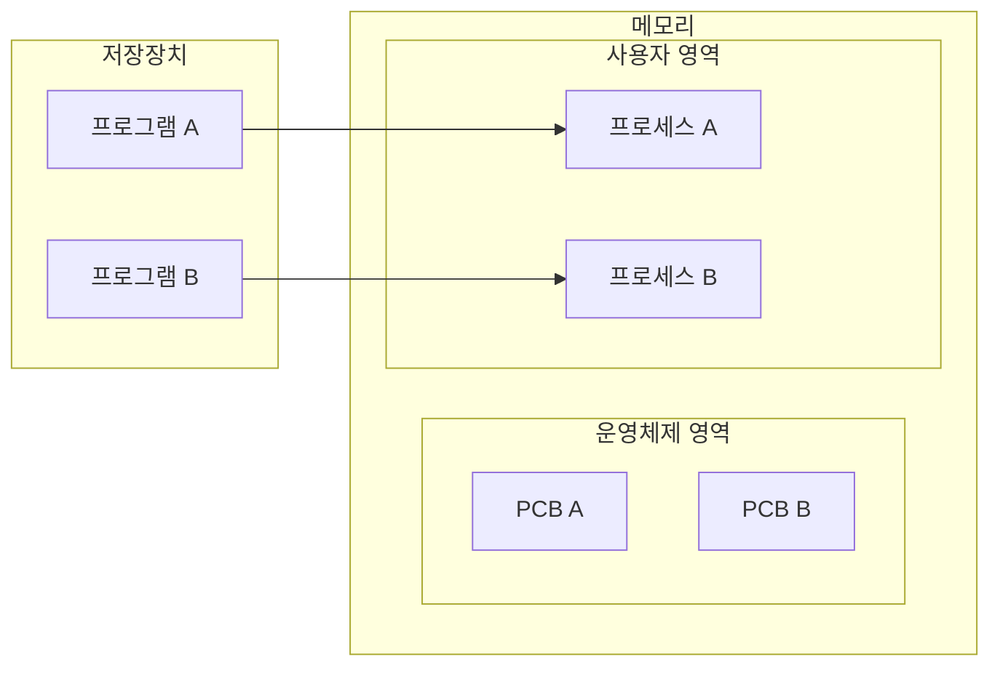
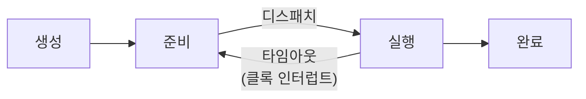
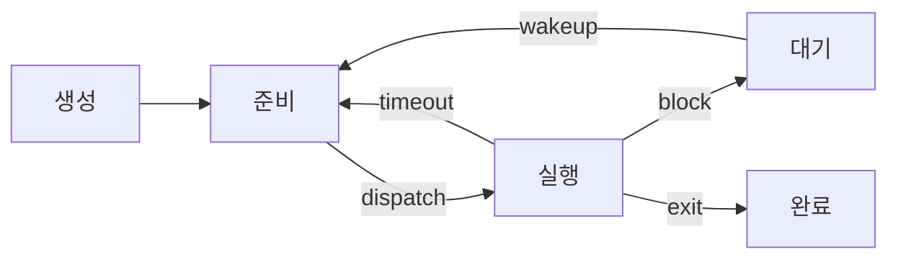
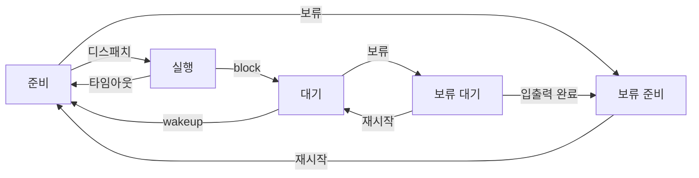

# 1. 프로세스의 개요

프로세스는 운영체제에서 하나의 작업 단위다. 프로그램을 실행하면 그 프로그램은 프로세스가 된다.

## 1.1 프로세스의 개념

| 구분 | 프로그램 (program) | 프로세스 (process) |
| --- | --- | --- |
| 위치 | 저장장치 | 메모리 |
| 상태 | 정적 | 동적 |
| 표현 | "짠다", "작성한다" | "실행한다" |
| 의미 | 어떤 데이터로 어떤 작업을 할지 적어 놓은 절차 | 그 절차를 실제로 실행에 옮긴 것 |

- 폰노이만 구조에서 프로그램이 실행된다는 것은 코드가 메모리에 올라와 작업이 진행된다는 뜻이다.
- 비유: 프로그램은 레시피, 프로세스는 레시피대로 만드는 요리다.

## 1.2 요리사 모형으로 이해하기

레스토랑에서 주문이 들어와 요리가 나가기까지의 과정은 운영체제가 프로세스를 처리하는 과정과 비슷하다.

| 레스토랑 | 운영체제 |
| --- | --- |
| 요리사 | CPU |
| 주문서 | 프로세스 제어 블록 (PCB) |
| 주문서의 일련번호 | 프로세스 구분자 (PID) |
| 주문 목록 | 준비 상태 (준비 큐) |
| 대기 목록 | 대기 상태 |
| 보류 목록 | 보류 상태 |

### 주문서의 역할

- 주문서에는 일련번호, 테이블 번호, 인원, 선택한 코스, 특별 요청(굽기 정도 등)이 적혀 있다.
- 조리 방법과 요리가 나가는 순서를 결정하는 핵심 자료다.
- 요리가 진행되는 동안 현재 어디까지 제공했는지도 표시된다.

### 일괄 작업 방식의 요리

- 테이블이 하나뿐인 레스토랑과 같다. 한 번에 한 손님만 받고, 식사가 끝나야 다음 손님을 받는다.
- 주문서는 받은 순서대로 처리한다. → 주문 목록은 큐로 관리된다.
- 순서가 단순하지만, 손님이 식사하는 동안 요리사가 쉬게 되어 효율이 떨어진다.

> [!TIP]
> **큐와 스택**
>
> - 큐 (queue): 먼저 들어온 데이터가 먼저 나간다. 양쪽이 뚫린 파이프
> - 스택 (stack): 먼저 들어온 데이터가 마지막에 나간다. 한쪽만 뚫린 파이프

### 시분할 방식의 요리

- 손님이 식사하는 동안 다른 테이블의 요리를 만든다.
- 요리사는 주문 목록에서 주문서를 하나 꺼내 단품 요리 하나를 만들고, 그 주문서를 목록 맨 뒤로 보낸다.
- 요리사는 1명이지만, 시간을 나눠 쓰면 여러 명이 있는 것처럼 모든 테이블에 지체 없이 요리를 낼 수 있다.
  → CPU가 1개여도 시간을 쪼개 여러 프로세스에 나눠 주면 동시에 실행되는 것처럼 보인다.
- 주문서가 주문 목록에 올라오면 요리 시작, 모든 요리가 나가면 주문서 삭제 = 작업 종료

### 예상치 못한 상황 처리

**새우가 손질되지 않았다면** (→ 대기 상태)

- 보조 요리사에게 손질을 맡기고, 주문서를 대기 목록으로 옮긴 뒤 다른 요리를 한다.
- 손질이 끝나도 하던 요리를 마저 끝낸다. 그 주문서는 주문 목록으로 보내 순서를 기다리게 한다. (→ 대기에서 준비로)

**손님이 요리를 천천히 달라고 하면** (→ 보류 상태)

- 언제 재개할지 모르므로 주문서를 보류 목록으로 옮긴다.
- 손님이 다시 요청하면 주문 목록으로 보내고, 식사를 포기하면 주문서를 폐기한다.

- 대기 목록은 끝나는 시점을 예측할 수 있는 작업, 보류 목록은 언제 재개될지 또는 중단될지 모르는 작업이다.

## 1.3 프로그램에서 프로세스로의 전환

프로세스는 컴퓨터 시스템의 작업 단위로, 태스크 (task)라고도 부른다.

프로그램이 프로세스가 될 때 운영체제는 다음 두 가지를 한다.

1. 프로그램을 메모리의 적당한 위치로 가져온다.
2. 작업 지시서인 **프로세스 제어 블록 (PCB, Process Control Block)** 을 만든다.

### PCB의 대표 정보

| 정보 | 내용 | 요리사 모형 |
| --- | --- | --- |
| 프로세스 구분자 (PID) | 메모리의 여러 프로세스를 구분하는 번호 | 주문서 일련번호 |
| 메모리 관련 정보 | 프로세스가 메모리 어디에 있는지, 메모리 보호용 경계·한계 레지스터 | 테이블 번호 |
| 각종 중간값 | 다음에 실행할 위치(프로그램 카운터)와 작업 중인 레지스터 값 | 어떤 요리까지 나갔는지 |

- 시분할 시스템에서는 여러 프로세스가 번갈아 실행된다.
- 예: 프로세스 A가 103행까지 실행하고 CPU를 넘겼다면, 다음 차례에 104행부터 이어서 실행해야 한다.
  → 그래서 PCB에 프로그램 카운터와 레지스터 값을 저장해 둔다.

### 프로세스와 PCB의 관계



- PCB는 운영체제가 관리하는 데이터 구조라서 **운영체제 영역**에 만들어진다.
- 프로세스가 종료되면 프로세스는 메모리에서 삭제되고 PCB도 폐기된다.

> [!IMPORTANT]
> **프로세스 = 프로그램 + PCB**
>
> - 프로그램이 프로세스가 된다 = 운영체제로부터 PCB를 받는다
> - 프로세스가 종료된다 = PCB가 폐기된다

### 사용자 프로세스와 커널 프로세스

- 운영체제도 프로그램이므로 프로세스 형태로 실행된다.
- 부팅 때 부트스트랩이 운영체제 관련 프로세스를 먼저 실행하고, 그 뒤에 일반 프로세스가 실행된다.
- 그래서 컴퓨터에는 사용자 프로세스 (user process)와 커널 프로세스 (kernel process)가 섞여서 실행된다.

## 1.4 프로세스의 상태

- 일괄 작업 시스템: 생성 (create) → 실행 (run) → 완료 (terminate)
- 시분할 시스템: 실행 중인 프로세스가 다른 프로세스에 CPU를 자주 넘겨주므로 상태가 더 복잡하다.

### 네 가지 상태



| 상태 | 설명 |
| --- | --- |
| 생성 (create) | 프로세스가 메모리에 올라와 실행 준비를 마친 상태. PCB가 생성된다 |
| 준비 (ready) | CPU를 얻을 때까지 기다리는 상태. 레스토랑의 주문 목록 |
| 실행 (running) | CPU를 얻어 실제로 작업하는 상태. 정해진 시간 동안만 CPU를 쓸 수 있다 |
| 완료 (terminate) | 작업을 마치고 PCB가 사라진 상태 |

**관련 용어**

- CPU 스케줄러 (CPU scheduler): 준비 상태의 프로세스 중 다음에 실행할 프로세스를 고르고, 모든 상태 전환을 관리한다.
- 디스패치 (dispatch): CPU 스케줄러가 준비 상태의 프로세스 하나를 실행 상태로 바꾸는 작업
- 타임 슬라이스 (time slice): 프로세스에 배당된 작업 시간. 타임 퀀텀 (time quantum)이라고도 한다.
- 타임아웃 (time out): 타임 슬라이스 안에 작업을 끝내지 못해 준비 상태로 돌아가는 것
  - 프로세스가 실행 상태에 들어가면 CPU는 클록에 "타임 슬라이스가 지나면 알려 달라"고 알람을 맞춘다.
  - 시간이 되면 클록이 인터럽트로 알린다. 그래서 타임아웃은 정확히는 클록 인터럽트다.

### 다섯 가지 상태

**대기 상태가 필요한 이유**

- 실행 중인 프로세스가 입출력을 요청하면, 입출력이 끝날 때까지 다음 작업을 할 수 없다.
- 이 프로세스를 실행 상태에 그대로 두면 CPU도 놀게 된다.
- 그래서 입출력을 요청한 프로세스를 대기 상태로 옮기고, 그동안 다른 프로세스를 실행한다.



| 상태 | 설명 | 관련 작업 |
| --- | --- | --- |
| 생성 | 프로그램이 메모리에 올라오고 PCB를 할당받은 상태 | 메모리 할당, PCB 생성 |
| 준비 | 실행을 기다리는 모든 프로세스가 차례를 기다리는 상태 | `dispatch(PID)`: 준비 → 실행 |
| 실행 | 선택된 프로세스가 타임 슬라이스 동안 CPU를 사용하는 상태 | `timeout(PID)`: 실행 → 준비<br/>`exit(PID)`: 실행 → 완료<br/>`block(PID)`: 실행 → 대기 |
| 대기 | 입출력을 요청한 프로세스가 완료를 기다리는 상태 | `wakeup(PID)`: 대기 → 준비 |
| 완료 | 프로세스가 종료된 상태 (정상 종료 `exit`, 비정상 종료 `abort`) | 메모리 삭제, PCB 삭제 |

**상태별 보충**

- **준비**: PCB는 준비 큐 (ready queue)에서 기다린다. 실제로는 준비 큐를 여러 개 운영하며, 몇 개를 둘지와 어떤 PCB를 실행할지는 CPU 스케줄러가 정한다.
- **실행**: 실행 상태에 들어갈 수 있는 프로세스 수는 CPU 개수만큼이다.
- **대기**: blocking 또는 wait 상태라고도 한다.
  - 입출력장치별로 마련된 큐에서 기다린다.
  - 입출력이 끝나면 인터럽트가 발생하고, 해당 프로세스를 찾아 깨운다. (`wakeup`)
  - 입출력이 끝나도 실행 상태로 바로 가지 않고 준비 상태로 간다. 바로 가려면 지금 실행 중인 프로세스를 내보내야 해서 복잡해지기 때문이다.
- **완료**: 코드와 데이터를 메모리에서 지우고 PCB를 폐기한다.
  - 오류 등으로 강제 종료 (abort)되면, 직전 메모리 상태를 저장장치에 저장한다. 이를 **코어 덤프 (core dump)** 라고 하며 디버깅에 쓴다.

## 1.5 휴식 상태와 보류 상태

생성·준비·실행·대기·완료의 다섯 상태를 **활성 상태 (active status)** 라고 한다. 그 밖에 특별한 경우의 상태가 두 가지 있다.

### 휴식 상태 (pause status)

프로세스가 작업을 **잠시 멈춘** 상태다.

- 데이터가 메모리에 그대로 있고 PCB도 유지되므로, 멈춘 지점부터 다시 시작 (resume)할 수 있다.
- 유닉스에서 실행 중에 `Ctrl + Z`를 누르면 볼 수 있다. 종료된 것처럼 보이지만 실제로는 정지 (stopped) 상태다.

```bash
$ sleep 100
^Z
[1]+  Stopped                 sleep 100
$ jobs
[1]+  Stopped                 sleep 100
$ bg
[1]+ sleep 100 &
$ jobs
[1]+  Running                 sleep 100 &
```

- `fg` (foreground job): 정지된 작업을 앞에서 다시 시작
- `bg` (background job): 정지된 작업을 뒤에서 다시 시작. 백그라운드 명령어는 끝에 `&`가 붙는다.
- 반면 `Ctrl + C`는 강제 종료다. 메모리와 PCB가 모두 사라져 처음부터 다시 실행해야 한다.

### 보류 상태 (suspend status)

프로세스가 **메모리에서 잠시 쫓겨난** 상태다. 일시 정지 상태라고도 한다.

**보류 상태가 되는 경우**

- 메모리가 꽉 차서 일부 프로세스를 내보내야 할 때
- 프로그램에 오류가 있어 실행을 미뤄야 할 때
- 바이러스처럼 악의적인 프로세스로 판단될 때
- 아주 긴 주기로 반복되는 프로세스라 내보내도 문제가 없을 때
- 입출력을 기다리는 프로세스의 입출력이 계속 지연될 때

대부분 성능을 떨어뜨리거나, 실행을 미뤄도 큰 지장이 없는 프로세스다.

- 보류 상태의 프로세스는 **스왑 영역 (swap area)** 에 보관된다. 메모리에서 쫓겨난 데이터를 임시로 두는 곳이다.

| 구분 | 위치 | 상태 |
| --- | --- | --- |
| 휴식 상태 | 메모리 | 멈춰 있음 |
| 보류 상태 | 스왑 영역 | 메모리에서 쫓겨남 |

**보류 준비와 보류 대기**



- 보류 준비 (ready suspend): 준비 상태에서 옮겨진 보류 상태
- 보류 대기 (blocked suspend): 대기 상태에서 옮겨진 보류 상태
- 재시작하면 원래의 활성 상태로 돌아간다.
- 보류 대기 상태에서 입출력이 끝나면, 활성 상태가 아니라 보류 준비 상태로 옮겨간다.

---

[목차](./README.md) | [프로세스 제어 블록과 문맥 교환 →](./02-프로세스-제어-블록과-문맥-교환.md)
