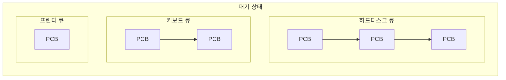
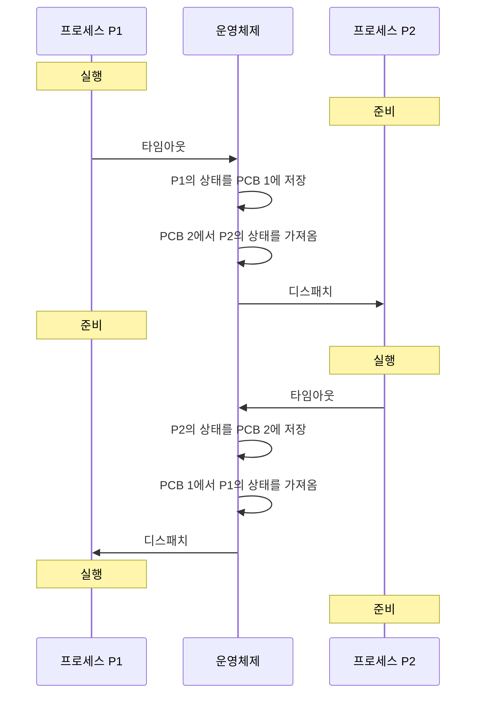

# 2. 프로세스 제어 블록과 문맥 교환

## 2.1 프로세스 제어 블록 (PCB, Process Control Block)

프로세스를 실행하는 데 필요한 중요한 정보를 보관하는 자료 구조다. TCB (Task Control Block)라고도 한다.

- 모든 프로세스는 고유의 PCB를 가진다.
- 프로세스가 생성될 때 만들어지고, 실행을 마치면 폐기된다.

### PCB의 구성

| 순서 | 항목 | 내용 |
| --- | --- | --- |
| 1 | 포인터 | 준비 큐·대기 큐를 구현할 때 PCB끼리 연결하는 데 사용 |
| 2 | 프로세스 상태 | 생성, 준비, 실행, 대기, 보류 준비, 보류 대기 등 현재 상태 |
| 3 | 프로세스 구분자 (PID) | 여러 프로세스를 구별하는 번호 |
| 4 | 프로그램 카운터 | 다음에 실행할 명령어의 위치 |
| 5 | 프로세스 우선순위 | 실행 순서와 빈도를 정하는 기준 |
| 6 | 각종 레지스터 정보 | 실행 중 사용하던 레지스터 값 |
| 7 | 메모리 관리 정보 | 메모리 위치, 경계·한계 레지스터 값, 세그먼테이션·페이지 테이블 |
| 8 | 할당된 자원 정보 | 사용 중인 입출력 자원, 열린 파일 등 |
| 9 | 계정 정보 | 계정 번호, CPU 할당 시간, CPU 사용 시간 등 |
| 10 | PPID와 CPID | 부모 프로세스 구분자, 자식 프로세스 구분자 |

**항목별 보충**

- **프로세스 우선순위**
  - 프로세스마다 중요도가 다르다. 커널 프로세스는 사용자 프로세스보다 우선순위가 높고, 사용자 프로세스끼리도 우선순위가 다르다.
  - 그래서 준비 큐도 우선순위별로 여러 개 운영된다.
  - CPU 스케줄러는 우선순위를 기준으로 실행할 프로세스를 고른다. 높은 우선순위의 프로세스가 먼저, 더 자주 실행된다.
- **각종 레지스터 정보**
  - 2장의 레지스터 외에 누산기 (accumulator), 색인 레지스터 (index register), 스택 포인터 (stack pointer) 등의 값을 저장한다.
  - 이전에 쓰던 중간값을 보관해야 다음 차례에 이어서 실행할 수 있다.
- **할당된 자원 정보**
  - 예: 하드디스크의 파일을 열어 작업 중이거나, 음악 재생을 위해 사운드카드에 접근 중이라면 그 정보를 저장한다.
- **PPID와 CPID**
  - PPID (Parent PID): 부모 프로세스 (parent process)를 가리킨다.
  - CPID (Child PID): 자식 프로세스 (child process)를 가리킨다.

### 포인터의 역할

PCB 맨 위의 포인터는 같은 큐에 있는 PCB들을 연결하는 데 쓰인다.

**대기 큐 (waiting queue)**

- 시스템에는 입출력장치가 여러 종류라서, 대기 상태의 프로세스도 다양하다.
- 이들을 한곳에 모아 두면, 예를 들어 하드디스크 인터럽트가 왔을 때 해당 프로세스를 찾으려고 대기 중인 모든 프로세스를 뒤져야 한다.
- 그래서 **같은 입출력을 기다리는 프로세스끼리** 같은 큐에 모아 둔다.

**입출력이 끝나면**

1. 하드디스크에서 완료 인터럽트가 온다.
2. 하드디스크 큐에서 해당 PCB를 찾는다.
3. PCB의 상태를 준비 상태로 바꾸고, 하드디스크 큐에서 빼서 준비 큐로 옮긴다.

- 준비 큐도 대기 큐처럼 여러 개다. 프로세스 우선순위에 따라 나뉜다.

## 2.2 문맥 교환 (context switching)

### 문맥 교환의 의미

**요리사 모형**

요리사가 13번 주문서의 새우튀김을 끝내고 14번 주문서의 등심 요리로 넘어간다고 하자.

1. 13번 주문서에 새우튀김을 마쳤다고 표시한다.
2. 새우튀김에 쓰던 재료와 도구를 치운다.
3. 13번 주문서를 주문 목록으로 보내고, 14번 주문서를 가져온다.
4. 등심 요리에 필요한 재료와 도구를 가져온다.

→ 작업 전환은 주문서를 바꾸는 동시에 **작업 환경도 바꾸는** 것이다.

**운영체제에서**

CPU를 차지하던 프로세스가 나가고 새 프로세스를 받아들이는 작업이다.

- 나가는 프로세스의 PCB에는 지금까지의 작업 내용을 저장한다.
- 들어오는 프로세스의 PCB 내용으로 CPU를 다시 세팅한다.
- 이처럼 두 프로세스의 PCB를 교환하는 작업이 문맥 교환이다.

### 문맥 교환의 절차

1. 실행 중인 P1이 타임 슬라이스를 다 써서 타임아웃이 된다.
2. P1의 작업 결과가 PCB 1에 저장되고, P1은 준비 상태로 간다.
3. 준비 상태의 P2가 실행 상태가 되면, CPU 레지스터가 PCB 2의 값으로 채워져 작업을 이어간다.

### 문맥 교환이 일어나는 경우

- 프로세스가 주어진 시간(타임 슬라이스)을 다 썼을 때
- 인터럽트가 걸렸을 때
  - 예: 프로세스가 자기 메모리 영역을 벗어나 경계 레지스터 범위를 넘으면 인터럽트가 발생한다.
  - 현재 프로세스의 PCB를 저장하고, 인터럽트 관리 프로세스를 실행 상태로 만든다.
  - 인터럽트 관리 프로세스는 문제를 일으킨 프로세스를 강제 종료하고 처리를 마친다.

---

[← 프로세스의 개요](./01-프로세스의-개요.md) | [목차](./README.md)
