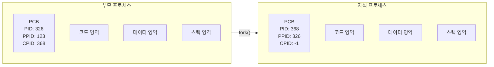
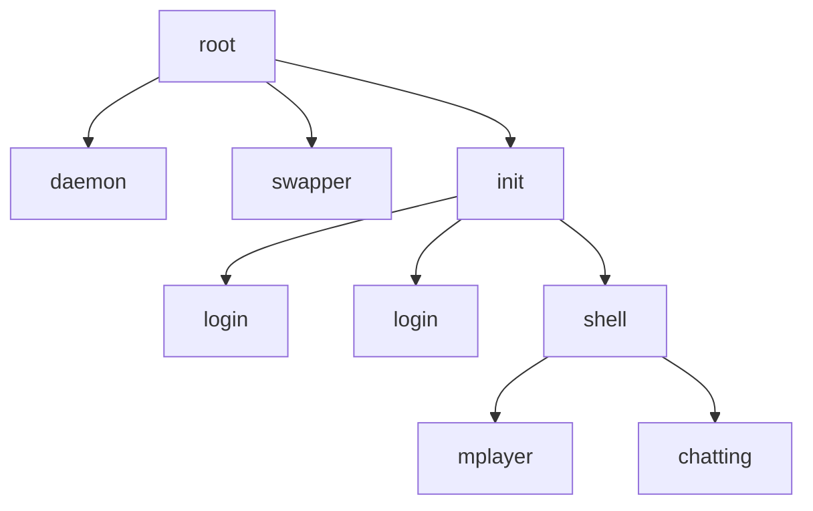

# 3. 프로세스의 연산

프로세스가 어떻게 생성되고 복사되는지 살펴본다. 그 전에 프로세스의 구조부터 알아본다.

## 3.1 프로세스의 구조

프로세스는 코드 영역, 데이터 영역, 스택 영역으로 구성된다.

| 영역 | 스파게티 비유 | 내용 | 권한 |
| --- | --- | --- | --- |
| 코드 영역 (code area) | 요리책 | 프로그램 본문. 텍스트 영역 (text area)이라고도 한다 | 읽기 전용 |
| 데이터 영역 (data area) | 재료 | 코드가 실행되며 쓰는 변수, 파일 등의 데이터 | 읽기·쓰기 (상수는 읽기 전용) |
| 스택 영역 (stack area) | 칼, 도마, 냄비 같은 조리 도구 | 프로세스 실행에 부수적으로 필요한 데이터 (예: 함수 호출 후 돌아올 위치) | 읽기·쓰기, 사용자에게 보이지 않음 |

- 예: 워드프로세서를 실행하면
  - 프로그램은 코드 영역에
  - 편집 중인 문서는 데이터 영역에
  - 워드프로세서를 동작시키기 위한 부가 데이터는 스택 영역에 올라간다.
- 데이터 영역은 다시 일반 데이터 영역과 **힙 (heap)** 영역으로 나뉜다.


## 3.2 프로세스의 생성과 복사

**새로 생성**

1. 운영체제가 프로그램을 메모리로 가져와 코드 영역에 넣는다.
2. PCB를 만든다.
3. 데이터 영역과 스택 영역을 확보한 뒤 실행한다.

**복사**

실행 중인 프로세스를 복사해서 새 프로세스를 만들 수도 있다. 비유하면 같은 요리를 처음부터 다시 만드는 대신 복제해서 내놓는 것이다.

### fork() 시스템 호출

> [!IMPORTANT]
> **fork()**: 실행 중인 프로세스를 복사하는 시스템 호출
> 원래 프로세스는 부모 프로세스, 새로 생긴 프로세스는 자식 프로세스가 되어 부모-자식 관계로 연결된다.

- 책의 예: 워드프로세서를 하나 더 실행하거나, 크롬에서 `Ctrl + N`으로 새 창을 열면 기존 프로세스를 복사한다.

> [!WARNING]
> 실제로는 두 예 모두 fork()와 다르게 동작하는 경우가 많다. 예를 들어 크롬의 새 창은 보통 같은 브라우저 프로세스 안에서 열린다. fork()의 개념을 이해하기 위한 비유 정도로 보면 된다.

### fork()의 동작 과정

fork()를 호출하면 PCB를 포함한 부모 프로세스 영역의 대부분이 자식에게 복사된다. 단, PCB 중 다음 항목은 달라진다.

| 항목 | 부모 | 자식 | 이유 |
| --- | --- | --- | --- |
| PID | 326 | 368 | 서로 다른 프로세스이므로 |
| 메모리 관련 정보 | 부모 위치 | 자식 위치 | 차지하는 메모리 위치가 다르므로 |
| PPID | 123 | 326 | 자식의 부모는 326 |
| CPID | 368 | -1 | 자식은 아직 자식이 없음 |



### fork()의 장점

1. 생성 속도가 빠르다. 하드디스크에서 프로그램을 새로 가져오지 않고 메모리에서 복사한다.
2. 자원을 그대로 상속한다. 부모가 초기화한 파일 등을 자식이 추가 작업 없이 바로 쓸 수 있다.
3. 시스템 관리가 효율적이다. PPID·CPID로 연결되어 있어, 자식이 끝나면 부모가 자식의 자원(메모리, 파일, 하드웨어)을 정리할 수 있다.

> [!TIP]
> **Copy-on-Write (CoW)**
>
> 현대 유닉스 계열 OS는 fork() 때 메모리를 바로 복사하지 않는다. "일단 같이 쓰다가, 누군가 고칠 때만 복사"한다.
>
> - **왜 필요한가**: 메모리를 통째로 복사하면 느리다. 게다가 fork() 직후 바로 exec()를 부르는 경우가 많아서, 복사한 메모리를 곧바로 버리게 된다.
> - **동작 방식**
>   1. fork() 직후 부모와 자식이 같은 메모리를 가리키고, 그 메모리를 읽기 전용으로 표시한다.
>   2. 읽기만 하는 동안에는 그대로 공유한다.
>   3. 한쪽이 쓰려고 하면 운영체제가 그 부분(페이지, 보통 4KB)만 복사한 뒤 쓰기를 허용한다.
> - **효과**: fork()가 빨라지고, 수정한 부분만 복사하므로 메모리도 아낀다.
>
> ```
> fork() 직후          자식이 x를 수정하면
> 부모 ─┐              부모 ── [x = 1]
>       ├─ [x = 1]
> 자식 ─┘              자식 ── [x = 2]  ← 이 페이지만 새로 복사
> ```

### fork() 코드 예시

```c
#include <stdio.h>
#include <stdlib.h>
#include <unistd.h>

int main() {
    int pid;
    pid = fork();              // 프로세스 복사

    if (pid < 0) {             // 복사 실패
        printf("Error");
        exit(-1);
    } else if (pid == 0) {     // 자식 프로세스
        printf("Child");
        exit(0);
    } else {                   // 부모 프로세스
        printf("Parent");
        exit(0);
    }
}
```

- fork()가 반환하는 값
  - 부모 프로세스: 0보다 큰 값 (자식의 PID)
  - 자식 프로세스: 0
  - 실패: 0보다 작은 값
- 그래서 `Parent`와 `Child`가 둘 다 출력된다.
- fork() 이전에 연 파일이나 선언한 변수는 모두 자식에게 상속된다.
- 부모와 자식은 독립적으로 실행되므로, 어느 쪽이 먼저 출력될지는 알 수 없다.

> [!WARNING]
> 책의 코드에서 `void main()`은 `int main()`으로, 빠져 있던 `<stdlib.h>`(`exit` 사용)를 추가했다.

## 3.3 프로세스의 전환

fork()로 복사한 요리를 아예 다른 요리로 바꾸고 싶다면 exec()를 쓴다.

### exec() 시스템 호출

> [!IMPORTANT]
> **exec()**: 이미 만들어진 프로세스의 구조를 재활용해, 내용만 새 프로그램으로 바꾸는 시스템 호출

| 시스템 호출 | 스파게티 비유 | 하는 일 |
| --- | --- | --- |
| fork() | 스파게티를 하나 더 만든다 | 새 프로세스를 복사 |
| exec() | 스파게티를 우동으로 바꾼다 | 프로세스는 그대로 두고 내용만 바꿈 |
| fork() + exec() | 스파게티를 복사해 우동으로 바꾼다 | 새 프로그램을 자식 프로세스로 실행 |

**왜 재활용하는가?**

- 새 프로세스를 만들려면 PCB 생성, 메모리 확보, 종료 후 자원 정리를 위한 부모-자식 관계 설정이 필요하다.
- exec()를 쓰면 이미 있는 PCB, 메모리 영역, 부모-자식 관계를 그대로 쓰고 **새 코드만 가져오면** 된다.

### exec()의 동작 과정

| 구분 | 변화 |
| --- | --- |
| 코드 영역 | 기존 내용을 지우고 새 코드로 교체 |
| 데이터 영역 | 새 변수로 채움 |
| 스택 영역 | 리셋 |
| PCB: PID, PPID, CPID, 메모리 관련 정보 | 그대로 유지 |
| PCB: 프로그램 카운터 등 레지스터, 사용한 파일 정보 | 리셋 |

- 마치 프로세스를 처음 시작하는 것처럼 정리된다.
- fork()는 새 프로세스를 하나 복사하는 것, exec()는 구조는 그대로 두고 내용만 바꿔 새로 실행하는 것이다.

> [!NOTE]
> 실제 유닉스에서는 열려 있던 파일이 exec() 후에도 기본적으로 유지된다. 닫히도록 따로 설정(close-on-exec)한 파일만 정리된다.

### exec() 코드 예시

fork()와 exec()를 함께 써서 뮤직 플레이어 `mplayer`를 실행하는 코드다.

```c
#include <stdio.h>
#include <stdlib.h>
#include <unistd.h>
#include <sys/wait.h>

int main() {
    int pid;
    pid = fork();

    if (pid < 0) {
        printf("Error");
        exit(-1);
    } else if (pid == 0) {                        // 자식 프로세스
        execlp("mplayer", "mplayer", NULL);       // 코드 영역이 mplayer로 바뀜
        exit(0);
    } else {                                      // 부모 프로세스
        wait(NULL);                               // 자식이 끝날 때까지 대기
        printf("mplayer Terminated");
        exit(0);
    }
}
```

1. 부모가 fork()로 자식을 만들고, `wait()`로 자식이 끝날 때까지 기다린다. (자식과의 동기화)
2. 자식이 `execlp()`를 실행하는 순간, 코드 영역이 mplayer로 바뀌어 처음부터 실행된다.
3. mplayer가 끝나면 부모의 `wait()` 다음으로 돌아와 `mplayer Terminated`를 출력한다.

- exec() 후에도 PID, PPID, CPID가 바뀌지 않기 때문에 자식이 끝난 뒤 부모로 돌아올 수 있다.
- exec()는 인자 형식에 따라 `execl()`, `execlp()`, `execv()`, `execvp()` 등이 있으며 기능은 같다.

> [!WARNING]
> 책 코드의 `pid=0`은 `pid==0`의 오타라 고쳤다.

## 3.4 프로세스의 계층 구조

### 유닉스의 프로세스 계층 구조

- 커널이 부팅되면 커널 관련 프로세스를 여러 개 만든다.
- 그중 **init 프로세스**가 일반 사용자 프로세스의 출발점이다.
- 나머지 프로세스는 모두 init의 자식으로, fork()와 exec()로 만들어져 **트리 구조**를 이룬다.



> [!NOTE]
> 최신 리눅스에서는 init 대신 **systemd**가 PID 1로 이 역할을 한다.

### 계층 구조의 장점

**1. 여러 작업의 동시 처리**

- login 프로세스는 한 번에 1명만 처리할 수 있다.
  → 사용자가 접속할 때마다 fork()로 login 프로세스를 복사해 나눠 준다.
- 로그인이 끝나면 명령을 처리할 shell 프로세스가 필요하다.
  - login을 종료하고 shell을 새로 만들면 메모리 정리, PCB 삭제, 메모리 할당, PCB 생성을 다시 해야 해서 비효율적이다.
  - 대신 exec()로 login 프로세스를 shell 프로세스로 바꾼다. 자원도 재활용하고 부모-자식 관계도 유지된다.
- shell에서 프로그램(예: mplayer)을 실행할 때도 fork()로 자식 shell을 만든 뒤 exec()로 mplayer로 바꾼다.

**2. 자원 회수가 쉽다**

- 부모-자식 관계로 책임이 분명해진다.
- 자식이 끝나면 부모가 자식의 자원을 회수 (garbage collection)하면 된다.
- 모든 프로세스가 독립적이었다면 운영체제가 매번 직접 회수해야 해서 복잡해진다.

### 고아 프로세스와 좀비 프로세스

부모는 자원을 회수하려고 자식이 끝날 때까지 기다린다. 그런데 연락이 끊기면 자원이 남는다.

| 구분 | 발생 원인 |
| --- | --- |
| 고아 프로세스 (orphan process) | 부모가 자식보다 먼저 종료됨 |
| 좀비 프로세스 (zombie process) | 자식은 종료됐는데 부모가 뒤처리를 하지 않음 |

- 이런 프로세스가 많아지면 자원이 낭비되므로, 운영체제는 반환되지 않은 자원을 주기적으로 회수해야 한다.

> [!NOTE]
> 유닉스에서는 고아 프로세스를 init(systemd)이 새 부모로 입양해 대신 정리해 준다.

**exit()와 return()의 역할**

```c
int main() {
    printf("Hello \n");
    exit(0);
}
```

- `main()` 끝의 `exit()`나 `return`은 자식 프로세스가 작업을 마쳤음을 부모에게 알린다.
- 안 쓴다고 문제가 생기거나 좀비가 되는 건 아니다.
- 다만 알려 주면, 부모가 미뤄 둔 자원 정리나 자식과의 동기화를 할 수 있다.

> [!TIP]
> **객체지향 언어와의 관계 (책의 관점)**
>
> - 프로세스의 복사, 상속, 계층 구조는 객체지향 언어의 기본 개념과 닮았다.
> - 예: 자바에서는 모든 객체가 최상위 클래스 `Object`의 자식이고, 상위 객체의 특징을 상속한다.

> [!TIP]
> **컴퓨터를 오래 켜 두면 느려지는 이유**
>
> - 부팅 때 없던 프로세스들이 메모리에 상주하고, 제대로 정리되지 않은 자원이 쌓이기 때문이다.
> - 재부팅하면 이런 찌꺼기가 사라져 다시 빨라진다.

---

[← 프로세스 제어 블록과 문맥 교환](./02-프로세스-제어-블록과-문맥-교환.md) | [목차](./README.md)
