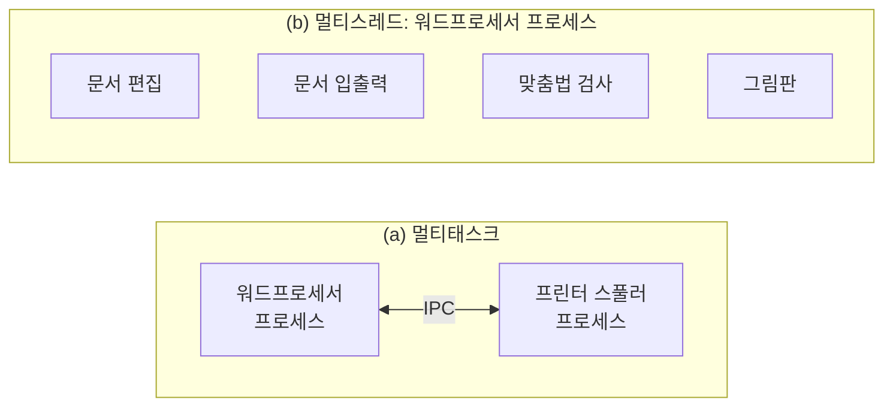
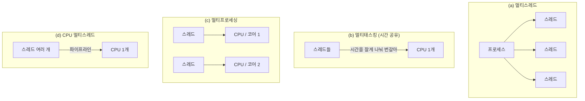
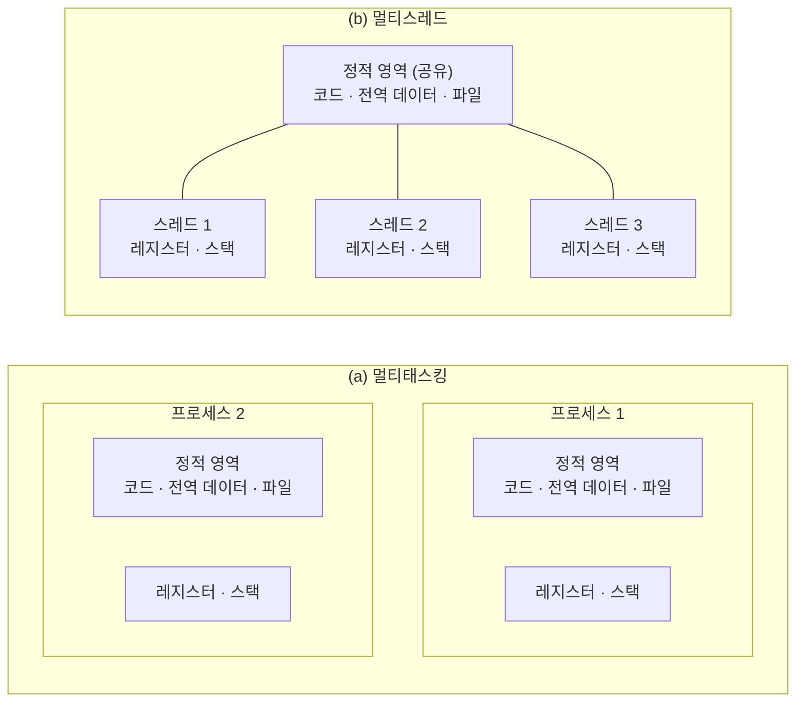
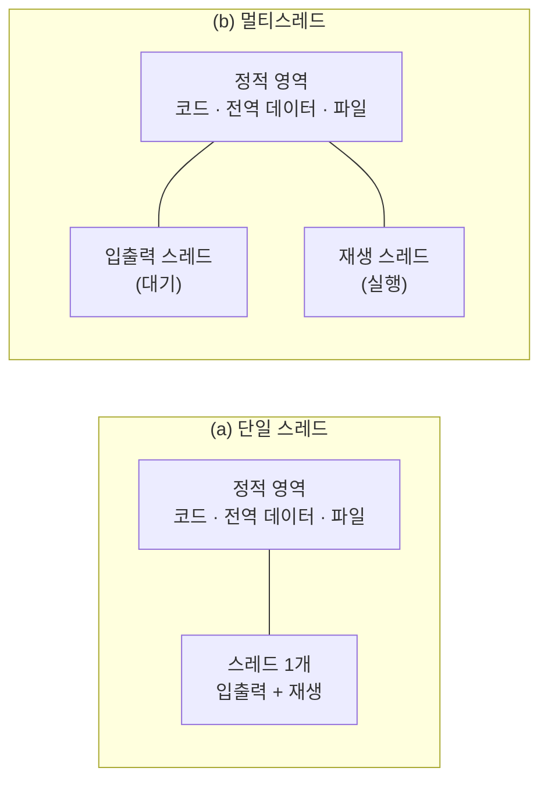
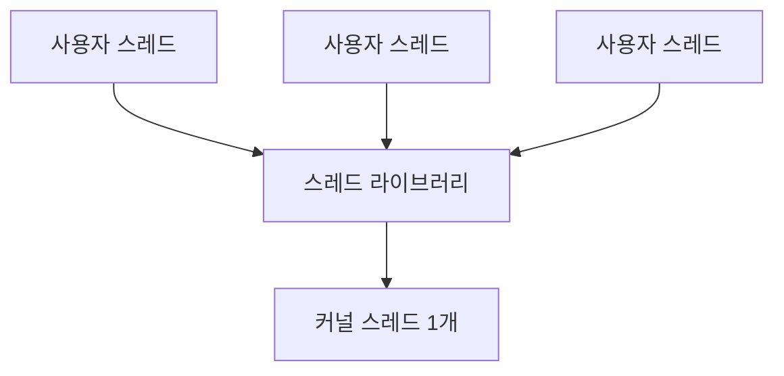
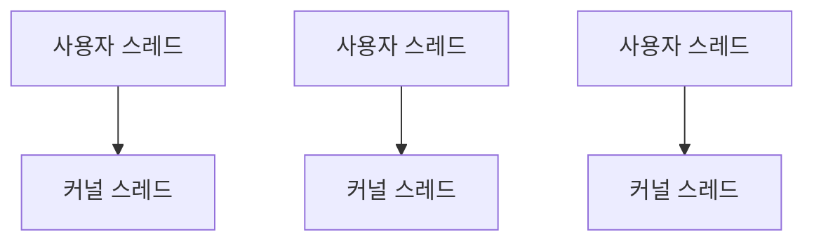
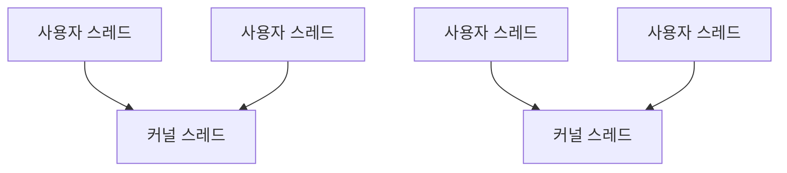

# 4. 스레드

오늘날의 운영체제는 프로세스의 낭비 요소를 없애고 작업을 유연하게 처리하기 위해 멀티스레드를 사용한다. 스레드의 개념부터 멀티스레드 모델까지 살펴본다.

## 4.1 스레드의 개념

### 스레드의 정의

안심 스테이크 만들기에 비유하면 다음과 같다.

| 요리 | 운영체제 |
| --- | --- |
| 레시피, 고기·채소, 칼·집게 등을 준비하는 과정 | 프로세스 생성 |
| 레시피의 절차에 따라 고기 굽기, 채소 굽기, 소스 뿌리기를 하는 것 | 스레드 |
| 요리 작업 전체 | 프로세스 |

- 운영체제는 코드와 데이터를 메모리에 올리고, PCB를 만들고, 메모리 영역을 확보한 뒤 프로세스를 준비 큐에 넣는다.
- CPU 스케줄러는 프로세스가 해야 할 일을 CPU에 전달하는데, 이때 **전달하는 일 하나가 스레드**다.
- 즉 **운영체제 입장의 작업 단위는 프로세스**, **CPU 입장의 작업 단위는 스레드**다.

> [!IMPORTANT]
> **스레드 (thread)**: 프로세스의 코드에 정의된 절차에 따라 CPU에 작업 요청을 하는 실행 단위

**단일 스레드 vs 멀티스레드**

- 요리사 한 명이 모든 조리를 맡으면 → 1개의 프로세스에 1개의 스레드 (단일 스레드)
- A 요리사는 고기 굽기, B 요리사는 채소 굽기와 소스 뿌리기를 동시에 하면 → 1개의 프로세스에 2개의 스레드 (멀티스레드)

> [!NOTE]
> **작업의 크기**
>
> job > task > operation 순으로 크고, 이를 대입하면 **처리 (job) > 프로세스 (task) > 스레드 (operation)** 가 된다.
>
> - 여러 스레드가 모여 프로세스가 되고, 여러 프로세스가 모여 처리가 된다.
> - 여러 프로세스를 모아 한꺼번에 처리하는 방식을 일괄 작업 (batch job)이라고 한다.

### 프로세스와 스레드의 차이

프로세스끼리는 **약하게**, 스레드끼리는 **강하게** 연결되어 있다.

| 구분 | 코스 요리 비유 | 특징 |
| --- | --- | --- |
| 프로세스 | 코스를 이루는 개별 요리 (죽, 안심 스테이크, 케이크) | 죽이 스테이크에, 스테이크가 케이크에 큰 영향을 주지 않는다. 서빙 순서를 바꿔도 된다 |
| 스레드 | 스테이크를 이루는 조리 (고기 굽기, 채소 굽기, 소스 뿌리기) | 미디엄이면 채소부터, 웰던이면 고기부터 굽는다. 소스는 반드시 굽기가 끝난 뒤에 뿌린다 |

**응용 프로그램의 예**



| 구분 | 멀티태스크 | 멀티스레드 |
| --- | --- | --- |
| 예 | 워드프로세서와 프린터 스풀러 | 워드프로세서 안의 문서 편집, 입출력, 맞춤법 검사, 그림판 |
| 독립성 | 워드프로세서가 비정상 종료돼도 프린터 스풀러는 정상 동작 | 워드프로세서가 종료되면 안의 스레드도 모두 강제 종료 |
| 통신 방법 | 프로세스 간 통신 (IPC, Inter Process Communication) | 변수·파일을 공유하고, 전역 변수나 함수 호출로 통신 |

### 스레드 관련 용어



| 용어 | 의미 |
| --- | --- |
| 멀티스레드 | 프로세스 내 작업을 여러 스레드로 나눠 작업의 부담을 줄이는 **프로세스 운영 기법** |
| 멀티태스킹 | 운영체제가 CPU에 작업을 줄 때 **시간을 잘게 나눠 배분**하는 기법. 이런 시스템을 시분할 시스템 (time-sharing system)이라 하며, 이때 CPU에 전달되는 것은 프로세스가 아니라 스레드다 |
| 멀티프로세싱 | **CPU를 여러 개** (또는 한 CPU 안의 코어 여러 개) 사용해 여러 스레드를 동시에 처리하는 환경. 네트워크로 연결된 여러 컴퓨터가 스레드를 나눠 협업하는 분산 시스템도 포함 |
| CPU 멀티스레드 | 한 번에 하나씩 처리해야 하는 스레드를 **파이프라인 기법**으로 동시에 여러 개 처리하는 병렬 처리 기법 |

- **멀티스레드**: 운영체제가 **소프트웨어적으로** 프로세스를 작은 단위의 스레드로 나눠 운영하는 기법
- **CPU 멀티스레드**: **하드웨어적인** 방법으로 하나의 CPU에서 여러 스레드를 동시에 처리하는 병렬 처리 기법

> [!NOTE]
> 책에서는 멀티프로세싱이 슈퍼스칼라 기법과 같다고 설명하지만, 엄밀히 말하면 슈퍼스칼라는 **하나의 코어** 안에 파이프라인을 여러 개 두는 기법이다. "여러 개를 동시에 처리한다"는 점이 비슷하다는 정도로 보면 된다.
>
> CPU 멀티스레드는 실제로 동시 멀티스레딩 (SMT, Simultaneous Multi-Threading)이라고 부르며, 인텔의 하이퍼스레딩 (Hyper-Threading)이 대표적이다. 작업 관리자에서 "코어 8개, 논리 프로세서 16개"처럼 보이는 이유다.

> [!TIP]
> **스레드의 탄생 배경**
>
> - 프로세스 개념은 운영체제 설계 당시부터 있었지만, 스레드 개념은 한참 뒤에 생겼다.
> - 초기에는 프로세스가 위에서 아래로 순차 실행됐고 내부 작업을 나누기 어려웠다. 지금으로 치면 스레드가 1개인 프로세스만 있던 셈이라 둘을 구분할 필요가 없었다.
> - 이후 코어가 여러 개인 CPU가 등장했는데, 프로세스에 스레드가 하나뿐이면 여러 코어에 나눠 동시에 작업할 수 없다.
> - 그래서 오늘날의 운영체제는 프로세스를 여러 스레드로 나눠 여러 코어에 배분한다.

## 4.2 멀티스레드의 구조와 예

### fork()의 낭비 요소

- C 같은 초기 언어는 순차적으로 실행되어, 여러 작업을 동시에 하려면 fork()로 프로세스를 복사하거나 exec()로 전환해야 했다.
- 그런데 fork()로 복사하면 **코드 영역과 데이터 영역 일부가 메모리에 중복**된다.
- 부모-자식 관계여도 서로 독립적인 프로세스라서 이 중복을 없앨 수 없다.
- 예: 워드프로세서를 여러 개 띄워 숙제, 편지 쓰기, 자료 정리를 하면 코드 일부, PCB, 공유 변수가 메모리 여러 곳에 중복된다.


→ 비슷한 일을 하는 프로세스를 2개 만드는 대신, **코드·데이터를 공유하면서 하나의 프로세스 안에서 여러 일을 하는 것**이 스레드다.

### 정적인 영역과 동적인 영역

| 구분 | 의미 | 예 |
| --- | --- | --- |
| 정적인 영역 | 프로세스가 실행되는 동안 바뀌지 않는 영역 | 코드, 전역 데이터, 파일 |
| 동적인 영역 | 스레드가 작업하면서 값이 바뀌거나 생기고 사라지는 영역 | 레지스터 값, 스택, 힙 |

- fork()로 여러 프로세스를 만들면 필요 없는 정적 영역이 여러 개 생긴다.
- 멀티스레드는 정적 영역 (코드, 파일 등)을 **공유**하고, 스레드마다 레지스터와 스택만 따로 가진다.



| 이름 | 의미 |
| --- | --- |
| 가벼운 프로세스 (LWP, Light Weight Process) | 스레드 |
| 무거운 프로세스 (HWP, Heavy Weight Process) | 스레드가 1개인 일반 프로세스 |

- 워드프로세서 창을 여러 개 띄울 때 첫 번째 창은 천천히 열리지만 두 번째부터 빨리 열리는 이유도, 하나의 프로세스에 스레드를 추가하는 방식이기 때문이다.

### 멀티스레드 코드 예시

**자바 스레드 코드**

```java
class TH_test extends Thread {
    public void run() {
        for (int i = 0; i < 100; i++)
            System.out.println("Th_Test");
    }
}

public class test_main {
    public static void main(String[] args) {
        TH_test TH_print = new TH_test();
        TH_print.start();                    // run()을 새 스레드로 실행

        for (int i = 0; i < 100; i++)
            System.out.println("Test_Main");
    }
}
```

- `public class test_main`은 C의 `main()`에 해당한다. 자바는 객체지향 언어라 모든 함수가 객체 안에 있다.
- `class TH_test extends Thread`는 `Thread`를 확장한 스레드 객체로, `run()` 부분이 스레드로 실행되어 `Th_Test`를 100번 출력한다.
- `main()`은 `TH_print` 객체를 만들어 실행하고, 자신은 `Test_Main`을 100번 출력한다.
- 스레드가 아니었다면 `Test_Main` 100번 후 `Th_Test` 100번이 출력되겠지만, 2개의 스레드가 독립적으로 실행되므로 **두 문자열이 섞여서 출력**된다.

```
Th_Test
Th_Test
Test_Main
Test_Main
Test_Main
Th_Test
...
```

> [!WARNING]
> 책 코드의 `test—main`, `1O0` 같은 오타와 빠진 중괄호를 고쳤다. `println`이 이미 줄을 바꾸므로 `\n`도 뺐다.

**같은 결과를 fork()로 만든 C 코드**

```c
#include <stdio.h>
#include <stdlib.h>
#include <unistd.h>

int main() {
    int i = 0, pid;
    pid = fork();

    if (pid < 0) {
        printf("Error");
        exit(-1);
    } else if (pid == 0) {                // 자식 프로세스
        for (i = 0; i < 100; i++)
            printf("Th_Test\n");
        exit(0);
    } else {                              // 부모 프로세스
        for (i = 0; i < 100; i++)
            printf("Test_Main\n");
        exit(0);
    }
}
```

- 결과는 자바 코드와 같지만, PCB·코드·데이터가 모두 **2배**가 되어 스레드보다 낭비가 심하다.

> [!NOTE]
> **스레드 라이브러리**
>
> - 스레드는 운영체제가 지원하는 라이브러리로 생성한다. 예: 마하 운영체제의 C-threads, 솔라리스의 threads
> - 자바는 라이브러리가 아니라 언어 자체에서 스레드를 제공하며, 스레드 클래스의 `run()`을 오버라이딩해서 쓴다.
> - 오늘날 C에서는 POSIX 표준인 **pthreads** (`pthread_create()`)가 대표적이다.

## 4.3 멀티스레드의 장단점

### 멀티스레드의 장점

비디오 플레이어는 파일을 저장장치에서 가져오는 **입출력 부분**과 화면에 보여 주는 **재생 부분**으로 나뉜다.

| 구분 | 동작 |
| --- | --- |
| 단일 스레드 | 입출력을 요청하면 프로세스 전체가 대기 상태가 된다. 입력이 끝나야 다시 재생할 수 있다 |
| 멀티스레드 | 입출력 스레드가 대기 상태여도 재생 스레드는 실행 상태에 있다. 입출력과 상관없이 재생할 수 있다 |



- 채팅하면서 파일을 주고받거나, 문서를 편집하면서 맞춤법을 검사하는 일도 독립적인 스레드로 만들면 효율이 높아진다.

| 장점 | 내용 |
| --- | --- |
| 응답성 향상 | 한 스레드가 입출력으로 멈춰도 다른 스레드가 작업을 계속해 사용자 요구에 빨리 응답한다 |
| 자원 공유 | 프로세스가 가진 자원을 모든 스레드가 공유해 작업을 원활하게 진행한다 |
| 효율성 향상 | 여러 프로세스를 만들 때와 달리 불필요한 자원 중복을 막아 시스템 효율이 높아진다 |
| 다중 CPU 지원 | CPU가 2개 이상이면 여러 스레드를 동시에 처리해 CPU 사용량이 늘고 처리 시간이 줄어든다 |

### 멀티스레드의 단점

모든 스레드가 자원을 공유하기 때문에 **한 스레드에 문제가 생기면 프로세스 전체에 영향**을 미친다.

| 구분 | 인터넷 익스플로러 | 크롬 |
| --- | --- | --- |
| 멀티탭 구현 방식 | 하나의 프로세스 + 멀티스레드 | 탭마다 독립적인 프로세스 (멀티태스킹) |
| 탭 하나에 문제가 생겨 강제 종료하면 | 브라우저 전체가 종료된다 | 그 탭만 종료되고 다른 탭에 미치는 영향이 작다 |

- 워드프로세서를 여러 개 띄워 쓰다가 문서 하나에 문제가 생기면 전체가 종료되는 것도 같은 현상이다.
- 요즘은 메모리가 넉넉하고 멀티코어 CPU가 대중화되어 여러 프로세스를 여러 CPU에서 동시에 실행할 수 있다.
- 그래서 크롬은 낭비 요소가 있더라도 안정성을 위해 멀티스레드 대신 멀티태스킹을 쓴다.

> [!NOTE]
> 인터넷 익스플로러는 2022년에 지원이 종료됐다. IE도 버전 8부터는 탭을 별도 프로세스로 분리했고, 지금의 Edge는 크롬과 같은 Chromium 기반의 멀티프로세스 구조다. 개념을 비교하기 위한 예로 보면 된다.

> [!TIP]
> 스레드끼리 자원을 공유하면 **동시에 같은 변수를 고치는 문제**도 생긴다. 이를 막기 위한 동기화는 이후 프로세스 동기화 단원에서 다룬다.

## 4.4 멀티스레드 모델

프로세스가 커널 프로세스와 사용자 프로세스로 나뉘듯, 스레드도 둘로 나뉜다.

| 구분 | 의미 |
| --- | --- |
| 커널 스레드 (kernel thread) | 커널이 직접 생성하고 관리하는 스레드 |
| 사용자 스레드 (user thread) | 라이브러리로 구현된 일반적인 스레드 |

사용자 스레드가 커널 기능을 쓰려면 시스템 호출을 해야 하며, 커널 스레드와 어떻게 대응되느냐에 따라 모델이 나뉜다.

### 사용자 스레드 (1 to N 모델)

- 운영체제가 멀티스레드를 지원하지 않을 때 쓰는 방법으로, 초기 스레드 시스템에서 사용했다.
- 사용자 레벨에서 라이브러리로 구현하며, **스케줄링이나 동기화 같은 커널의 일을 라이브러리가 대신** 한다.
- 커널 입장에서는 **하나의 프로세스**처럼 보인다.
- 사용자 프로세스 안의 여러 스레드가 커널 스레드 하나와 연결되므로 1 to N 모델이라 부른다.



**장점: 빠르다**

- 라이브러리가 직접 스케줄링하고 필요한 정보를 처리하므로 커널의 문맥 교환이 필요 없다.
- 커널의 문맥 교환은 뮤직 플레이어와 워드프로세서처럼 레지스터·주변장치가 다른 프로세스를 바꿀 때 PCB 저장·복구 같은 부가 작업이 필요하다.
- 사용자 스레드는 같은 워드프로세서에서 다른 문서를 편집하는 수준이라, 필요한 값만 저장했다가 돌려 놓으면 된다.

**단점**

| 단점 | 이유 |
| --- | --- |
| 하나가 대기하면 모두 대기 | 커널 스레드가 입출력으로 대기 상태가 되면 연결된 모든 사용자 스레드가 함께 대기한다. 커널 입장에서는 하나의 프로세스라 일부만 대기시킬 수 없다 |
| 여러 CPU를 동시에 쓸 수 없음 | 한 프로세스의 타임 슬라이스를 여러 스레드가 나눠 쓴다. 커널은 하나의 프로세스로 인식하므로 여러 CPU에 나눌 수 없다 |
| 보안에 취약 | 커널의 공유 변수 보호 장치를 라이브러리에서 직접 구현해야 한다 |

### 커널 스레드 (1 to 1 모델)

- 커널이 멀티스레드를 지원하는 방식으로, 사용자 스레드 하나가 커널 스레드 하나와 연결된다.



- 장단점은 사용자 스레드와 반대다.

| 장점 | 단점 |
| --- | --- |
| 독립적으로 스케줄링되어 한 스레드가 대기해도 다른 스레드는 계속 작업한다 | 문맥 교환 오버헤드 때문에 느리다 |
| 멀티 CPU를 사용할 수 있다 | |
| 커널의 보호 기능을 쓰므로 보안에 강하고 안정적이다 | |

### 멀티레벨 스레드 (M to N 모델)

- 사용자 스레드와 커널 스레드를 섞은 방식으로, 하이브리드 스레드 (hybrid thread)라고도 한다.
- 커널 스레드의 개수가 사용자 스레드보다 **같거나 적다**.



- 한 커널 스레드가 대기 상태가 되면 다른 커널 스레드가 대신 작업해 사용자 스레드보다 유연하다.
- 하지만 커널 스레드를 함께 쓰므로 문맥 교환 오버헤드가 있어 사용자 스레드만큼 빠르지는 않다.
- 그래서 **빠르게 움직여야 하는 스레드는 사용자 스레드**로, **안정적으로 움직여야 하는 스레드는 커널 스레드**로 작동시킨다.

| 모델 | 대응 | 속도 | 대기 시 | 멀티 CPU |
| --- | --- | --- | --- | --- |
| 사용자 스레드 | 1 to N | 빠름 | 모두 대기 | 불가 |
| 커널 스레드 | 1 to 1 | 느림 | 나머지는 계속 | 가능 |
| 멀티레벨 스레드 | M to N | 중간 | 다른 커널 스레드가 대신 | 가능 |

> [!NOTE]
> 현재 리눅스 (NPTL)와 윈도우의 기본 스레드는 **1 to 1 모델**이다. 반대로 Go의 고루틴 (goroutine)이나 자바 21의 가상 스레드 (virtual thread)는 수많은 가벼운 스레드를 적은 수의 커널 스레드에 올리는 **M to N 모델**이다. 문맥 교환이 싸고 개수를 많이 만들 수 있어서 서버처럼 동시 요청이 많은 곳에서 쓴다.

---

[← 프로세스의 연산](./03-프로세스의-연산.md) | [목차](./README.md) | [[심화] 동적 할당 영역과 시스템 호출 →](./05-동적-할당-영역과-시스템-호출.md)
