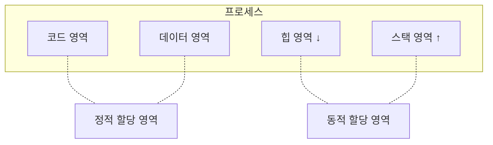
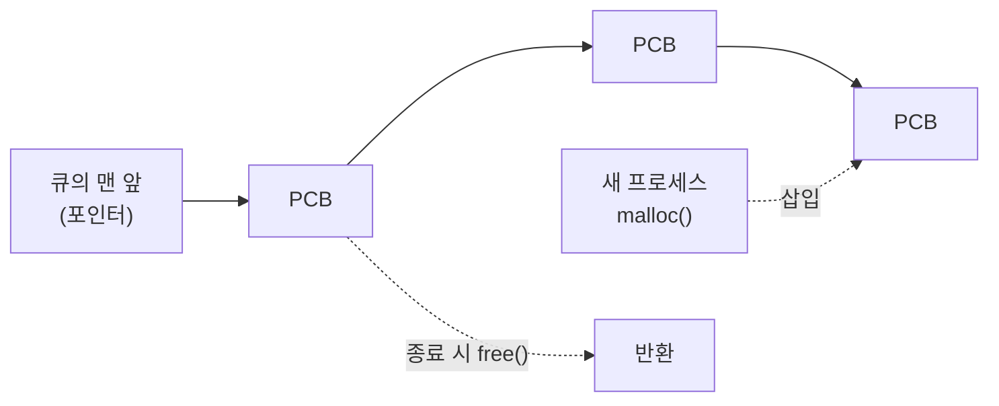

# 5. [심화] 동적 할당 영역과 시스템 호출

코드를 보면서 프로세스의 동적 할당 영역과 exit() / wait() 시스템 호출을 깊이 있게 살펴본다.

## 5.1 프로세스의 동적 할당 영역

앞에서 프로세스를 코드·데이터·스택 영역으로 나눴는데, 정확히는 **힙 영역**도 있다.



| 구분 | 영역 | 특징 |
| --- | --- | --- |
| 정적 할당 영역 | 코드, 데이터 | 프로세스가 실행되기 직전에 위치와 크기가 정해지고, 실행 중에는 변하지 않는다 |
| 동적 할당 영역 | 스택, 힙 | 프로세스가 실행되는 동안 만들어지며, 크기가 늘었다 줄었다 한다 |

- 코드 영역: 프로그램 본체가 있는 곳
- 데이터 영역: 프로그램이 쓰려고 정의한 변수와 데이터가 있는 곳. 포인터를 제외한 일반 변수는 선언할 때 크기가 정해진다.

### 스택 영역

스택은 함수 호출 시 두 가지 일을 위해 쓴다.

1. **돌아올 주소 저장**: 호출한 함수가 끝나면 호출 전 코드로 돌아와야 하므로, 돌아올 메모리 주소를 저장한다.
2. **지역 변수 저장**: 변수의 사용 범위 (scope)를 구현한다.
   - 전역 변수 (global variable): 프로그램의 모든 함수에서 쓸 수 있다.
   - 지역 변수 (local variable): 특정 함수에서만 쓸 수 있고, 함수가 끝나면 공간을 반환해야 한다. 이 지역 변수를 스택에 저장한다.

- 스택은 먼저 들어간 데이터가 가장 나중에 나오는 자료 구조다. 넣는 것을 **push**, 꺼내는 것을 **pop**이라 한다.

```c
#include <stdio.h>
#include <stdlib.h>

void mul(int e, int f) {
    printf("mul %d\n", e * f);
}

void add(int c, int d) {
    mul(c, d);              // ② 돌아올 위치
    printf("add %d\n", c + d);
}

int main() {
    int a = 1, b = 2;
    printf("main %d %d\n", a, b);
    add(a, b);              // ① 돌아올 위치
    exit(0);
}
```

출력 결과

```
main 1 2
mul 2
add 3
```

**스택의 변화**

| 시점 | 동작 | 스택 (위가 top) |
| --- | --- | --- |
| main()이 add() 호출 | push: 돌아올 위치 ①, 지역 변수 c, d | ① c d |
| add()가 mul() 호출 | push: 돌아올 위치 ②, 지역 변수 e, f | ② e f / ① c d |
| mul() 종료 (`mul 2` 출력 후) | pop: e, f는 더 이상 못 쓰고 ②로 복귀 | ① c d |
| add() 종료 (`add 3` 출력 후) | pop: c, d가 사라지고 ①로 복귀 | (비어 있음) |

- 스택은 프로세스를 작동하기 위해 커널이 유지하는 자료 구조다.
- 프로세스와 스레드를 구분하면, 더 정확히는 **스레드가 작동하는 동안 추가·삭제되는 동적 할당 영역**이다. (그래서 스레드마다 스택을 따로 가진다.)

**왜 동적 영역인가?**

- 프로세스가 쓰는 함수는 컴파일 때 정해지지만, **어떤 함수가 몇 번 호출될지는 실행하면서 정해진다.**
- 예: 사칙연산을 함수로 만든 계산기는 사용자 입력에 따라 곱셈 함수가 한 번도 안 불릴 수도, 백 번 넘게 불릴 수도 있다.
- 그래서 스택 크기는 스레드가 진행되면서 커졌다 작아졌다 한다.

> [!TIP]
> **함수 호출을 줄이면 빨라질까?**
>
> - 모든 코드를 `main()`에 넣으면 스택 유지 비용이 줄어 조금 빨라진다.
> - 하지만 오류를 찾기 어렵고, 코드를 재사용하기 어렵고, 여러 사람이 나눠 작업하기 어렵다. 그래서 함수를 쓴다.
> - 참고로 요즘 컴파일러는 작은 함수를 호출하는 자리에 함수 본문을 직접 넣는 **인라인 (inline)** 최적화를 알아서 해 준다. 코드는 함수로 나눠 쓰고, 이런 최적화는 컴파일러에 맡기면 된다.

### 힙 영역

힙은 **실행 중에 동적으로 할당되는 변수 영역**이다. 대표적인 예가 `malloc()`이다.

```c
#include <stdlib.h>

int main() {
    int sarr[50];
    int *darr;

    darr = (int*)malloc(sizeof(int) * 50);   // 이 순간 힙에 정수 50개 공간 할당
    // ...
    free(darr);                              // 다 쓰면 반환
    return 0;
}
```

| 변수 | 할당 시점 | 위치 | 반환 시점 |
| --- | --- | --- | --- |
| `sarr` | 실행 전에 크기가 정해짐 | 데이터 영역 (책 기준) | 쓰든 안 쓰든 끝날 때까지 메모리를 차지 → **낭비** |
| `darr` | `malloc()`을 만나는 순간 | 힙 영역 | `free()`로 필요 없을 때 바로 반환 |

- 크기는 같아도 `darr`은 필요할 때만 메모리를 차지했다가 반환하므로 효율적이다.

> [!WARNING]
> 책에서는 `sarr`이 데이터 영역에 만들어진다고 설명하지만, `main()` 안에서 선언한 **지역 변수라 실제로는 스택 영역**에 올라간다. 데이터 영역에 올리려면 함수 밖에 전역 변수로 선언하거나 `static`을 붙여야 한다. 어느 쪽이든 크기가 고정되어 있고 미리 자리를 차지한다는 점은 같다.

**메모리 관리가 중요한 이유**

- 같은 프로그램이라도 메모리를 많이 쓰는 쪽이 적게 쓰는 쪽보다 느리다.
- 포인터, `malloc()`, `calloc()` 등은 메모리를 효율적으로 쓰기 위해 만들어졌다.
- 어쩌다 한 번 쓰는 큰 배열을 처음부터 선언해 끝까지 놔두면 안 된다.

**예 1: 워드프로세서의 편집 공간**

- 사용자가 얼마나 큰 문서를 만들지 알 수 없으니 배열 크기를 정할 수 없다.
- 무작정 크게 잡으면 메모리가 낭비되고 시스템이 느려진다.

**예 2: PCB 관리**

- 가장 단순한 방법은 PCB 구조체 배열을 1,000개쯤 미리 잡아 두는 것이지만 낭비가 심하다.
- 대신 새 프로세스가 생기면 `malloc()`으로 PCB를 만들어 큐에 넣고, 끝나면 `free()`로 반환한다.



## 5.2 exit()와 wait() 시스템 호출

### exit() 시스템 호출

```c
int main() {
    printf("Hello \n");
    exit(0);
}
```

- `main()` 끝의 `exit()`나 `return`은 **자식 프로세스가 끝났음을 부모 프로세스에 알려 주는** 시스템 호출이다.
- 모든 프로세스는 부모-자식 관계다. 유닉스가 init을 맨 위에 두고 계층 구조를 만드는 이유는 **자원 회수가 쉽기** 때문이다.
- `exit()`를 호출하면 부모가 자식이 쓰던 자원을 빨리 거둬 갈 수 있다.
- 인자로 종료 상태를 알린다. 0이면 정상 종료, -1이면 비정상 종료다.

> [!NOTE]
> 실제로는 0이 아닌 값이면 모두 비정상 종료로 본다. 또 부모가 받는 값은 하위 8비트뿐이라 `exit(-1)`은 255로 전달된다. 그래서 보통 `exit(1)`이나 `EXIT_FAILURE`를 쓴다.

**fork() 코드 다시 보기**

```c
#include <stdio.h>
#include <stdlib.h>
#include <unistd.h>

int main() {
    int pid;
    pid = fork();

    if (pid < 0) {
        printf("Error");
        exit(-1);
    } else if (pid == 0) {     // 자식 프로세스
        printf("Child");
        exit(0);
    } else {                   // 부모 프로세스
        printf("Parent");
        exit(0);
    }
}
```

- `Parent`와 `Child`가 출력되는 건 분명하지만 **어느 쪽이 먼저일지는 알 수 없다.**
- 두 프로세스가 독립적으로 움직여 먼저 실행 상태가 된 쪽이 먼저 출력된다. 대부분 `Parent`가 먼저지만 가끔 `Child`가 먼저 나온다.

### wait() 시스템 호출

위 코드는 좋은 코드가 아니다.

- 부모가 자식의 `exit()`를 받지 않고 `Parent`만 출력한 채 먼저 끝날 수 있다.
- 자식의 자원을 정리해야 할 부모가 먼저 끝나면 자식의 `exit()`는 돌아갈 곳이 없다. 이것이 **고아 프로세스**다.
- 반환되지 못한 자원은 나중에 운영체제가 회수하지만, 고아 프로세스가 많으면 자원이 낭비된다.

→ 이를 막기 위해 **wait()** 를 쓴다. 자식이 끝날 때까지 기다렸다가, 자식이 종료되면 다음 문장을 실행한다.

```c
#include <stdio.h>
#include <stdlib.h>
#include <unistd.h>
#include <sys/wait.h>

int main() {
    int pid;
    pid = fork();

    if (pid < 0) {
        printf("Error");
        exit(-1);
    } else if (pid == 0) {                 // 자식 프로세스
        printf("C=%d", getpid());
        exit(0);
    } else {                               // 부모 프로세스
        wait(NULL);                        // 자식이 끝날 때까지 대기
        printf("P=%d", getpid());
        exit(0);
    }
}
```

| 함수 | 반환값 |
| --- | --- |
| `getpid()` | 현재 프로세스의 PID |
| `getppid()` | 부모 프로세스의 PID |

1. 자식이 자신의 PID를 먼저 출력한다.
2. 부모는 `wait()`에서 자식이 끝나기를 기다린다.
3. 자식의 `exit(0)`이 실행되어 끝나면, 부모가 `wait()` 다음 줄을 실행해 자신의 PID를 출력한다.

- 따라서 부모가 자식보다 먼저 끝나는 일이 없다.
- 이런 특징 때문에 `wait()`는 **부모와 자식 간 동기화**에도 쓰인다.

> [!NOTE]
> `wait()`가 더 직접적으로 막아 주는 것은 **좀비 프로세스**다. 자식이 끝나도 부모가 `wait()`로 종료 상태를 받아 가기 전까지는 PCB 같은 정보가 남아 좀비가 된다. 부모가 `wait()`를 호출해야 이 정보가 완전히 정리된다.

### 전면 프로세스와 후면 프로세스

윈도우에서 창을 여러 개 띄우면 맨 앞 창만 키보드와 모니터를 쓸 수 있다.

| 구분 | 의미 |
| --- | --- |
| 전면 프로세스 (foreground process) | 맨 앞에서 작동하는 프로세스 |
| 후면 프로세스 (background process) | 뒤에서 작동하는 프로세스 |

텍스트만 쓰는 유닉스 셸에도 같은 개념이 있다. 명령어 뒤에 `&`를 붙이면 후면 프로세스가 된다.

```sh
sleep 100     # 전면 프로세스
sleep 100 &   # 후면 프로세스
```

- `sleep 100`은 100초 동안 기다리라는 명령이다.
- 전면 프로세스는 키보드로 명령을 내려도 응답하지 않아, 100초 동안 다른 작업을 못 한다.
- 후면 프로세스는 바로 다음 작업을 할 수 있고, 100초 뒤 끝났다고 알려 준다.

**이 차이가 바로 wait()를 쓰느냐 마느냐의 차이다.**

| 구분 | 셸의 동작 |
| --- | --- |
| 전면 프로세스 | 셸이 `wait()`를 호출하므로, 자식이 끝날 때까지 다음 명령어를 받지 않는다 |
| 후면 프로세스 | 셸이 `wait()`를 호출하지 않으므로, 바로 다음 명령어를 받을 수 있다 |

---

[← 스레드](./04-스레드.md) | [목차](./README.md)
