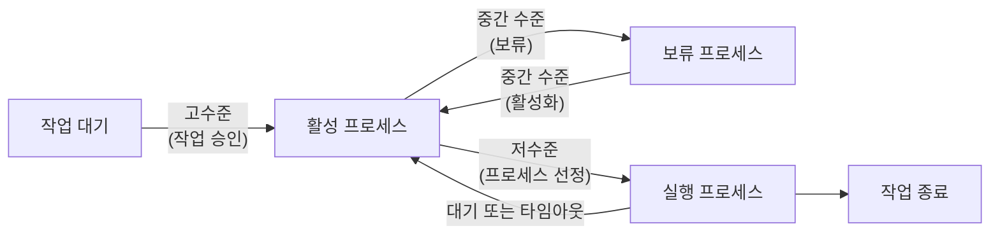

# 1. 스케줄링의 개요

CPU 스케줄러는 프로세스가 생성된 뒤 종료될 때까지 모든 상태 변화를 조정한다. 프로세서 스케줄러 (processor scheduler)라고도 한다.

## 1.1 식당 관리자의 스케줄링

주방과 홀이 분리된 식당에서는 요리사가 홀 상황을 알기 어렵다. 그래서 식당 관리자가 홀을 관리한다.

| 식당 관리자의 일 | 예 |
| --- | --- |
| 예약·좌석 관리 | 도착 순서대로 안내, 손님이 많으면 대기표 배부, 예약석 비워 두기 |
| 주문 관리 | 요리, 드레싱, 익힘 정도, 알레르기 여부 등을 주문서에 적어 주방에 전달 |
| 조리 순서 관리 | 예약 손님의 주문을 앞당기거나, 식사 속도에 맞춰 디저트 순서를 바꿈 |
| 손님 요청 관리 | 메뉴 변경, 식사 일시 중단, 더 구워 달라는 요청 처리 |

요리사는 주문서 순서대로 요리만 할 뿐 손님의 식사 진행 상황을 모른다. 관리자가 전체 상황을 보고 조리 순서를 조절해 요리사에게 알려준다.

운영체제에서 이 식당 관리자 역할을 하는 것이 CPU 스케줄러다.

> [!IMPORTANT]
> **스케줄링**: 여러 프로세스의 상황을 고려해 CPU와 시스템 자원을 어떻게 배정할지 결정하는 일

## 1.2 스케줄링의 단계

식당 관리자는 두 가지 범위에서 일한다.

- **큰 틀**: 좌석 관리. 주방·재료 상황과 식당 규모를 보고 손님을 몇 명 받을지, 여유 좌석을 몇 개 남길지 정한다.
- **작은 틀**: 조리 순서 관리. 자리를 잡은 손님들의 식사 진행 상황과 요구에 맞춰 요리가 나가는 순서와 속도를 정한다.

CPU 스케줄링도 규모에 따라 세 단계로 나뉜다.

| 단계 | 다른 이름 | 하는 일 |
| --- | --- | --- |
| 고수준 스케줄링 | 장기 스케줄링, 작업 스케줄링, 승인 스케줄링 | 시스템에 받아들일 작업 수를 정한다 |
| 중간 수준 스케줄링 | - | 활성화된 프로세스 일부를 보류시켜 과부하를 막는다 |
| 저수준 스케줄링 | 단기 스케줄링 | 어떤 프로세스에 CPU를 줄지 정한다 |

### 고수준 스케줄링 (high level scheduling)

가장 큰 틀의 스케줄링이다. 장기 스케줄링 (long-term scheduling), 작업 스케줄링 (job scheduling)이라고도 한다.

- 작업을 너무 많이 받으면 시스템에 과부하가 걸린다. 주방 상황을 생각하지 않고 손님을 무조건 많이 받는 것과 같다.
- 그래서 시스템 전체의 작업 수를 조절한다.
  - 작업은 운영체제가 다루는 일의 가장 큰 단위로, 프로세스 1개 이상으로 이루어진다.
- 작업 요청이 오면 시스템 상황을 보고 받아들일지 거부할지 결정한다. 그래서 승인 스케줄링 (admission scheduling)이라고도 한다.
- 이 결정으로 동시에 실행할 수 있는 프로세스의 총개수가 정해진다. 이를 **멀티프로그래밍 정도 (degree of multiprogramming)** 라고 한다.
- 메인프레임 같은 큰 시스템에서 대규모 일괄 작업을 처리할 때 쓴다.

### 저수준 스케줄링 (low level scheduling)

가장 작은 단위의 스케줄링이다. 각 손님의 주문과 요리 제공 순서를 미세하게 조절하는 단계에 해당한다.

- 어떤 프로세스에 CPU를 할당할지, 어떤 프로세스를 대기 상태로 보낼지 등을 결정한다.
  - 예: 준비 → 실행, 실행 → 대기, 대기 → 준비
- 프로세스 상태 변화 대부분이 저수준 스케줄링에 해당한다.
- 아주 짧은 시간에 일어나서 단기 스케줄링 (short-term scheduling)이라고 부른다.

### 중간 수준 스케줄링 (middle level scheduling)

고수준과 저수준 사이에서 일어나는 스케줄링이다.

- 고수준 스케줄링으로 프로세스 수를 조절해도, 활성화된 뒤에 여러 사정으로 과부하가 걸릴 수 있다.
  - 비유: 좌석 수에 맞춰 손님을 받았는데, 하필 모두 조리 시간이 긴 코스 요리를 주문한 경우. 관리자는 빨리 나오는 코스로 유도하거나 주문을 천천히 받는다.
- 일부 프로세스를 중지 (suspend)시키고 나중에 다시 활성화해서, 활성화된 프로세스 수를 조절한다.
- 프로세스 상태 중 보류 상태에 해당한다.
- 저수준 스케줄링이 원만하게 이루어지도록 완충 (buffer) 역할을 한다.

### 스케줄링 단계 정리

- **고수준**: 시스템 전체 부하를 보고 작업을 시작할지 정한다. 멀티프로그래밍 정도가 여기서 결정된다.
- **중간 수준**: 과부하가 걸리면 활성 프로세스 일부를 보류 상태로 보낸다. 여유가 생기면 다시 활성화한다.
- **저수준**: 실제 작업이 이루어진다. 준비 상태의 프로세스를 실행 상태로 옮기거나, 대기 상태로 보내거나, 타임아웃으로 준비 상태로 돌려보낸다.

오늘날 CPU 스케줄러는 대부분 중간 수준과 저수준 스케줄링으로 구성된다. 어떤 프로세스를 고를지, 타임 슬라이스를 어떤 기준으로 정할지가 시스템 성능에 큰 영향을 준다.

> [!NOTE]
> 이후 "CPU 스케줄러"는 특별한 말이 없으면 저수준 스케줄러를 뜻한다.

## 1.3 스케줄링의 목적

CPU 스케줄링의 기본 목적은 모든 프로세스가 공평하게 작업하도록 하는 것이다.

| 목적 | 내용 |
| --- | --- |
| 공평성 | 모든 프로세스가 자원을 공평하게 배정받고, 배정 과정에서 특정 프로세스가 배제되지 않는다 |
| 효율성 | 시스템 자원이 쉬지 않고 사용되게 하고, 유휴 자원을 쓰려는 프로세스에 우선권을 준다 |
| 안정성 | 우선순위로 중요한 프로세스를 먼저 실행해, 자원을 독점하거나 파괴하려는 프로세스로부터 보호한다 |
| 확장성 | 프로세스가 늘어도 안정적으로 동작하고, 자원이 늘면 그 혜택이 성능에 반영된다 |
| 반응 시간 보장 | 응답이 없으면 사용자는 시스템이 멈췄다고 생각하므로, 적절한 시간 안에 반응한다 |
| 무한 연기 방지 | 특정 프로세스의 작업이 무한히 미뤄지지 않게 한다 |

다만 안정성과 효율성을 위해 공평성은 일정 부분 희생된다.

- 운영체제 프로세스는 일반 프로세스보다 먼저 CPU를 배정받는다.
- 일반 프로세스끼리도 우선순위에 따라 배정 순서가 달라진다.

---

[목차](./README.md) | [스케줄링 시 고려 사항 →](./02-스케줄링-시-고려-사항.md)
